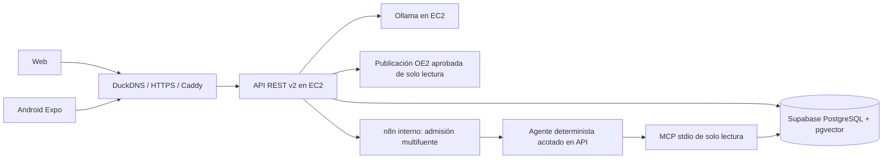

# BanuChat


Asistente académico para consultar documentación, revisar el progreso de demostración y conversar con respuestas acompañadas de fuentes. Proyecto de grado de Ingeniería de Sistemas, con clientes **web y Android**, API REST propia, PostgreSQL/pgvector en **Supabase** y **Ollama en AWS Academy**.

**Corte documental: 20 de noviembre de 2026.** Cliente publicado **1.0.4**; RAG conservado desde `a30088f` e integración administrada MCP/n8n validada en AWS. La demostración funciona con cuentas y expedientes ficticios y referencias CCD seleccionadas y depuradas. No constituye un sistema institucional ni acredita aprobación del CCD o de la universidad.

## Abrir la demostración

- [Web HTTPS de BanuChat](https://banuchat.duckdns.org/login).
- [APK Android ARM64 1.0.4](https://github.com/XeyKG/BanuChat_/releases/download/demo-1.0.4/BanuChat-demo-1.0.4-arm64.apk) · [Release y archivos](https://github.com/XeyKG/BanuChat_/releases/tag/demo-1.0.4).
- [Paquete académico 1.0.4](https://github.com/XeyKG/BanuChat_/releases/download/demo-1.0.4/BanuChat-entrega-academica-1.0.4.zip): APK, guía, checkpoint y capturas auténticas del corte de publicación.
- [Guía de presentación](docs/transition/ENTREGA-FINAL-BANUCHAT.md) · [Estado actual](docs/estado-vigente.md) · [Índice documental](docs/README.md).

El enlace directo de la APK respondió HTTP 200 en la comprobación del 20/11/2026. La guía de sustentación incluye una copia local para contingencias. Las credenciales de demostración se entregan por canal privado. La APK conserva paquete y firma y se puede instalar como actualización.

La disponibilidad depende de internet, Supabase y de que el Learner Lab mantenga la EC2 activa. Los servicios públicos no necesitan Metro ni una API ejecutándose en el PC. [Recuperación de la demostración](docs/operations/cloud-demo.md).

Para preparar la sustentación: [guía paso a paso de encendido y presentación](docs/operations/GUIA-PRESENTACION-BANUCHAT.md), con recorrido de pantallas, n8n/MCP publicados en AWS e inventario Docker histórico. Incluye una advertencia sobre temporizadores de pruebas encontrados en el n8n local; revisarla antes de arrancarlo.

## Funcionalidades disponibles

| Área | Comportamiento implementado |
| --- | --- |
| Acceso | Login propio BanuChat, sesión, renovación y logout; validación visible de campos y credenciales |
| Chat documental | Recuperación de evidencia, respuestas con citas y respuestas parciales o abstención cuando falta respaldo |
| Fuentes | Visor y descarga protegidos; procedencia y documentos comprobables desde las citas |
| Historial | Conversaciones persistidas por cuenta, reapertura de mensajes y fuentes, aislamiento entre usuarios |
| Mi progreso | Expediente sintético, cursos, intentos y recursamiento; acceso al expediente propio desde el chat |
| Calendario | Cuadrícula mensual, fechas marcadas, navegación de meses y agenda del día en hora de Bogotá |
| Banu al Día | Noticias y convocatorias de la demo, búsqueda, filtros y texto completo |
| Publicaciones OE2 | Programación, convocatorias y novedades aprobadas; procedencia y comparación de versiones, sin matrícula |
| Recordatorios | Configuración local del teléfono Android; no push remoto |

## Arquitectura publicada



La API controla identidad, propiedad de recursos, enrutamiento, recuperación y persistencia. El cliente consume REST; no accede directamente a tablas Supabase, MCP, n8n u Ollama. **La autenticación es de BanuChat; no se reemplazó por Supabase Auth.**

Desde el 20/11, las consultas estructuradas multifuente del despliegue administrado usan **n8n → agente determinista acotado → MCP stdio** en la EC2. El lector comprueba principal, perfil, release y despliegue, con rol de solo lectura separado en Supabase. Los fast paths y el RAG documental conservan sus recorridos. No se activa Unified ni se acredita ReAct dirigido por un LLM. [Evidencia y límites](docs/transition/CHECKPOINT-MCP-AWS-2026-11-20.md). [Arquitectura y separación de entornos](docs/arquitectura.md).

| Tecnología | Uso |
| --- | --- |
| Expo SDK 57, React Native, TypeScript | Una base de cliente para Android y web |
| Node.js y TypeScript | API REST, política conversacional, servicios e ingesta |
| PostgreSQL + pgvector | Datos estructurados, historial, citas y recuperación exacta por coseno |
| Qwen3 `qwen3-embedding:0.6b` | Embeddings de 1024 dimensiones |
| Qwen3 `qwen3:4b-instruct`, Ollama 0.35.0 | Síntesis documental en la EC2 existente |
| AWS Academy, Caddy, DuckDNS | Servidor de demostración y origen HTTPS canónico |
| MCP y n8n | Admisión y agente acotados en AWS para consultas estructuradas multifuente; laboratorio local conservado |

## Datos, procedencia y límites

- `data/synthetic` conserva la demo histórica congelada; no se sobrescribe ni se usa como fallback institucional silencioso.
- La carga sintética migrada documentó dos releases, 32 estudiantes, 62 intentos, ocho recursamientos y 120 vectores. Son datos de prueba.
- Las 107 referencias CCD depuradas publicadas conservan su propia release y manifiesto. Con las seis referencias anteriores hay 113 vectores suplementarios, separados de los sintéticos. Los embeddings documentales se copiaron tras validar integridad; los vectores de consulta se generan en runtime.
- El corpus privado, originales internos, configuración, contraseñas y claves de firma no forman parte de una instalación clonada del repositorio. Los ejemplos versionados no contienen secretos.
- No hay scraping institucional, matrícula real, SSO UNAB ni sincronización real con Google Drive o Google Sheets acreditados.

## Validación y limitaciones conocidas

La [corrección RAG del 18/11](docs/transition/CHECKPOINT-RAG-PERTINENCIA-2026-11-18.md) registró typecheck correcto, **192 pruebas CCD y 72 de contratos/evidencia**, y 24 consultas remotas con historial y aislamiento comprobados y 22 artefactos verificados por SHA-256. Hubo seis respuestas parciales con fuentes y cuatro abstenciones. **HTTP correcto no equivale a una respuesta semánticamente aprobada.** Los tiempos fueron 1,30–110,28 s; RAG no se declara estable y dos vCPU limitan la inferencia.

La [publicación 1.0.4](docs/transition/CHECKPOINT-DEMO-1.0.4.md) acredita recorridos web y Huawei, 77 pruebas Mobile y 22 API focales de ese incremento. Las métricas académicas históricas, SUS y aprobación de objetivos tienen [evidencia y pendientes propios](docs/academic/oe1-oe6-current-status.md). Estos conteos son resultados fechados, no una nueva ejecución de todas las suites.

## Desarrollo y verificación

Requiere Node.js 22, npm y dependencias por paquete. No existe un único `npm install` en la raíz. Para instalar y verificar los cuatro paquetes, sin iniciar servicios ni cargar configuración privada:

```sh
node scripts/verify-local.mjs
```

El script ejecuta `npm ci`, TypeScript y tests de API, RAG, MCP y Mobile. Las comprobaciones con PostgreSQL/Ollama, n8n, Android físico y usuarios reales son independientes. [Workflow Verify](.github/workflows/verify.yml) · [GitHub Actions](https://github.com/XeyKG/BanuChat_/actions).

Para una comprobación focal, desde el paquete correspondiente:

```sh
npm run typecheck
npm test
```

Para ejecutar el producto local existente, consultar [el procedimiento Unified](docs/operations/final-integrated-demonstration.md) y los README de [API](backend/api/README.md) y [Mobile](mobile/README.md). `npm start` de la API exige configuración privada y el laboratorio ya preparado; no configura automáticamente Supabase ni una copia nueva del corpus. No ejecutar scripts de migración, restauración o ingesta contra otra base por seguir un ejemplo.

## Mapa del repositorio

| Ruta | Contenido |
| --- | --- |
| [backend/api](backend/api/README.md) | REST, autenticación propia, servicios, RAG conversacional y adaptadores |
| [backend/rag](backend/rag/README.md) | Ingesta, validación, embeddings, aprobación y publicación |
| [backend/mcp-server](backend/mcp-server/README.md) | Servidor interno stdio y contrato de herramientas de lectura |
| [mobile](mobile/README.md) | Cliente compartido Android/web y pruebas de servicios |
| [infra](infra/README.md) | SQL, Compose, ejemplos y herramientas operativas |
| [n8n](n8n/README.md) | Workflow conversacional en AWS y antecedentes locales |
| [eval](eval/README.md) | Metodología y resultados con fecha y alcance |
| [docs](docs/README.md) | Estado actual, arquitectura, decisiones, operación y trazabilidad académica |

Los ADR y checkpoints históricos conservan su fecha. Para presentar el estado actual, empezar por `docs/estado-vigente.md` y el checkpoint consolidado, no por un incremento antiguo.
