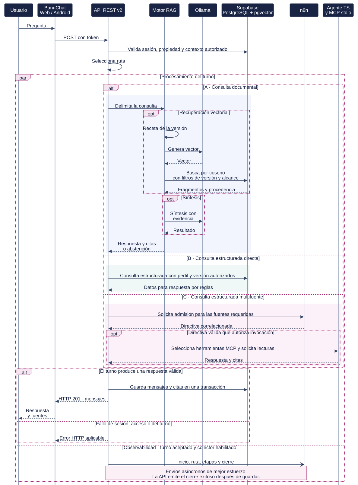
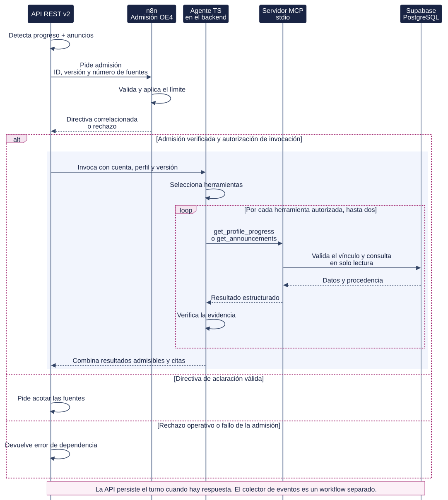

# Secuencia conversacional de BanuChat

**Figura 3, apartado 8.3 · Corte documental del 22 de noviembre de 2026.** El análisis toma como referencia `main` en `72501b1` y la publicación 1.0.9, cuyo código se identifica como `bbbe366`. La evidencia de recorridos en AWS corresponde a los checkpoints del 20 y del 21 de noviembre. [Publicación 1.0.9](../transition/CHECKPOINT-CATEGORIAS-EDITORIALES-1.0.9.md)

[Fuente Mermaid](figura-3-secuencia-banuchat.mmd) · [SVG para el informe](figura-3-secuencia-banuchat.svg) · [PNG para diapositivas](figura-3-secuencia-banuchat.png)

## Participantes

| Participante | Responsabilidad |
| --- | --- |
| Usuario | Envía una consulta desde una sesión de BanuChat y puede abrir las fuentes que acompañan la respuesta. |
| BanuChat web / Android | El cliente compartido de Expo y React Native envía el mensaje con el token de acceso, presenta la respuesta y ofrece los enlaces a fuentes disponibles. |
| API REST v2 | Verifica la sesión y la propiedad de la conversación, obtiene el perfil y el contexto, selecciona la ruta, aplica reglas y guarda el turno. |
| Motor RAG | Componente del backend que delimita la consulta, selecciona evidencia documental versionada, decide si puede responder y construye las citas. |
| Ollama | Servicio en la EC2 que genera embeddings de consulta y, cuando la ruta documental lo requiere, evalúa o sintetiza texto a partir de la evidencia recibida. |
| Supabase | Aloja PostgreSQL y su extensión pgvector. PostgreSQL atiende autenticación propia de BanuChat, lecturas autorizadas, recuperación de documentos y persistencia de mensajes. La extensión permite comparar vectores. |
| n8n | Ejecuta dos workflows con responsabilidades distintas. OE4 responde a las solicitudes síncronas de admisión multifuente. El colector registra eventos técnicos enviados desde la API. |
| Agente TypeScript / MCP stdio | El agente del backend selecciona y concilia los resultados. El servidor MCP ejecuta las herramientas admitidas mediante un proceso hijo que se comunica por entrada y salida estándar. |

## Tramo común

| Interacción | Evidencia en el repositorio |
| --- | --- |
| Envío autenticado | `submitMessage` usa el cliente `sendMessage` y la sesión adjunta el token. La solicitud es `POST /api/v2/conversations/{id}/messages`. [Pantalla de chat](../../mobile/src/app/chat.tsx#L200) · [Cliente de mensajes](../../mobile/src/api/messages.ts#L184) · [Sesión del cliente](../../mobile/src/auth/auth-session.ts#L80) |
| Autenticación, autorización y contexto | El servidor verifica el token mediante `verifyAccess`. `AuthenticatedResources.send` obtiene la identidad y el perfil y comprueba la propiedad con `banuchat_auth.resource_context`. `sendMessage` recupera historial acotado, versión de datos y ordinal del siguiente mensaje. [Servidor REST](../../backend/api/src/http/api-v2-server.ts#L81) · [Verificación de acceso](../../backend/api/src/auth/auth-service.ts#L108) · [Recursos autenticados](../../backend/api/src/auth/resources.ts#L83) · [Función SQL](../../infra/db/007_authenticated_resources.sql#L43) · [Lectura del contexto](../../backend/api/src/application/messages.ts#L462) |
| Selección | `dispatchChatQuery` usa el catálogo de intenciones y atiende las rutas directas. Si delega, `createManagedMcpResponder` distingue la consulta estructurada multifuente de la documental en la composición administrada. [Router](../../backend/api/src/routing/intent-router.ts#L1634) · [Despacho](../../backend/api/src/chat/chat-dispatcher.ts#L39) · [Selección de rama administrada](../../backend/api/src/agent/managed-mcp-agent.ts#L18) |
| Persistencia y presentación | `sendMessage` comprueba el resultado antes de guardar en una transacción el mensaje del usuario, el del asistente y las referencias disponibles. Se usa `banuchat_auth.persist_turn` o `banuchat_reference.persist_turn` cuando las citas incluyen la versión complementaria. La API responde HTTP 201 y ajusta los enlaces de artefactos a REST v2. El historial recupera las citas y `ChatSources` muestra las que existen. Para un documento accesible, el cliente puede abrir el artefacto a través de `GET /api/v2/documents/{id}/artifact`. [Validación y persistencia](../../backend/api/src/application/messages.ts#L638) · [Selección de la función SQL](../../backend/api/src/auth/resources.ts#L128) · [Respuesta, historial y artefacto](../../backend/api/src/http/api-v2-server.ts#L115) · [Visor de fuentes](../../mobile/src/components/chat-sources.tsx#L63) |

## A · Consulta documental

1. La API compone el RAG autenticado y, cuando está configurado, el corpus complementario CCD seleccionado. `createApprovedReferences` delimita el alcance con la pregunta y el historial y conserva la procedencia de cada corpus. Una consulta explícita al material de demostración puede usar el corpus sintético. Una pregunta fuera del alcance documental aprobado puede acabar en aclaración o abstención. [Composición administrada](../../backend/api/src/authenticated-main.ts#L60) · [Selección de referencias](../../backend/api/src/chat/approved-references.ts#L27) · [RAG autenticado](../../backend/api/src/authenticated-runtime.ts#L23)
2. Si se necesita recuperación vectorial, `retrieveDocumentChunksForQuery` valida primero la receta de embeddings de la versión. El adaptador de referencias aprobadas obtiene esa receta del manifiesto fijado. Luego Ollama genera el vector de consulta con `qwen3-embedding:0.6b`, de 1024 dimensiones, mediante `/api/embed`. Con el vector, PostgreSQL ordena por distancia coseno y limita resultados a la versión y a las claves documentales admisibles cuando aplica. La recuperación de referencias fijadas verifica también el hash del manifiesto. [Orden de recuperación](../../backend/api/src/application/document-query-retrieval.ts#L133) · [Cliente de embeddings](../../backend/api/src/retrieval/ollama-query-embedding-client.ts) · [Adaptador RAG autenticado](../../backend/api/src/application/authenticated-document-retrieval.ts#L10) · [Funciones de referencias y pgvector](../../infra/db/016_approved_ccd_corpus.sql)
3. El backend decide cómo responder tras evaluar cobertura y procedencia. Algunas preguntas se resuelven por extracción o reglas a partir de la evidencia. Otras requieren que Ollama evalúe o sintetice con `qwen3:4b-instruct` vía `/api/chat`. El backend controla qué fuentes admite y qué citas asocia. La delimitación puede pedir una aclaración antes de invocar servicios. La falta de respaldo puede dar una abstención, o una respuesta parcial con citas y `insufficient_evidence`. Un fallo de una dependencia puede devolver HTTP 503. [RAG general](../../backend/api/src/chat/document-rag.ts#L156) · [RAG para referencias CCD](../../backend/api/src/chat/ccd-knowledge.ts#L323) · [Cliente de generación](../../backend/api/src/generation/ollama-generator-client.ts#L196) · [Errores REST](../../backend/api/src/auth/primitives.ts)

## B · Consulta estructurada directa

Una pregunta como «¿Qué hay en el calendario de esta semana?» puede resolverse en `dispatchChatQuery`. Según la intención, el backend utiliza servicios como `getCalendarEvents`, `getProfileProgress`, `getCourseCatalog` o `getAnnouncements` para leer PostgreSQL con los filtros aplicables. El progreso usa el perfil asociado a la cuenta. Los renderizadores forman la respuesta y las citas a partir de los resultados. La resolución prescinde de generación y del webhook OE4. Si el colector está habilitado, recibe eventos técnicos de esta ruta. [Despacho y servicios](../../backend/api/src/chat/chat-dispatcher.ts#L39) · [Renderizadores](../../backend/api/src/chat/chat-renderers.ts) · [Caso de calendario](../transition/CHECKPOINT-N8N-RAG-OBSERVABILIDAD.md#turnos-públicos-correlacionados)

## C · Consulta estructurada multifuente

[Fuente Mermaid](secuencia-multifuente-banuchat.mmd) · [SVG](secuencia-multifuente-banuchat.svg) · [PNG](secuencia-multifuente-banuchat.png)

| Interacción | Evidencia en el repositorio |
| --- | --- |
| Detección y posible restricción previa | `usesManagedStructuredMcp` y `requiresConversationalOrchestration` detectan necesidades de fuentes. La administración excluye señales documentales de esta rama y puede responder a restricciones de alcance antes de solicitar admisión. El ejemplo acreditado combina cursos completados y convocatorias. [Rama administrada](../../backend/api/src/agent/managed-mcp-agent.ts#L18) · [Política de alcance](../../backend/api/src/agent/bounded-mcp-agent.ts#L383) |
| Admisión OE4 en n8n | La API espera la respuesta a un webhook privado con autenticación de servicio. Envía `operation_id`, versión, cantidad de fuentes y metadatos operativos. La pregunta y el token de sesión quedan en la API. `Authenticated Conversation Webhook` conduce a `Validate Bounded Admission`. La rama válida pasa por `Decide Operational Admission` y `Return Correlated Directive` (200). Hasta dos fuentes permiten `invoke_bounded_mcp_agent`. Superar dos en una solicitud válida produce `request_clarification`. La rama inválida termina en `Reject Unsupported Transition` (422). La API comprueba correlación y formato antes de actuar. [Workflow OE4](../../n8n/workflows/oe4-conversation-v1.json) · [Adaptador de admisión](../../backend/api/src/orchestration/n8n-conversation.ts#L90) |
| Selección y ejecución del plan | `runBoundedMcpAgent` aplica una política determinista que limita el plan a dos herramientas. Para el caso acreditado, `get_profile_progress` y `get_announcements`. `StdioMcpClientFactory` inicia el servidor MCP administrado con el contexto fijado por el backend. Las herramientas operan sobre datos sintéticos autorizados. [Política del agente](../../backend/api/src/agent/bounded-mcp-agent.ts#L447) · [Cliente stdio](../../backend/api/src/agent/mcp-client.ts#L161) · [Runtime MCP administrado](../../backend/mcp-server/src/managed-main.ts) |
| Datos, combinación y salida | El servidor MCP comprueba el vínculo de identidad, perfil, versión y despliegue con `assertManagedMcpContext` en una transacción de solo lectura por herramienta. Usa el rol `cloud_mcp_reader`. El agente valida las observaciones, descarta las inadmisibles y combina la evidencia y sus citas, con respuesta parcial o abstención cuando corresponde. La API conserva la persistencia y el estado HTTP. [Vínculo y permisos](../../backend/mcp-server/src/managed-runtime.ts#L30) · [Herramientas de lectura](../../backend/api/src/application/mcp-synthetic-reads.ts) · [Validación y composición](../../backend/api/src/agent/bounded-mcp-agent.ts#L447) · [Caso acreditado](../transition/CHECKPOINT-N8N-RAG-OBSERVABILIDAD.md#turnos-públicos-correlacionados) |

El webhook OE4 limita la admisión operativa de esa ruta. La API ya dispone de la sesión, el historial y el contexto autorizado cuando lo invoca. Por eso conserva las decisiones de negocio, la selección de herramientas y la propiedad del turno. Las respuestas estructuradas y documentales siguen sus propios recorridos. MCP ofrece el contrato de invocación de herramientas. RAG recupera y utiliza evidencia documental. Ollama ejecuta los modelos bajo las instrucciones del backend.

## Observabilidad en las tres rutas

Con `BANUCHAT_N8N_CHAT_EXECUTIONS=1` en el perfil administrado, la API emite el inicio tras admitir el turno y luego su ruta, las etapas aplicables y el estado terminal. En un turno exitoso, emite el cierre después de persistir. Cada evento lleva `operation_id` y `sequence` y puede contener duración, etapa, estado, código de error o conteo de citas. El colector recibe metadatos técnicos sin el texto de la conversación ni credenciales. El envío es asíncrono y de mejor esfuerzo. Puede perder eventos o registrarlos fuera de orden y no bloquea la respuesta al usuario. [Emisión y estado terminal](../../backend/api/src/auth/resources.ts#L83) · [Adaptador de eventos](../../backend/api/src/orchestration/n8n-chat-execution.ts) · [Bandera de habilitación](../../backend/api/src/authenticated-main.ts#L88)

En el workflow publicado `BanuChatChatExecution1`, **Recibir evento interno** conecta con **Validar estructura y procedencia**. Los datos válidos pasan a **Registrar ruta y estado técnico**, un nodo Set que proyecta el resumen antes de **Confirmar recepción** (202). La rama inválida responde 422 y la salida de error del Set responde 500. El registro visible en **Executions** pertenece a n8n y a su SQLite interno. Una ejecución verde puede registrar un turno de chat fallido. [Workflow del colector](../../n8n/workflows/chat-executions-v1.json) · [Evidencia publicada](../transition/CHECKPOINT-N8N-RAG-OBSERVABILIDAD.md)

## Discrepancias y alcance de la evidencia

| Hallazgo | Representación adoptada |
| --- | --- |
| La ficha de estado del 20/11 menciona clientes anteriores. El checkpoint 1.0.9 registra la publicación editorial y deja las pruebas funcionales al propietario. | El corte de código es 1.0.9. Los casos conversacionales se atribuyen a sus verificaciones del 20 y 21/11. [Ficha de estado](../estado-vigente.md) · [Publicación 1.0.9](../transition/CHECKPOINT-CATEGORIAS-EDITORIALES-1.0.9.md) |
| El diagrama de componentes del 20/11 conecta n8n con el agente y dibuja entradas de persistencia para RAG y fast path. | La secuencia indica que la directiva vuelve a la API, que ejecuta el agente. La API guarda los turnos válidos de las tres rutas. [Arquitectura anterior](../arquitectura.md#composición-publicada) · [Rama administrada](../../backend/api/src/agent/managed-mcp-agent.ts#L24) · [Persistencia común](../../backend/api/src/application/messages.ts#L638) |
| La composición Unified local tiene un alcance distinto del perfil publicado. La revisión del colector también cambió entre el cierre inicial y el del 21/11. | Se representa `managed` con `managed_mcp` y colector habilitado, según su evidencia. El checkpoint identifica la revisión OE4 publicada `60a7577b-30b1-4d52-87d9-dbaf28642def` y la del colector `6360ea8c-f1bc-4ddf-8112-5217133a3dc2`. En AWS, OE4 comparte workflow con una rama de ingesta manual heredada, fuera de esta secuencia. [Composición](../../backend/api/src/authenticated-main.ts#L69) · [Revisiones publicadas](../transition/CHECKPOINT-N8N-RAG-OBSERVABILIDAD.md#estado-efectivo-y-evidencia-de-cierre) |

La figura representa tres rutas seleccionadas de un turno autenticado. Omite ramas auxiliares del router, como saludo y filtro de contenido, y el detalle de adquisición e ingesta de fuentes. Un token inválido o ausente puede producir 401, una conversación ajena 404 y un conflicto concurrente 409. Una desconexión puede quedar registrada como `cancelled` aunque el backend haya llegado a guardar el turno. [Manejo HTTP](../../backend/api/src/http/api-v2-server.ts) · [Errores y propiedad](../../backend/api/src/auth/primitives.ts) · [Cierre del turno](../../backend/api/src/auth/resources.ts#L144)

El 20/11 se documentó un turno con generación en Ollama, HTTP 201 y tres fuentes. El 21/11 se documentaron un turno documental por extracción con ocho citas y cero llamadas de generación, un turno directo de calendario con una cita y el turno multifuente indicado con tres citas. Ese día también se registró un 503 por agotamiento del plazo de la llamada de generación. La causa interna de la latencia quedó abierta. Estos casos respaldan los recorridos ilustrados. Quedan fuera del alcance una garantía de cobertura del corpus o latencia, la autorización institucional, las integraciones con sistemas universitarios y un ciclo ReAct dirigido por un LLM. [Evidencia 20/11](../transition/CHECKPOINT-MCP-AWS-2026-11-20.md) · [Evidencia 21/11](../transition/CHECKPOINT-N8N-RAG-OBSERVABILIDAD.md)

## Guion oral · aproximadamente 90 segundos

> El recorrido empieza cuando la persona envía una pregunta desde BanuChat en la web o en Android. La API verifica la sesión y confirma que la conversación pertenece a esa cuenta. Con el contexto autorizado, selecciona una de las rutas que muestra la figura.
>
> En una consulta documental, el backend delimita qué fuentes puede usar. Si necesita recuperar fragmentos por similitud, primero verifica la configuración de la versión y obtiene un vector de consulta con Ollama. Luego PostgreSQL y pgvector buscan evidencia en Supabase. El backend puede responder directamente con esa evidencia, usar Ollama para sintetizarla o abstenerse si falta respaldo.
>
> Una pregunta sobre el calendario de esta semana sigue la ruta estructurada directa. El backend consulta los datos autorizados y arma la respuesta con reglas.
>
> Si la pregunta combina cursos completados y convocatorias, la API pide admisión a n8n. Recibida la directiva, el agente TypeScript decide qué herramientas MCP usar y combina las lecturas autorizadas. La API guarda el turno y las citas antes de devolver los mensajes, y la aplicación muestra las fuentes disponibles. Un segundo workflow de n8n registra las etapas técnicas en paralelo, sin demorar la respuesta.

## Pie de figura propuesto para el apartado 8.3

> **Figura 3. Diagrama de secuencia de una consulta autenticada en BanuChat.** Se muestran las rutas documental, estructurada directa y estructurada multifuente, junto con la persistencia del turno y el registro asíncrono de eventos. Fuente de la figura — elaboración propia a partir del código vigente de BanuChat 1.0.9 y de los checkpoints técnicos del 20 y 21 de noviembre de 2026.

Para el informe tamaño carta, insertar el SVG a ancho de la caja de texto en una página que reserve espacio para el pie. El detalle multifuente puede ir en la página siguiente o en un anexo. [Checkpoint de esta documentación](../transition/CHECKPOINT-DIAGRAMAS-ARQUITECTURA-2026-11-22.md)
