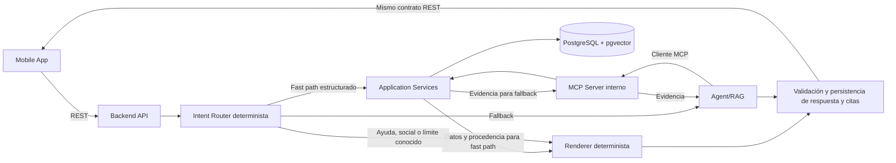
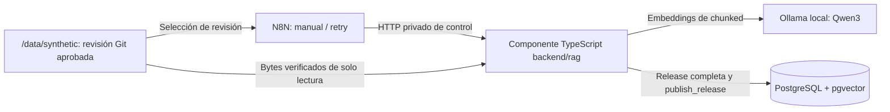
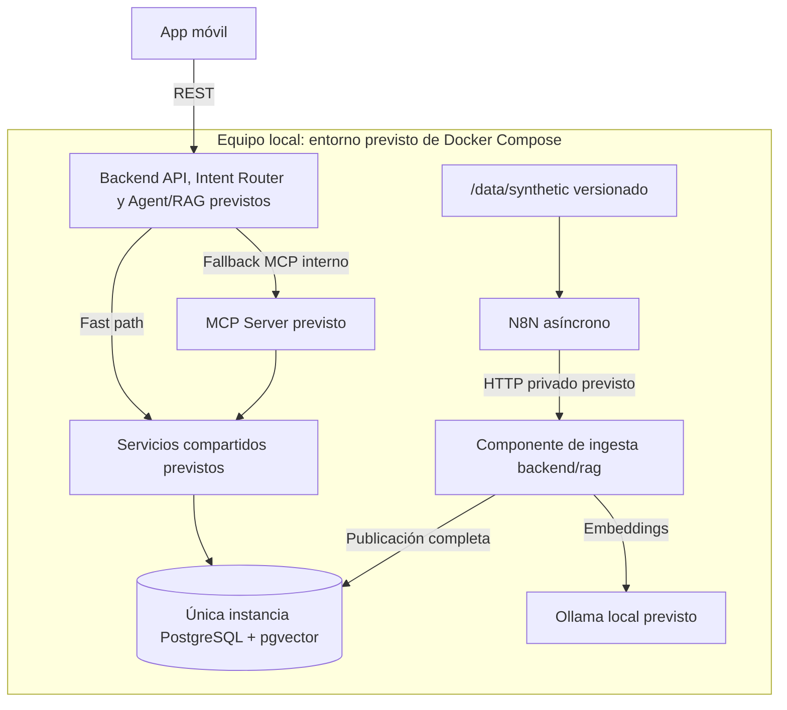

# Arquitectura técnica de BanuChat

## Alcance vigente

BanuChat es un prototipo académico en Fase 1 — Análisis y Diseño. Todo dato funcional
(documentos, cursos, calendarios, convocatorias y perfiles) será sintético y tendrá
su fuente de verdad versionada en `/data/synthetic`. PostgreSQL conserva una
representación procesada y reconstruible desde esos archivos.

Este documento aplica las decisiones de `AGENTS.md` y del
[ADR 0001](adr/0001-alcance-sintetico-y-despliegue-local.md).
El anteproyecto es una referencia histórica: su despliegue en servidores UNAB,
scraping del CCD e integraciones institucionales fueron descartados.
No se accederá a datos, APIs, páginas ni infraestructura real de UNAB/CCD.

## Componentes y responsabilidades

| Componente | Responsabilidad | Ubicación |
| --- | --- | --- |
| Mobile App | React Native + TypeScript; consume únicamente la API REST pública. | `mobile/` |
| REST Backend API | Entrada síncrona; fija contexto, evalúa Intent Router y persiste respuesta/citas de la misma release. | `backend/api/` |
| Intent Router | Catálogo determinista: fast path seguro o fallback Agent/RAG; sin LLM, embeddings ni N8N para clasificar. | Especificación en `docs/enrutamiento-intenciones.md`; catálogo en `backend/api/` |
| Application Services | Lógica compartida por fast path y tools MCP, con acceso consistente a PostgreSQL; sin implementación todavía. | Capa lógica interna prevista del backend |
| Agent/RAG | Ciclo ReAct, recuperación de contexto y selección controlada de herramientas; el agente es cliente MCP. | `backend/`, `backend/rag/` |
| MCP Server interno | Expone herramientas controladas mediante los mismos servicios de aplicación que usa el fast path. | `backend/mcp-server/` |
| PostgreSQL + pgvector | Una instancia para información relacional y embeddings, separados por el modelo de datos. | `infra/db/` |
| N8N | Orquesta ingesta y sincronización asíncrona de versiones aprobadas del dataset. | `n8n/workflows/` |
| Datos sintéticos | Fuente de verdad versionada, con origen simulado explícito. | `data/synthetic/` |
| Docker Compose local | Entorno de desarrollo y demostraciones iniciales. | `infra/docker-compose.yml` |

## Consulta síncrona

N8N queda fuera del camino síncrono. La app no consume MCP, N8N ni PostgreSQL
directamente. El generador sigue abierto; embeddings usa Ollama local con
`qwen3-embedding:0.6b`, 1024 dimensiones y coseno ([ADR 0003](adr/0003-embedding-local-qwen3.md)).

El [ADR 0004](adr/0004-enrutamiento-determinista-intenciones.md) introduce el router.
El fast path no llama a MCP ni al LLM generador; usa servicios compartidos y renderers.
Ante ambigüedad, conflicto, texto residual o consulta compuesta se utiliza Agent/RAG.
El diagrama muestra dependencias lógicas y retornos, no nuevos contenedores ni código.
Las consultas REST directas siguen pudiendo utilizar servicios sin router ni agente.

Ambas rutas citan evidencia verificable del corpus sintético, documental o estructurada,
y declaran evidencia insuficiente cuando corresponda. Mantienen una release por turno.
No presentan la simulación como información institucional vigente. Los documentos con
`retrieval_mode=full_document` no se fragmentan ni vectorizan; se resuelven como
artefactos completos verificados por la ruta REST interna aprobada, no URLs externas.

## Ingesta y sincronización asíncrona

El [ADR 0005](adr/0005-ingesta-reproducible-n8n.md) propone esta frontera, sin implementarla.
N8N orquesta triggers, llamada y resumen; TypeScript valida revisión/aprobación, schemas,
hashes y relaciones, procesa documentos y gobierna intentos/publicación. La flecha
fuente → N8N representa selección, no carga ni modificación del corpus desde nodos.
El componente lee directamente el checkout aprobado y no ejecuta Git pull.

El calendario se carga como parte de una release completa desde `/data/synthetic/calendars`;
no sincronización independiente, Google Sheets ni fuente institucional. Full_document
produce versiones sin chunks/embeddings y conserva el artefacto exacto para REST.
Chunked v1 propone secciones H2, sin overlap: 60 chunks estimados, todavía no generados.

Se conservan 76 items por intento exitoso, incluidos skipped verificados. Solo
publish_release promueve atómicamente; un fallo mantiene current. Ready actual es
no-op y una ready histórica no se reactiva mediante ingesta normal. La
[especificación](ingesta-reproducible.md) detalla receta, locking, retry y fallos.
Los workflows se exportarán como JSON versionado al implementar, sin secretos.

## Despliegue local

Este diagrama describe límites lógicos, no fija un contenedor por módulo.
El Compose actual solo declara PostgreSQL con una imagen que incluye pgvector y N8N.
La extensión deberá habilitarse en la base mediante una migración revisada en una
etapa posterior; disponer de la imagen no significa que la extensión esté activada.
No hay servicios backend o mobile en Compose ni inicialización automática del SQL.

Las credenciales se suministrarán localmente mediante variables; los puertos publicados
se restringen a `127.0.0.1`. No existe despliegue institucional.

## Perfiles, usabilidad y funcionalidades pendientes

Los perfiles para historial y personalización son totalmente sintéticos. La estrategia
de autenticación local está pendiente; no habrá autenticación institucional.

Los datos que puedan recogerse posteriormente en pruebas de usabilidad con personas
son distintos del corpus funcional. Su consentimiento, minimización, anonimización,
almacenamiento y acceso requieren diseño previo; no deben alimentar `/data/synthetic`.

Las notificaciones mediante un proveedor push real son una funcionalidad deseable
pendiente de diseño explícito y no se incorpora un proveedor en esta iteración.

## Trazabilidad y evaluación

| Objetivo | Interpretación vigente |
| --- | --- |
| OE1 | RAG sobre corpus sintético: faithfulness ≥ 0,80; context precision ≥ 0,80; context recall ≥ 0,75; answer relevancy ≥ 0,80; MRR ≥ 0,70. |
| OE2 reformulado | Ingesta de revisión sintética aprobada: objetivo <24h desde disponibilidad para ingesta y éxito >90 %, no medidos; separar espera y duración trigger→publicación del trabajo humano previo. |
| OE3 | Selección controlada y dinámica de herramientas MCP por el agente. |
| OE4 | Orquestación E2E: publicación atómica, trazabilidad, sin pérdida/mezcla de items y current preservada ante fallos; todos los casos críticos deben cumplir lo esperado. Duración observada sin nuevo umbral. Se descarta la sincronización independiente de 30 min; redacción académica pendiente de actualización. |
| OE5 | SUS promedio > 70/100, ningún resultado < 50/100 y completación de tareas > 85 %. |
| OE6 | Estabilidad de contenedores locales, sin caídas > 5 minutos, y respuesta promedio < 5 segundos. |

Estos son criterios para evaluaciones futuras; este cambio documental no acredita
su cumplimiento experimental.

## Artefactos que requieren revisión posterior

El esquema inicial `infra/db/001_initial_schema.sql` fue reescrito con autorización,
sin ejecutarlo; véase [su documentación física](../infra/db/README.md).
Los contratos `backend/mcp-server/tools-contract.md` y
`backend/mcp-server/tools.contract.json` siguen intactos y en borrador:

- SQL: pendiente validación ejecutada de migración, integridad, permisos y concurrencia.
- MCP: retirar dependencia de Sheets, identificar datos sintéticos, revisar identidad local,
  evidencia, enlaces y responsabilidad sobre persistencia de trazas.
- Modelo generador, transporte MCP y autenticación local: pendientes de diseño.

Las decisiones confirmadas en `AGENTS.md` prevalecen sobre esos borradores.
