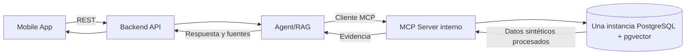
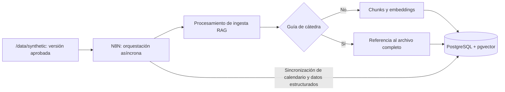
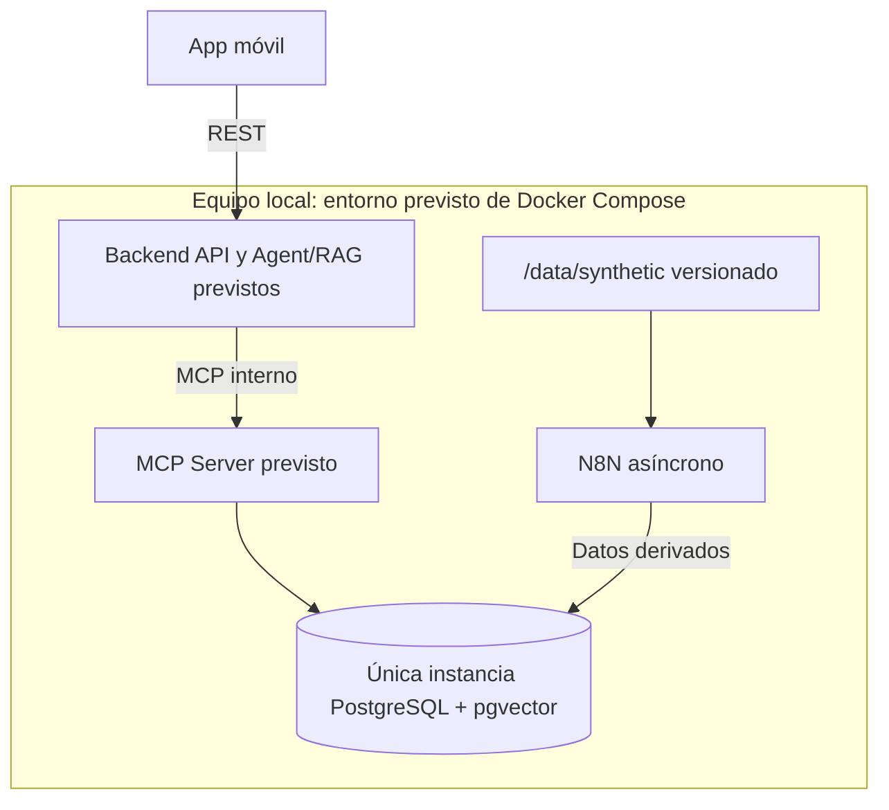

# Arquitectura técnica de BanuChat

## Alcance vigente

BanuChat es un prototipo académico en Fase 1 — Análisis y Diseño. Todo dato funcional
(documentos, cursos, calendarios, convocatorias y perfiles) será sintético y tendrá
su fuente de verdad versionada en `/data/synthetic`. PostgreSQL conserva una
representación procesada y reconstruible desde esos archivos.

Este documento aplica las decisiones de `AGENTS.md` y del
[ADR 0001](adr/0001-alcance-sintetico-y-despliegue-local.md).
El anteproyecto es una referencia histórica: su despliegue en servidores UNAB,
scraping del CCD e integraciones institucionales fueron descartados.
No se accederá a datos, APIs, páginas ni infraestructura real de UNAB/CCD.

## Componentes y responsabilidades

| Componente | Responsabilidad | Ubicación |
| --- | --- | --- |
| Mobile App | React Native + TypeScript; consume únicamente la API REST pública. | `mobile/` |
| REST Backend API | Entrada síncrona de consultas; invoca Agent/RAG y devuelve respuestas citadas. | `backend/api/` |
| Agent/RAG | Ciclo ReAct, recuperación de contexto y selección controlada de herramientas; el agente es cliente MCP. | `backend/`, `backend/rag/` |
| MCP Server interno | Expone herramientas controladas sobre la representación procesada de datos sintéticos. | `backend/mcp-server/` |
| PostgreSQL + pgvector | Una instancia para información relacional y embeddings, separados por el modelo de datos. | `infra/db/` |
| N8N | Orquesta ingesta y sincronización asíncrona de versiones aprobadas del dataset. | `n8n/workflows/` |
| Datos sintéticos | Fuente de verdad versionada, con origen simulado explícito. | `data/synthetic/` |
| Docker Compose local | Entorno de desarrollo y demostraciones iniciales. | `infra/docker-compose.yml` |

## Consulta síncrona

N8N queda fuera del camino síncrono. La app no consume MCP, N8N ni PostgreSQL
directamente. El generador sigue abierto; embeddings usa Ollama local con
`qwen3-embedding:0.6b`, 1024 dimensiones y coseno ([ADR 0003](adr/0003-embedding-local-qwen3.md)).

El agente debe citar documento y sección del corpus sintético y declarar falta de
información cuando no tenga evidencia suficiente. No debe presentar la simulación
como información institucional vigente. Las guías de cátedra sintéticas se sirven
mediante enlace al documento completo, sin fragmentación ni embeddings.

## Ingesta y sincronización asíncrona

El calendario procede de `/data/synthetic/calendars`. Google Sheets queda fuera del MVP.
N8N consume versiones identificables del dataset: no genera arbitrariamente la fuente
de verdad ni sustituye su revisión y versionado. La base procesada nunca introduce
datos funcionales sin correspondencia con los archivos sintéticos.

Los flujos futuros se exportarán como JSON y deberán registrar qué versión procesaron,
el resultado y los fallos. El formato exacto de los datasets y el modelo de datos se
diseñarán en la siguiente etapa. Actualmente solo existen directorios documentales.

## Despliegue local

Este diagrama describe límites lógicos, no fija un contenedor por módulo.
El Compose actual solo declara PostgreSQL con una imagen que incluye pgvector y N8N.
La extensión deberá habilitarse en la base mediante una migración revisada en una
etapa posterior; disponer de la imagen no significa que la extensión esté activada.
No hay servicios backend o mobile en Compose ni inicialización automática del SQL.

Las credenciales se suministrarán localmente mediante variables; los puertos publicados
se restringen a `127.0.0.1`. No existe despliegue institucional.

## Perfiles, usabilidad y funcionalidades pendientes

Los perfiles para historial y personalización son totalmente sintéticos. La estrategia
de autenticación local está pendiente; no habrá autenticación institucional.

Los datos que puedan recogerse posteriormente en pruebas de usabilidad con personas
son distintos del corpus funcional. Su consentimiento, minimización, anonimización,
almacenamiento y acceso requieren diseño previo; no deben alimentar `/data/synthetic`.

Las notificaciones mediante un proveedor push real son una funcionalidad deseable
pendiente de diseño explícito y no se incorpora un proveedor en esta iteración.

## Trazabilidad y evaluación

| Objetivo | Interpretación vigente |
| --- | --- |
| OE1 | RAG sobre corpus sintético: faithfulness ≥ 0,80; context precision ≥ 0,80; context recall ≥ 0,75; answer relevancy ≥ 0,80; MRR ≥ 0,70. |
| OE2 reformulado | Ingesta asíncrona: actualización menor de 24 horas desde incorporación de un documento sintético; éxito mayor de 90 %. |
| OE3 | Selección controlada y dinámica de herramientas MCP por el agente. |
| OE4 | Integración sin pérdida de datos; sincronización del calendario sintético en máximo 30 minutos. |
| OE5 | SUS promedio > 70/100, ningún resultado < 50/100 y completación de tareas > 85 %. |
| OE6 | Estabilidad de contenedores locales, sin caídas > 5 minutos, y respuesta promedio < 5 segundos. |

Estos son criterios para evaluaciones futuras; este cambio documental no acredita
su cumplimiento experimental.

## Artefactos que requieren revisión posterior

El esquema inicial `infra/db/001_initial_schema.sql` fue reescrito con autorización,
sin ejecutarlo; véase [su documentación física](../infra/db/README.md).
Los contratos `backend/mcp-server/tools-contract.md` y
`backend/mcp-server/tools.contract.json` siguen intactos y en borrador:

- SQL: pendiente validación ejecutada de migración, integridad, permisos y concurrencia.
- MCP: retirar dependencia de Sheets, identificar datos sintéticos, revisar identidad local,
  evidencia, enlaces y responsabilidad sobre persistencia de trazas.
- Modelo generador, transporte MCP y autenticación local: pendientes de diseño.

Las decisiones confirmadas en `AGENTS.md` prevalecen sobre esos borradores.
