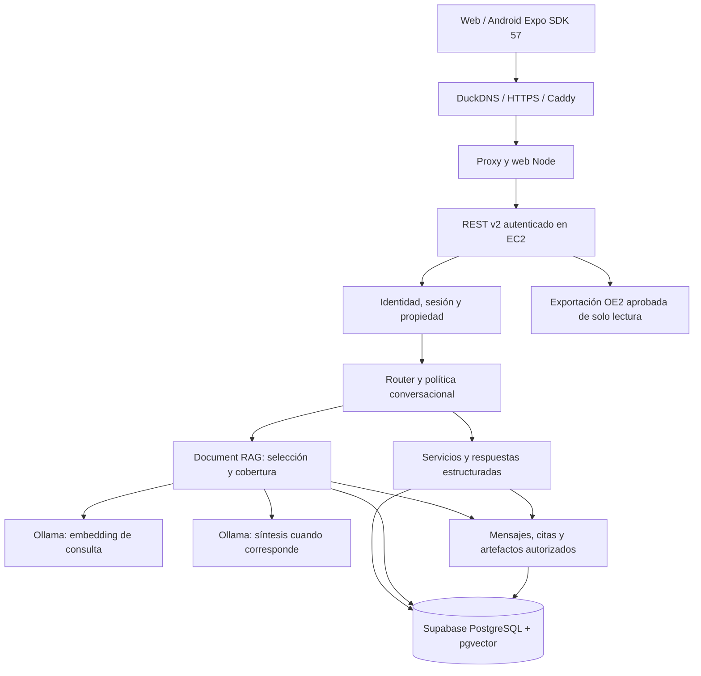

# Arquitectura técnica de BanuChat

Corte: **18/11/2026**, código de referencia `a30088f`. [Estado vigente](estado-vigente.md) y [checkpoint consolidado](transition/CHECKPOINT-PUBLICACION-BANUCHAT.md). El anteproyecto y los ADR históricos describen compromisos y decisiones de sus fechas; no prueban que todos sus componentes estén desplegados ni aceptados.

## Composición publicada

EC2 existente de AWS Academy, Amazon Linux 2023, m6i.large de dos vCPU/8 GiB. Caddy termina HTTPS y el cliente usa el origen canónico `https://banuchat.duckdns.org`. API y Ollama escuchan en la frontera interna del servidor; los clientes no conectan directamente a la base ni al modelo. El PC se utiliza para desarrollo y validación, no para atender la demostración publicada.

## Componentes y responsabilidades

| Componente | Implementación y responsabilidad |
| --- | --- |
| Web/Android | `mobile/`, Expo SDK 57 + React Native + TypeScript; un cliente REST v2 con navegación, sesión, chat y fuentes |
| API y autenticación | `backend/api/`; login BanuChat, autorización por propietario, límites de solicitud, servicios y persistencia |
| Router y política documental | `src/routing` y `src/chat` dentro de API; fast paths, alcance, contexto acotado, recuperación y composición de respuesta |
| RAG/ingesta | `backend/rag/`; preparación, validación, embeddings, aprobación y publicación de releases; no es el servidor web |
| PostgreSQL + pgvector | Supabase en el despliegue; SQL explícito y funciones/roles restringidos, sin acceso directo de clientes |
| Ollama | `qwen3-embedding:0.6b` y `qwen3:4b-instruct`; runtime 0.35.0 en el despliegue validado |
| OE2 publicado | Lector opcional de exportación sintética validada por hash; programación, anuncios y comparación sin matrícula |
| MCP y n8n | Servidor/herramientas y workflows implementados con evidencia local; no activados como composición Unified en la API administrada |

## Consulta síncrona

1. REST v2 valida sesión y propiedad del recurso. La cuenta determina perfil y contexto; los identificadores enviados por el cliente no autorizan acceso a otro estudiante.
2. Las consultas estructuradas usan servicios PostgreSQL y renderers. El progreso sintético y el chat tienen fronteras propias; un perfil no sustituye la autenticación.
3. Document RAG resuelve el sujeto y las referencias del historial acotado, delimita fuentes y obtiene el vector de consulta de Ollama. PostgreSQL recupera por coseno exacto sobre los chunks de la release autorizada.
4. La política considera atributos, pertinencia dentro del top-k, rol curricular y límites de período/población. Puede extraer hechos o solicitar síntesis al modelo, con protocolo de fuentes. Una coincidencia de palabras no acredita una respuesta completa.
5. Si falta información, produce una respuesta parcial con sus citas o se abstiene. Las preguntas causales/de resultados, registros personales y oferta no acreditada no se convierten en hechos por el mero nombre del curso.
6. La API persiste mensajes y referencias autorizadas. Historial reconstruye contenido y citas; el visor/descarga comprueba autorización e integridad de artefactos.

La [corrección de pertinencia](transition/CHECKPOINT-RAG-PERTINENCIA-2026-11-18.md) no contiene un mapa de las preguntas de evaluación a respuestas, no cambia el modelo y no crea un agente ReAct. La generación sigue limitada por capacidad y por la evidencia publicada.

## Persistencia y separación de fuentes

| Tipo | Tratamiento |
| --- | --- |
| Documentos y embeddings | Persistentes y asociados a release/configuración; dimensión 1024 y distancia coseno. No se acreditan índices HNSW/IVFFlat |
| Vector de consulta | Temporal para recuperar evidencia; no representa un nuevo documento ni el historial del estudiante |
| Historial y citas | Mensajes, propiedad y referencias persistidas; accesibles por la API autorizada |
| Contexto conversacional | Historial acotado de preguntas y respuestas; no reemplaza registros académicos ni crea memoria personal vectorizada |
| `full_document` | Artefactos completos con integridad; no se fragmentan ni vectorizan |

La conversación y los expedientes de cloud siguen en el contexto sintético. El suplemento CCD conserva **su propia release, manifiesto, artefactos y citas**; no se presentan sus vectores como parte de las releases sintéticas ni se borra su procedencia al mostrar una respuesta.

La migración documentó dos releases sintéticas, 32 estudiantes, 62 intentos y 120 vectores. La ampliación CCD adoptó 107 referencias depuradas y conservó las seis anteriores: 113 vectores suplementarios. Se copiaron embeddings documentales previamente validados; los embeddings de consulta sí se calculan en runtime. No se afirma regeneración completa del corpus desde cero en AWS.

## Identidad, permisos y conexión

La autenticación propia vive en BanuChat; Supabase presta PostgreSQL administrado, no reemplaza la sesión por Supabase Auth. El código controla la relación cuenta → perfil/release → estudiante académico y la propiedad de conversaciones. Los esquemas de autenticación, dominio académico y referencias tienen funciones y permisos específicos; el rol habitual de API es restringido, no `postgres`.

El perfil `managed` admite la base/host/pooler previstos, verifica CA y hostname y comprueba `runtime_scope`. No se elimina TLS para superar incompatibilidades. Las credenciales son configuración privada del servidor, nunca variables públicas de Expo o argumentos de herramientas MCP.

## Unified local y composición agéntica

`npm start` en API ejecuta `scripts/start-unified.mts`. El laboratorio existente usa `banuchat_unified` en loopback 55463 y REST v2 en 3004, con configuración privada y datos auxiliares separados. Puede activar un agente determinista acotado, herramientas MCP de lectura y admisión n8n para planes multifuente. No todos los turnos pasan por ellos y no es ReAct LLM productivo.

El entrypoint `authenticated-main.ts` impide activar `unified` con el perfil `managed`. Por tanto, la evidencia de MCP/n8n local no debe atribuirse a la web pública. El servidor MCP stdio ejecutable y su contrato se conservan; no se requiere reimplementarlo en otro lenguaje para describir el despliegue.

[Runbook Unified local](operations/final-integrated-demonstration.md) · [MCP](../backend/mcp-server/README.md) · [n8n](../n8n/README.md).

## Ingesta asíncrona y publicaciones

Las recetas conservan validación de manifest, bytes/hash, procedencia, aprobación y precondiciones de destino. El backend TypeScript gobierna procesamiento, embeddings, relaciones y publicación; n8n orquesta llamadas autorizadas, no mueve la lógica académica a nodos de workflow.

El repositorio incluye ingesta manual y workflows de fixtures OE2, conversación OE4 y calendario OE4. Son evidencias locales; no acreditan scraping institucional ni conectores reales Google Drive/Sheets. La copia OE2 publicada es estática, aprobada y fijada por SHA-256. Un cambio exige nueva exportación aprobada y asociación explícita de su hash; no se actualiza sola ni formaliza inscripciones.

No se modifica `data/synthetic` v1 ni se suben originales institucionales para completar automáticamente un dato faltante. El corpus privado conserva sus límites y permanece fuera de Git por defecto. [Ingesta reproducible](ingesta-reproducible.md) · [Recetas y ejemplos](../infra/README.md).

## Operación, trazabilidad y límites

- [Operación cloud](operations/cloud-demo.md): recuperación de la instancia existente, servicios y precarga; no requiere reconstruir datos por una parada de Academy.
- [Publicación 1.0.4](transition/CHECKPOINT-DEMO-1.0.4.md): evidencia web/Android, firma y compatibilidad de actualización.
- [RAG 18/11](transition/CHECKPOINT-RAG-PERTINENCIA-2026-11-18.md): 24 turnos remotos, fuentes/historial/aislamiento y límites de completitud. Tiempos 1,30–110,28 s; se conservan 150/175/180 s para API/cliente/proxy.
- [Matriz académica](academic/oe1-oe6-current-status.md): compromisos originales y brechas. No se acredita SUS, aceptación institucional, on-prem UNAB, disponibilidad permanente ni mejora cuantitativa general a partir de una regresión conocida.

La operación en AWS depende del Learner Lab, sus créditos y Supabase. Permanecen respuestas parciales y lagunas en los derivados publicados. No se declara RAG estable ni se confunde una muestra HTTP satisfactoria con aprobación semántica, académica o institucional.
