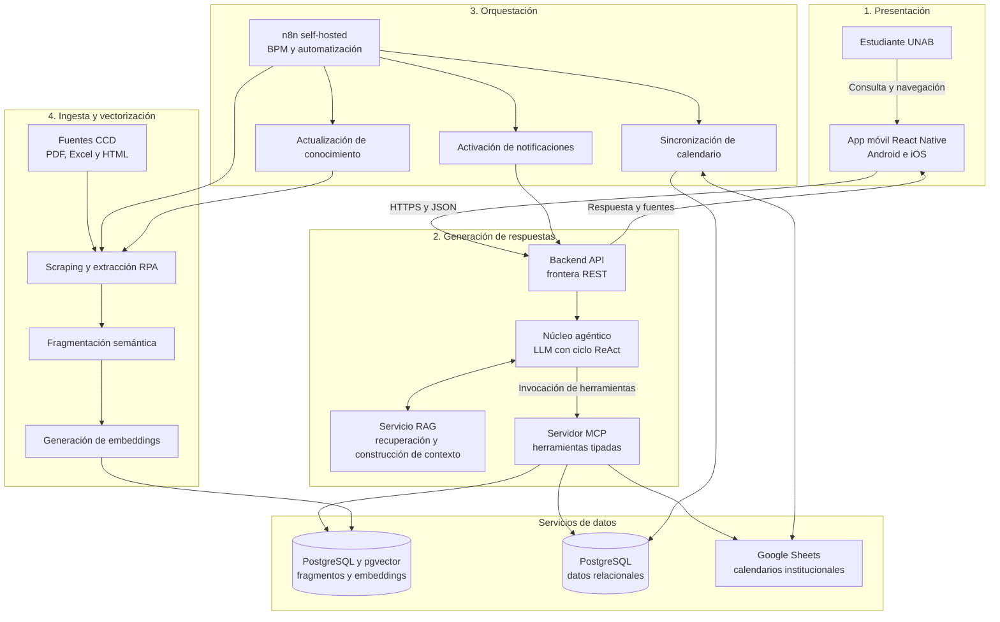
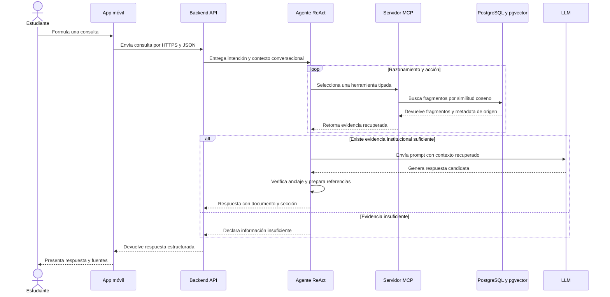
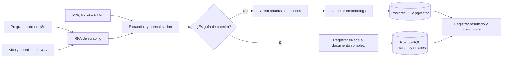
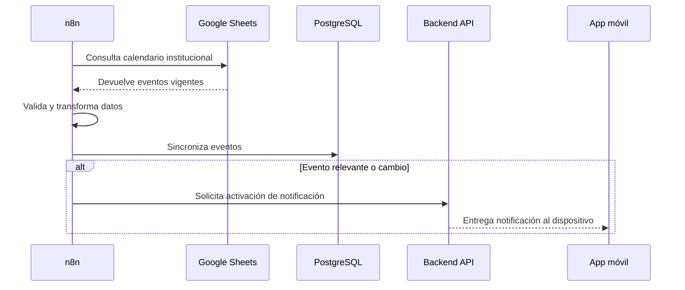
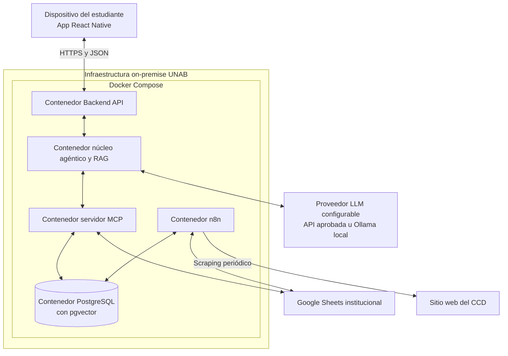

# Arquitectura técnica de BanuChat

## Propósito y alcance

Este documento traduce la arquitectura sustentada en la sección 11.4, **Arquitectura Técnica del Sistema**, del anteproyecto a una guía técnica versionada para BanuChat. Su propósito es mantener trazabilidad entre la propuesta académica y los componentes que se diseñen y construyan en el monorepo.

La arquitectura se encuentra en fase de análisis y diseño. Los nombres de endpoints, las herramientas MCP, el esquema vectorial y los contratos entre servicios todavía deben especificarse y aprobarse antes de iniciar la implementación productiva.

## Fuentes de diseño

| Referencia del anteproyecto | Aporte a este documento |
| --- | --- |
| Sección 11.4, Arquitectura Técnica del Sistema | Define las cuatro capas funcionales: ingesta y vectorización, orquestación, generación de respuestas y presentación. |
| Sección 7.6, Arquitectura Lógica | Describe el flujo secuencial entre la app móvil, n8n, el agente con ciclo ReAct, MCP y las fuentes de datos; también ubica el scraping RPA como proceso paralelo. |
| Figura 2, Diagrama de Flujo | Identifica React Native, n8n/BPM, flujos conversacionales, agente LLM, servidor MCP, Google Sheets, PostgreSQL, pgvector y el bot de scraping. |
| Sección 13.3, Descripción de la Arquitectura del Sistema | Precisa que la app envía la consulta al Backend API, donde se activa RAG, y exige devolver la respuesta con la referencia al documento de origen. |

En el anteproyecto el sistema se denomina “Route AI”. En el código, la interfaz, la documentación técnica y los commits se utiliza exclusivamente el nombre **BanuChat**.

## Principios y restricciones

- **Despliegue on-premise:** los servicios se ejecutan en infraestructura de la UNAB mediante contenedores Docker; la arquitectura no introduce dependencias de despliegue en nube pública.
- **Respuestas fundamentadas:** toda afirmación institucional debe estar respaldada por contexto recuperado y debe incluir documento y sección de origen.
- **Fallo explícito:** si el corpus no contiene información suficiente, el agente debe indicarlo y no completar la respuesta con conocimiento no verificado.
- **Acceso mediante MCP:** el agente accede a pgvector, PostgreSQL y calendarios mediante herramientas tipadas del servidor MCP, no mediante conexiones improvisadas desde el LLM.
- **Automatización reproducible:** los procesos BPM y RPA se definen en n8n y cada flujo se exporta como JSON versionado en `n8n/workflows`.
- **Protección de datos:** las pruebas usan datos sintéticos o anonimizados y el tratamiento de información personal debe cumplir la Ley 1581 de 2012.
- **Guías de cátedra no vectorizadas:** estos documentos se ofrecen como enlace al archivo completo y quedan fuera del proceso de fragmentación y embeddings.
- **Contratos estables:** los nombres de las herramientas MCP y el esquema vectorial no se modifican sin revisión explícita, porque conectan el agente, el backend y n8n.

## Vista lógica por capas

La sección 11.4 organiza BanuChat en cuatro capas funcionales. Los servicios de datos y ejecución soportan estas capas dentro del entorno on-premise.

### 1. Capa de presentación

La aplicación móvil multiplataforma concentra la interacción con el estudiante. Ofrece consulta en lenguaje natural, calendario académico, historial de cursos y notificaciones. Se comunica mediante HTTPS y JSON con la API REST del backend; no accede directamente a bases de datos, al LLM ni a credenciales de servicios institucionales.

**Ubicación prevista:** `mobile/`.

### 2. Capa de generación de respuestas

El Backend API recibe la consulta y activa el núcleo agéntico. El agente interpreta la intención, sigue un ciclo ReAct y selecciona herramientas MCP cuando necesita recuperar conocimiento o consultar datos estructurados. Para una respuesta RAG, el backend recupera fragmentos por similitud coseno, construye el contexto, solicita la generación al LLM y valida que la respuesta quede anclada en las fuentes recuperadas.

La salida hacia la app debe incluir, como mínimo, la respuesta, las referencias al documento y sección de origen, y un estado explícito cuando no exista evidencia suficiente.

**Ubicación prevista:** `backend/api/`, `backend/rag/` y `backend/mcp-server/`.

### 3. Capa de orquestación

n8n actúa como motor BPM y de automatización. Administra la sincronización periódica del calendario desde Google Sheets, la activación de notificaciones y la actualización del corpus. Las tareas programadas deben operar sin intervención manual constante y quedar respaldadas como flujos JSON en el repositorio.

**Ubicación prevista:** `n8n/workflows/`.

### 4. Capa de ingesta y vectorización

Los flujos RPA extraen información del sitio institucional del CCD y procesan documentos PDF, Excel y HTML. El contenido elegible se normaliza, se divide en fragmentos semánticos, se convierte en embeddings y se almacena en PostgreSQL con pgvector junto con la metadata necesaria para rastrear su procedencia.

Las guías de cátedra constituyen una excepción: no se fragmentan ni se vectorizan; se registran para entregar el enlace al documento completo.

**Ubicación prevista:** `n8n/workflows/`, `backend/rag/` e `infra/db/`.

## Flujo de consulta RAG

## Flujo de actualización del conocimiento

La actualización del corpus ocurre de forma asíncrona para no aumentar la latencia de las consultas del estudiante.

Cada ejecución debe conservar la URL o documento de origen, la sección cuando esté disponible, la fecha de extracción y el estado del procesamiento. El modelo de datos exacto se definirá mediante migraciones versionadas en `infra/db/`.

## Flujo de calendario y notificaciones

La sincronización debe alcanzar una latencia máxima de 30 minutos respecto a la fuente, de acuerdo con el resultado esperado OE4. El mecanismo concreto de entrega de notificaciones se definirá sin introducir una dependencia de despliegue en nube pública.

## Vista de despliegue on-premise

`infra/docker-compose.yml` es el punto de orquestación del despliegue local. La inclusión exacta del proveedor LLM y de cualquier componente de notificaciones requiere una decisión de arquitectura y configuración mediante secretos; no deben almacenarse credenciales en el repositorio.

## Responsabilidades y correspondencia con el monorepo

| Componente | Responsabilidad arquitectónica | Ubicación | Evidencia esperada en Fase 1 |
| --- | --- | --- | --- |
| Backend API | Frontera REST para la app, validación de entradas y entrega de respuestas con fuentes | `backend/api/` | Contrato de API y modelos de solicitud/respuesta |
| Núcleo agéntico | Interpretación de intención, ciclo ReAct y selección dinámica de herramientas | `backend/` | Diagrama del ciclo y reglas de decisión |
| Servidor MCP | Exposición tipada de herramientas sobre pgvector, PostgreSQL y calendarios | `backend/mcp-server/` | Especificación de herramientas, entradas, salidas y errores |
| Motor RAG | Ingesta lógica, chunking, embeddings, recuperación y construcción de contexto | `backend/rag/` | Estrategia de chunking, metadata y recuperación |
| n8n | BPM, scraping RPA, sincronización y automatizaciones programadas | `n8n/workflows/` | Especificación de cada flujo y sus casos de error |
| PostgreSQL y pgvector | Persistencia relacional, metadata, embeddings y búsqueda vectorial | `infra/db/` | Modelo de datos y migraciones propuestas |
| App móvil | Consulta, calendario, historial y notificaciones | `mobile/` | Flujos de navegación y contrato de consumo de API |
| Evaluación | Métricas RAGAS, integración, scraping y pruebas SUS | `eval/` | Plan de evaluación, datasets sintéticos y criterios de aceptación |
| Infraestructura | Despliegue reproducible on-premise | `infra/` | Topología, servicios, redes, volúmenes y gestión de secretos |

## Contratos que deben especificarse antes de construir

1. **Contrato App–API:** estructuras de consulta, respuesta, fuentes, calendario, historial, notificaciones y errores.
2. **Contrato Agente–MCP:** catálogo y nombres definitivos de herramientas, tipos de entrada y salida, permisos, tiempos de espera y errores recuperables.
3. **Contrato RAG–Datos:** esquema de documentos, chunks, embeddings, metadata de origen, versionado, deduplicación y política de actualización.
4. **Contrato n8n–Backend:** eventos, autenticación entre servicios, idempotencia, reintentos y registro de fallos.
5. **Contrato de trazabilidad:** formato obligatorio de documento, sección, URL, fecha de extracción y versión del contenido en cada respuesta institucional.

Estos contratos son entregables de diseño. Su especificación no implica modificar el esquema vectorial ni fijar nombres de herramientas MCP sin la revisión correspondiente.

## Trazabilidad entre el anteproyecto y la construcción

| Afirmación sustentada | Elemento de diseño | Artefacto de construcción o verificación |
| --- | --- | --- |
| n8n extrae PDF, Excel y HTML del CCD | Flujo de actualización del conocimiento | JSON versionados en `n8n/workflows/` y pruebas de extracción en `eval/` |
| El contenido se fragmenta, vectoriza y almacena en pgvector | Pipeline de ingesta RAG | Especificación en `backend/rag/` y migraciones en `infra/db/` |
| n8n sincroniza calendarios y activa notificaciones | Flujo de calendario y notificaciones | Flujos n8n y pruebas de integración extremo a extremo |
| El backend recupera por similitud coseno | Flujo de consulta RAG | Estrategia de retrieval y evaluación RAGAS en `eval/` |
| El LLM responde solo con fuentes institucionales verificadas | Validación de anclaje y fallo explícito | Pruebas de faithfulness y respuestas con documento y sección |
| El agente selecciona dinámicamente herramientas | Ciclo ReAct y servidor MCP | Casos de selección de tool y pruebas de coherencia conversacional |
| La app ofrece consulta, calendario, historial y notificaciones | Capa de presentación | Especificación funcional en `mobile/` y pruebas SUS |
| El sistema se despliega on-premise con Docker | Vista de despliegue | `infra/docker-compose.yml` y pruebas de estabilidad |

## Criterios de validación asociados

La arquitectura se considerará implementada cuando los componentes puedan verificarse contra los objetivos específicos del anteproyecto, no solo cuando compilen:

- RAG: faithfulness ≥ 0,80; context precision ≥ 0,80; context recall ≥ 0,75; answer relevancy ≥ 0,80; MRR ≥ 0,70.
- Scraping: ejecución automática sin intervención, actualización del corpus en menos de 24 horas y extracción correcta superior al 90 %.
- Agente y MCP: selección dinámica de la herramienta adecuada según la intención y ejecución de tareas de varios pasos.
- n8n: transmisión extremo a extremo sin pérdida o corrupción y sincronización del calendario en máximo 30 minutos.
- App móvil: SUS promedio superior a 70/100, ningún resultado individual inferior a 50/100 y completación de tareas superior al 85 %.
- Despliegue: contenedores sin caídas superiores a 5 minutos y tiempo promedio de respuesta inferior a 5 segundos.

## Decisiones abiertas y discrepancias de la fuente

### Punto de entrada del flujo conversacional

La sección 7.6 y la Figura 2 ubican a n8n entre la app móvil y el agente. La sección 13.3, en cambio, establece que la app envía la consulta al Backend API y allí se activa RAG. El layout del monorepo también define que la app consume una API REST.

Como interpretación de trabajo, este documento representa al Backend API como frontera pública y a n8n como orquestador de procesos BPM, sincronización y RPA. Antes de construir el flujo conversacional se debe registrar un ADR que confirme una de estas opciones:

1. Backend API como entrada, con invocación interna de n8n cuando una regla BPM lo requiera.
2. n8n como entrada o gateway conversacional, con delegación posterior al backend.

La decisión debe evaluar latencia, disponibilidad, seguridad, observabilidad y acoplamiento; no debe tomarse únicamente por conveniencia de implementación.

### Número de capas

La sección 11.4 define cuatro capas, mientras que el Anexo C resume el sistema en tres. Este documento conserva las cuatro capas de la sección solicitada y utiliza el Anexo C para detallar el flujo RAG, sin tratar ambos conteos como arquitecturas distintas.

### Servicios externos pendientes

Google Sheets forma parte explícita de la propuesta. El proveedor LLM y el mecanismo de notificaciones deben seleccionarse respetando el despliegue on-premise, la protección de datos, la gestión segura de secretos y las aprobaciones institucionales.

## Control de cambios arquitectónicos

Toda decisión que cambie límites entre capas, contratos MCP, modelo vectorial, dependencia externa o topología de despliegue debe documentarse mediante un ADR en `docs/`. Cuando cambie la fuente académica o se apruebe una decisión, se debe actualizar la matriz de trazabilidad de este documento y los artefactos de diseño relacionados.
