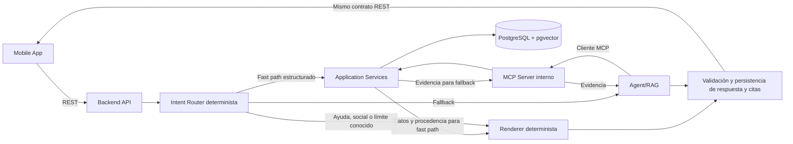
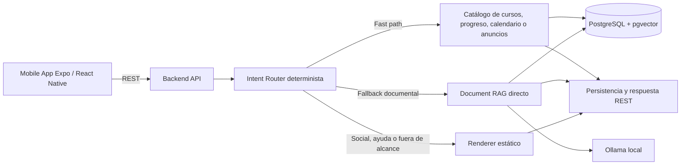
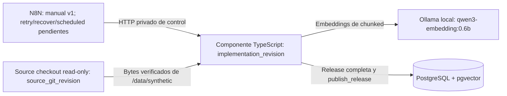
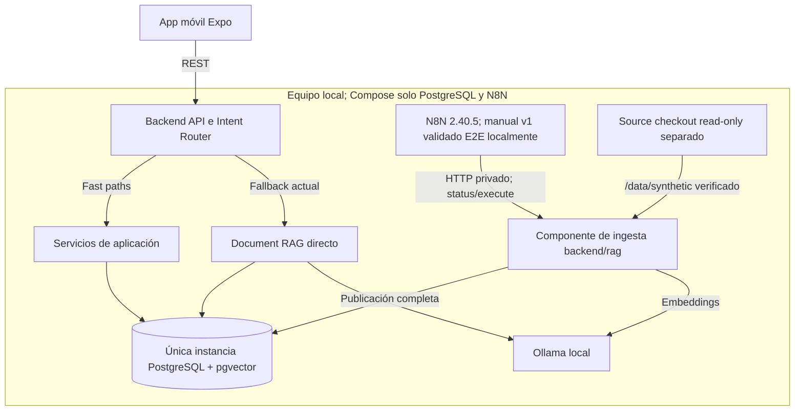

# Arquitectura técnica de BanuChat

## Alcance vigente

BanuChat es un proyecto académico cuyo MVP está en implementación incremental. Todo
dato funcional (documentos, cursos, calendarios, convocatorias y perfiles) es
sintético y tiene
su fuente de verdad versionada en `/data/synthetic`. PostgreSQL conserva una
representación procesada y reconstruible desde esos archivos.

Este documento aplica las decisiones de `AGENTS.md` y del
[ADR 0001](adr/0001-alcance-sintetico-y-despliegue-local.md).
El anteproyecto es una referencia histórica: su despliegue en servidores UNAB,
scraping del CCD e integraciones institucionales fueron descartados.
No se accederá a datos, APIs, páginas ni infraestructura real de UNAB/CCD.

## Componentes y responsabilidades

| Componente | Responsabilidad | Ubicación |
| --- | --- | --- |
| Mobile App | Expo SDK 57, React Native + TypeScript; consume únicamente la API REST pública. MVP de demostración M1–M5 validado manualmente en Android físico. | `mobile/` |
| REST Backend API | Entrada síncrona; fija contexto, evalúa Intent Router y persiste respuesta/citas de la misma release. | `backend/api/` |
| Intent Router | Catálogo determinista: fast path seguro o fallback Document RAG directo actual; Agent/RAG permanece como objetivo. Clasifica sin LLM, embeddings ni N8N. | Especificación en `docs/enrutamiento-intenciones.md`; catálogo en `backend/api/` |
| Application Services | Lógica compartida con acceso consistente a PostgreSQL; implementada para los fast paths actuales y pendiente de reutilización por tools MCP. | `backend/api/` |
| Agent/RAG objetivo | Ciclo ReAct, recuperación de contexto y selección controlada de herramientas; pendiente de integración en el fallback. | `backend/`, `backend/rag/` |
| MCP Server interno objetivo | Contrato de seis tools; servidor ejecutable e integración con Agent/ReAct pendientes. | `backend/mcp-server/` |
| PostgreSQL + pgvector | Una instancia para información relacional y embeddings, separados por el modelo de datos. | `infra/db/` |
| N8N | Workflow manual local validado en N3; orquesta ingesta asíncrona. Retry/recover/scheduled pendientes. | `n8n/workflows/` |
| Datos sintéticos | Fuente de verdad versionada, con origen simulado explícito. | `data/synthetic/` |
| Docker Compose local | Entorno de desarrollo y demostraciones iniciales. | `infra/docker-compose.yml` |

## Consulta síncrona

### Arquitectura objetivo

N8N queda fuera del camino síncrono. La app no consume MCP, N8N ni PostgreSQL
directamente. Agent/ReAct y MCP continúan siendo parte de esta arquitectura objetivo;
no están integrados en el fallback implementado actualmente. Embeddings usa Ollama
local con `qwen3-embedding:0.6b`, 1024 dimensiones y coseno
([ADR 0003](adr/0003-embedding-local-qwen3.md)).

El [ADR 0004](adr/0004-enrutamiento-determinista-intenciones.md) introduce el router.
El fast path no llama a MCP ni al LLM generador; usa servicios compartidos y renderers.
En este diseño objetivo, las decisiones de fallback se derivarán a Agent/ReAct;
en el runtime actual se derivan a Document RAG directo.
El diagrama muestra dependencias lógicas y retornos, no nuevos contenedores ni código.
Las consultas REST directas siguen pudiendo utilizar servicios sin router ni agente.

Las respuestas documentales y estructuradas citan evidencia verificable del corpus sintético,
y declaran evidencia insuficiente cuando corresponda. Mantienen una release por turno.
No presentan la simulación como información institucional vigente. Los documentos con
`retrieval_mode=full_document` no se fragmentan ni vectorizan; se resuelven como
artefactos completos verificados por la ruta REST interna aprobada, no URLs externas.

### Estado de implementación actual

El vertical slice conversacional fue validado inicialmente al commit
`f47ec9e29b8c161a2c88a4eadf641dab2359a964` y comprobado después por J1 y J2.
El HEAD actual incorpora además M3.1 y M3.2; catálogo `1.2.0-draft` y schema con
`$id` de esa versión. El recorrido implementado es:

La API expone actualmente `GET /api/v1/profiles`,
`POST /api/v1/conversations`,
`GET /api/v1/conversations`,
`GET /api/v1/conversations/{conversation_id}`,
`DELETE /api/v1/conversations/{conversation_id}`,
`POST /api/v1/conversations/{conversation_id}/messages`,
`GET /api/v1/documents/{document_version_id}/artifact`,
`GET /api/v1/calendar/events`,
`GET /api/v1/profiles/{profile_key}/progress` y
`GET /api/v1/announcements`.

El dispatcher resuelve `course_catalog`, `profile_progress`, `calendar_events` y `announcements`
con servicios de aplicación y renderers. `basic_social`, `capabilities_help` y
`known_out_of_scope` usan renderers estáticos sin SQL de dominio ni generador.
M8.1 implementa `course_catalog` como fast path estructurado sobre `banuchat.courses`
de la release vigente: oferta general sin perfil requerido por el dispatcher,
filtros `available`/`closed`/`archived` y citas `course` con `course_key` y procedencia.
No añade endpoint REST de cursos. Sus pruebas usan SQL controlado y cubren
persistencia/relectura de citas por HTTP; la prueba operacional local queda pendiente.
`document_lookup` sigue pendiente como fast path y se deriva a Document RAG.

Document RAG genera el embedding de la pregunta con `qwen3-embedding:0.6b` mediante
Ollama, recupera hasta cinco fragmentos con búsqueda exacta por coseno en
PostgreSQL + pgvector y genera con `qwen3:4b-instruct` mediante Ollama. Después
construye citas de los fragmentos recuperados y persiste el turno. Ollama es el
runtime de modelos; pgvector almacena y compara vectores, no genera embeddings.
Si no hay fragmentos o el generador declara evidencia insuficiente, devuelve una
respuesta de insuficiencia sin citas. La procedencia facilita verificación y no
demuestra por sí sola faithfulness o exactitud. El E2E real obtuvo HTTP 201.

Este estado no incluye un ciclo Agent/ReAct ni llamadas MCP desde el fallback.
Ambos siguen pendientes en la arquitectura objetivo.
El cliente móvil M1–M5 está implementado y fue validado manualmente en Android
físico. Historial y anuncios también están implementados; el estado de las etapas
móviles posteriores y sus validaciones está en [Mobile](../mobile/README.md).
J1 comprobó operacionalmente la ruta REST con PostgreSQL/pgvector y Ollama
reales; J2 comprobó mediante HTTP en proceso el router real con SQL controlado y
Document RAG simulado. Sus límites constan en el
[checkpoint J3](../eval/integration/results/j3-checkpoint-2026-10-03.md).

## Ingesta asíncrona de releases sintéticas completas

El [ADR 0005](adr/0005-ingesta-reproducible-n8n.md) define esta frontera. El core
TypeScript, transporte HTTP interno y su composición/startup operacional están
implementados. N0 validó localmente `/status`; N2 versionó e importó
`n8n/workflows/ingestion-manual-v1.json`; N3 ejecutó el workflow manual E2E desde
N8N 2.40.5: `not_started` llevó a `/execute` y publicó una release `ready/current`;
la segunda ejecución fue `already_current`. Véase [evidencia N3](../eval/ingestion/results/n3-n8n-e2e-2026-10-02.md).
El workflow permanece inactivo como automatización. Retry/recover/scheduled y una
topología portable siguen pendientes. En el recorrido implementado, N8N orquesta
triggers, llamada y resumen; TypeScript valida revisión/aprobación, schemas,
hashes y relaciones, procesa documentos y gobierna intentos/publicación. El runtime
de `backend/rag` y el checkout fuente son raíces separadas configuradas por el servidor,
nunca paths enviados por HTTP. El operador prepara la fuente en un worktree o checkout
equivalente read-only; no se crea aquí. N8N no ejecuta checkout, pull, fetch ni red Git.

HEAD del source checkout debe coincidir con source_git_revision aprobada; sus bytes,
manifest y schemas se validan allí. Para v1 es
`af7ac711e1da3426e1f5fbe8b2892cec1344ce8b`, registrado en dataset_releases.git_revision.
El código/build ejecutado tiene su propia implementation_revision en pipeline_config,
que puede ser posterior. approval_ref aprueba la fuente, no automáticamente el runtime.
Cambiar solo implementación puede producir otra release por pipeline_sha256 sin
alterar ni volver a aprobar el contenido. No se exige un checkout en dos revisiones.

El calendario se carga como parte de una release completa desde `/data/synthetic/calendars`;
no sincronización independiente, Google Sheets ni fuente institucional. Full_document
produce versiones sin chunks/embeddings y conserva el artefacto exacto para REST.
Chunked v1 usa secciones H2, sin overlap: la receta produce 60 chunks, validados en
PostgreSQL; la E2E real de Implementación 3 generó sus 60 embeddings. Estos conteos
no acreditan calidad RAG.

Se conservan 76 items por intento exitoso, incluidos skipped verificados. Solo
publish_release promueve atómicamente; un fallo mantiene current. Ready actual es
no-op y una ready histórica no se reactiva mediante ingesta normal. La
[especificación](ingesta-reproducible.md) detalla receta, locking, retry y fallos.
El workflow manual está versionado en JSON y la ejecución N3 se documenta en
[su evidencia](../eval/ingestion/results/n3-n8n-e2e-2026-10-02.md). Retry/recover/
scheduled siguen pendientes; no se versionan secretos ni valores operacionales.

## Despliegue local

Este diagrama describe límites lógicos, no fija un contenedor por módulo.
El Compose actual solo declara PostgreSQL con una imagen que incluye pgvector y N8N.
El SQL vigente ya incluye `CREATE EXTENSION IF NOT EXISTS vector WITH SCHEMA public;`
y la migración fue ejecutada en PostgreSQL local desechable. Compose por sí solo no
aplica automáticamente esa migración; disponer de la imagen no significa que toda
base nueva esté migrada. No hay servicios backend o mobile en el Compose actual.

El HTTP interno implementa `Authorization: Bearer <service-token>` con token fuera
de Git, mínimo 32 caracteres, sin whitespace ni logging, y comparación SHA-256 con
`timingSafeEqual`. N0 validó `/status` y N3 validó el recorrido manual con `/execute`
desde N8N en Windows + Docker Desktop; no es autenticación de usuarios. N3 usó
`host.docker.internal`, observado solo en ese entorno y no portable por definición.
Retry/recover/scheduled, topología/bind para futuros despliegues y permisos/roles
mínimos siguen pendientes. No existe despliegue institucional.

## Perfiles, usabilidad y funcionalidades pendientes

Los perfiles para historial y personalización son totalmente sintéticos. La estrategia
de autenticación local está pendiente; no habrá autenticación institucional.

Los datos que puedan recogerse posteriormente en pruebas de usabilidad con personas
son distintos del corpus funcional. Su consentimiento, minimización, anonimización,
almacenamiento y acceso requieren diseño previo; no deben alimentar `/data/synthetic`.

Las notificaciones mediante un proveedor push real son una funcionalidad deseable
pendiente de diseño explícito y no se incorpora un proveedor en esta iteración.

## Trazabilidad y evaluación

Esta tabla organiza el trabajo técnico del repositorio de forma provisional y no
constituye por sí sola una modificación aprobada de los objetivos académicos del
anteproyecto. La alineación definitiva de OE1–OE6 con el documento académico y las
decisiones del director del Proyecto de Grado sigue pendiente.

| Objetivo | Interpretación técnica de trabajo |
| --- | --- |
| OE1 | RAG sobre corpus sintético: faithfulness ≥ 0,80; context precision ≥ 0,80; context recall ≥ 0,75; answer relevancy ≥ 0,80; MRR ≥ 0,70. |
| OE2 — propuesta técnica provisional | Ingesta de revisión sintética aprobada: objetivo <24h desde disponibilidad para ingesta y éxito >90 %, no medidos; separar espera y duración trigger→publicación del trabajo humano previo. |
| OE3 | Selección controlada y dinámica de herramientas MCP por el agente. |
| OE4 | Orquestación E2E: publicación atómica, trazabilidad, sin pérdida/mezcla de items y current preservada ante fallos; todos los casos críticos deben cumplir lo esperado. Duración observada sin nuevo umbral. Se descarta la sincronización independiente de 30 min; redacción académica pendiente de actualización. |
| OE5 | SUS promedio > 70/100, ningún resultado < 50/100 y completación de tareas > 85 %. |
| OE6 | Estabilidad de contenedores locales, sin caídas > 5 minutos, y respuesta promedio < 5 segundos. |

Estos son criterios académicos, no resultados acreditados. Las evaluaciones
versionadas cubren alcances parciales y no demuestran su cumplimiento integral.

Como antecedente histórico, G2 observó cinco solicitudes HTTP warm
exitosas y registró media de 12195.50 ms, mediana de 12353.39 ms, mínimo de 10820.68 ms
y máximo de 13511.09 ms; 0/5 estuvieron por debajo de 5000 ms. La referencia
histórica de OE6 no se cumplió en esa muestra. No es un benchmark exhaustivo y no se
modifica ni se acredita OE6. Véase
[la evidencia G2](../eval/generation/results/g2-rag-e2e-smoke-2026-10-01.md).

La evidencia posterior [L1-B](../eval/generation/results/l1-b-rag-latency-2026-10-03.md)
observó diez POST warm secuenciales: media wall 4013.57 ms, mediana 3956.78 ms,
mínimo 1883.42 ms y máximo/p95 nearest rank 6485.59 ms; 8/10 por debajo de 5000 ms.
La generación tuvo media 3622.38 ms y la consulta vectorial DB 3.03 ms. Con n=10,
el p95 coincide con el máximo y no es una estimación poblacional robusta. L1-B
no acredita formalmente OE6 ni SLA; no se mezcla estadísticamente con G2 o L1.

[K2 v1](../eval/retrieval/results/k2-v1-2026-10-01.md) midió retrieval sobre 18 casos
chunked, top_k=5: MRR@5≈0.8519, Precision@5≈0.2222, Recall@5=Hit@5=1 (18/18 hits).
La precisión coincide con el máximo teórico agregado del gold; no mide faithfulness,
answer relevancy, UX ni latencia completa. Full_document quedó fuera del retrieval
vectorial. [M3.2-D](../eval/intent-routing/results/m3-2-reserved-first-run.md) obtuvo
14/14 route correct y exact correct en `reserved_primary`, cero fast paths
inesperados (0 %). Todos esos casos eran negativos/fallback: no demuestra accuracy
poblacional, recall positivo ni generalización. Véase [eval](../eval/README.md).

## Estado validado y trabajo pendiente

La migración inicial `infra/db/001_initial_schema.sql` ya fue ejecutada sobre PostgreSQL
local desechable y la suite A–K fue ejecutada. El core de ingesta implementa preflight,
carga de 64 registros estructurados sintéticos, documentos/chunking, embeddings,
publicación atómica y recovery/retry. También están implementados Approval Registry,
vínculos approval↔source, procedencia del runtime checkout, operaciones internas
`execute`/`retry`/`recover`/`status`, observación del WriterLease, transporte HTTP,
Bearer service token y parser de configuración operacional. Véanse
[documentación física](../infra/db/README.md) y [evidencia/límites](../infra/db/tests/README.md).
La E2E real de Implementación 3 acreditó 76 items procesados, 12 versiones ready,
60 chunks, 60 embeddings reales y `already_current`, pero usó una
`implementation_revision` TEST/sintética. Recovery/retry fue validado después con
PostgreSQL real y embeddings TEST_ONLY; son ejecuciones separadas.

Los contratos `backend/mcp-server/tools-contract.md` y
`backend/mcp-server/tools.contract.json`, versión `2.0.0-draft`, están congelados para
implementación. La eliminación de Google Sheets, identidad sintética y diseño de
evidencia/enlaces ya están resueltos; no son pendientes de rediseño. El sufijo draft
se conserva hasta disponer de implementación validada.

- SQL: pendientes pruebas de permisos con roles no propietarios, concurrencia y
  reintentos avanzados descritos en su documentación; no repetir como pendiente A–K.
- Operación de ingesta: N0 validó startup/status; N2 versionó e importó el workflow
  manual; N3 validó ejecución E2E manual, publicación `ready/current` y no-op
  `already_current` ([evidencia](../eval/ingestion/results/n3-n8n-e2e-2026-10-02.md)).
  Retry/recover/scheduled, topología futura y permisos/roles mínimos siguen pendientes.
- Consulta implementada: Intent Router determinista, fast paths de catálogo de cursos,
  progreso, calendario y anuncios, renderers social/ayuda/fuera de alcance, M3.1/M3.2,
  los endpoints REST descritos arriba, retrieval exacto,
  Document RAG directo con generación Ollama, citas y persistencia; vertical slice
  RAG E2E real con HTTP 201.
- Consulta pendiente: Agent/ReAct real, servidor MCP ejecutable e
  integración productiva del MCP interno al fallback. J1 cubre una ruta operacional
  concreta, no todas las variantes o condiciones de concurrencia REST.
- Producto/evaluación: autenticación de usuario final, RAGAS completa, SUS formal,
  pruebas formales con usuarios y notificaciones push reales. El MVP móvil de
  demostración M1–M5 ya existe; no hay despliegue institucional acreditado.

Las decisiones confirmadas en `AGENTS.md` prevalecen sobre referencias históricas.
