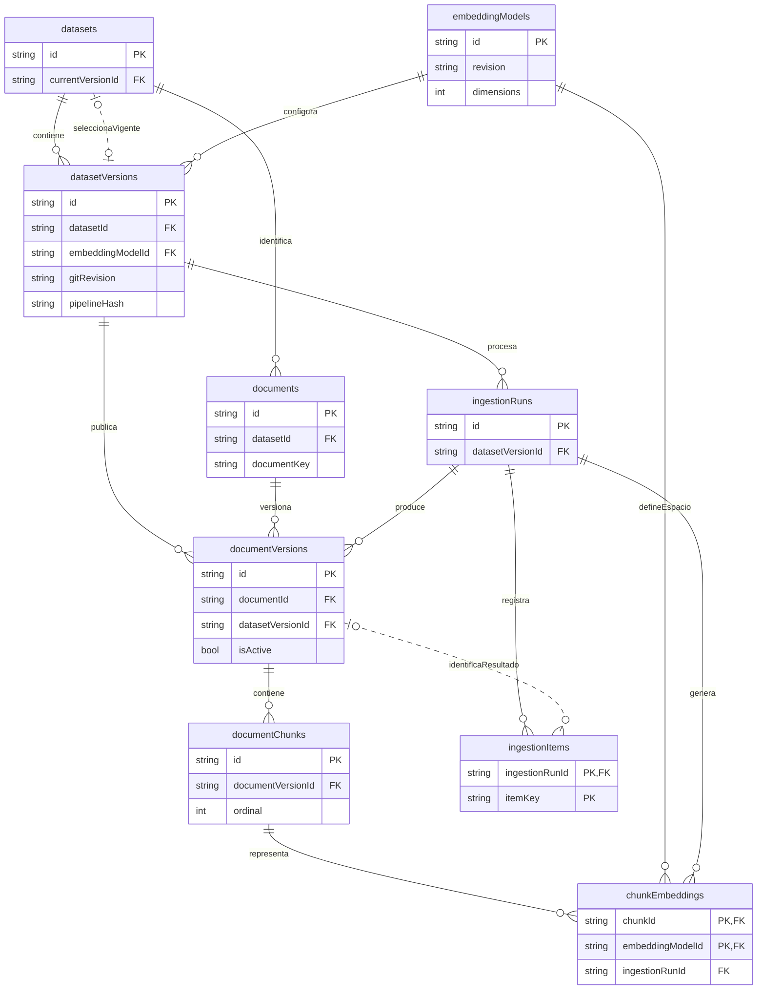
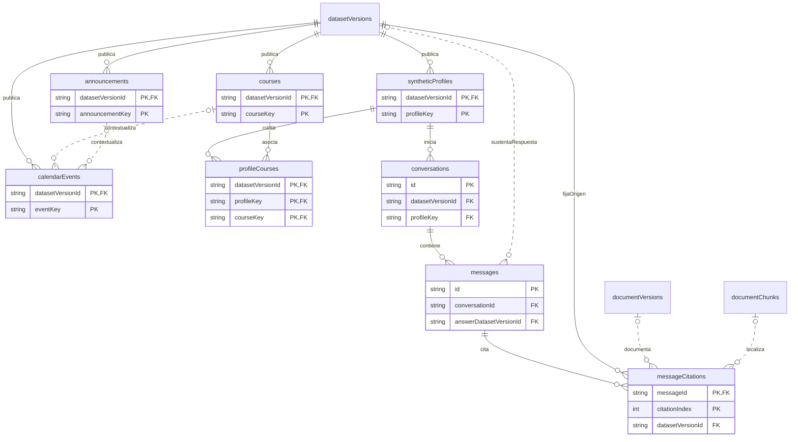

# Modelo de datos conceptual y lógico del MVP

Estado: propuesta para revisión humana, Fase 1. No constituye una migración aprobada.
Base de contraste: lectura completa de `infra/db/001_initial_schema.sql`, reglas vigentes
de `AGENTS.md` y arquitectura documentada. El SQL y los contratos MCP no se modifican.

## 1. Alcance

Una sola instancia PostgreSQL + pgvector conserva la representación procesada del corpus
100% sintético, cursos, calendario, convocatorias, perfiles de demostración y su progreso.
También conserva conversaciones visibles y citas, separadas conceptualmente del corpus.
No se prevén campos, conectores ni excepciones legales para incorporar datos reales.

`/data/synthetic` es la fuente de verdad versionada. Una publicación completa y validada
del dataset se activa de forma atómica. Las publicaciones anteriores se conservan para
citas y evaluaciones, pero no participan en consultas normales. Esta estrategia evita
combinar cursos, eventos y documentos de distintas publicaciones.

Se distinguen tres clases de persistencia:

- **Fuente funcional:** archivos sintéticos y manifiesto versionados; reconstruibles.
- **Derivados:** extracción, chunks, embeddings y resultados de ingesta; regenerables con
  la misma configuración. Regenerar embeddings no garantiza igualdad bit a bit si el
  proveedor cambia el modelo; para una repetición exacta se necesita conservar el artefacto.
- **Estado de demostración:** conversaciones, mensajes, citas y tiempos de ejecución.
  No se reconstruye desde el corpus ni se incorpora automáticamente al dataset. Una
  reconstrucción limpia recupera la base funcional, no las conversaciones de sesiones previas.

Fuera del modelo: autenticación institucional, credenciales, datos personales reales,
integraciones institucionales, entrega de notificaciones push, razonamiento interno,
mensajes internos del agente y registros identificables de participantes de usabilidad.
La app consume REST; el agente usa MCP interno; N8N ejecuta ingestas asíncronas aprobadas.
Ninguna de esas fronteras exige una base adicional.

## 2. Entidades

### Convenciones comunes

Los nombres siguientes son propuestas lógicas, no contratos congelados. Los identificadores
de documentos y registros estructurados son claves estables suministradas por el dataset,
no nombres de personas ni claves institucionales. Los IDs internos pueden resolverse a partir
de esas claves durante una reconstrucción; las evaluaciones no deben depender de UUID aleatorios.

Una **referencia de origen** contiene `dataset_version_id`, ruta relativa bajo
`/data/synthetic`, localizador de sección/registro y checksum del archivo en el manifiesto.
No contiene una URL externa. Las rutas deben normalizarse, impedir escapes y resolver dentro
de la raíz aprobada. Un registro JSON/CSV se cita como archivo + sección/clave de registro;
un documento como título + sección/página + versión. El backend resuelve enlaces locales
al artefacto completo de la revisión correspondiente.

Las entidades de dominio de una publicación son inmutables después de validarla. Sus
relaciones usan claves compuestas con `dataset_version_id` para impedir cruces de versiones.
No se añaden bolsas JSON genéricas, correos, identificaciones, programas académicos reales,
preferencias ni datos de contacto sin un caso de uso aprobado.

### 2.1 `datasets` — ámbito sintético y selección vigente

- **Responsabilidad:** identificar el único corpus funcional del MVP y su publicación vigente.
- **Campos/ID:** `id` estable, nombre, `synthetic_only` constante verdadera,
  raíz fija `/data/synthetic`, `current_version_id` opcional mientras no haya publicación.
- **Relaciones:** tiene muchas `dataset_versions`; apunta a una de sus propias versiones.
- **Restricciones:** un único dataset funcional; FK compuesta de pertenencia del puntero;
  solo puede apuntar a una publicación validada. No existe opción de origen real.
- **Justificación:** un único punto de activación permite consultas coherentes y rollback.

### 2.2 `dataset_versions` — publicación procesada reproducible

- **Responsabilidad:** fijar una instantánea completa del dataset y su receta de procesamiento.
- **Campos/ID:** `id`; `dataset_id`; revisión Git inmutable; hash del manifiesto; versión de
  esquema del dataset; configuración versionada y hash del pipeline de extracción/chunking;
  `embedding_model_id`; estado `staging/ready/failed`; instante de importación y validación.
- **Relaciones:** pertenece a un dataset; agrupa documentos versionados y datos estructurados;
  referencia la configuración exacta de embeddings y sus ejecuciones de ingesta.
- **Restricciones:** combinación única de dataset, revisión, manifiesto, pipeline y modelo.
  Una publicación `ready` no admite cambios de contenido/configuración. Un cambio de receta
  o modelo produce otra publicación, aunque los archivos fuente no hayan cambiado.
- **Justificación:** trazabilidad de corpus y pipeline para OE1/OE2/OE4, sin tablas separadas
  para cada etapa del procesamiento. Es una versión de la representación procesada; la
  revisión Git identifica por separado la versión del material fuente.

No se infiere vigencia por fecha máxima ni por estado `ready`: únicamente por el puntero
del dataset. Varias publicaciones pueden estar listas y solo una ser vigente.

### 2.3 `documents` — identidad documental estable

- **Responsabilidad:** reconocer un mismo documento a través de publicaciones.
- **Campos/ID:** `id`, `dataset_id`, `document_key` estable, clase `guide/other`.
- **Relaciones:** dataset y muchas `document_versions`.
- **Restricciones:** clave única dentro del dataset; clase inmutable; una guía siempre es
  documento completo, incluso al reprocesarla. Correcciones de clasificación requieren
  revisión explícita, no una actualización que permita vectorizar una guía.
- **Justificación:** conservar identidad aunque cambien título, contenido o ruta.

### 2.4 `document_versions` — contenido y estado en una publicación

- **Responsabilidad:** representar la versión exacta publicable de un documento.
- **Campos/ID:** `id`, `document_id`, `dataset_version_id`, etiqueta de versión opcional,
  título, referencia de origen, hash del contenido extraído, formato/MIME,
  `is_active`, política `chunk/full_document_link`, estado `pending/ready/failed`,
  fecha de ingesta y `ingestion_run_id` que produjo el registro.
- **Relaciones:** un documento, una publicación, una ejecución y cero o más chunks.
- **Restricciones:** único `(dataset_version_id, document_id)`; documento y publicación
  del mismo dataset; ejecución de la misma publicación; guías solo `full_document_link`.
  Inmutabilidad al publicar; no hay borrado si existen citas.
- **Justificación:** título, actividad y política también deben poder reconstruirse.

Una versión es la presencia del documento en una publicación concreta. Un archivo sin
cambios puede tener versiones procesadas distintas en dos publicaciones, compartiendo hash.
Se acepta esa duplicación acotada por simplicidad del MVP; no se introduce deduplicación
entre publicaciones. No se conserva el UNIQUE global `(document_id, content_sha256)` actual.

### 2.5 `document_chunks` — contexto recuperable con localizador

- **Responsabilidad:** conservar fragmentos de una versión vectorizable.
- **Campos/ID:** `id`, `document_version_id`, ordinal, texto, hash, sección/localizador,
  páginas inicial/final opcionales.
- **Relaciones:** una versión y sus embeddings/citas.
- **Restricciones:** ordinal único por versión; texto y localizador no vacíos; páginas
  positivas y ordenadas (fin requiere inicio); solo política `chunk`; inmutables al publicar.
  Texto idéntico en posiciones diferentes es válido: el hash no es UNIQUE por versión.
- **Justificación:** contexto con anclaje documental. Conteo de tokens no se persiste sin
  consumidor aprobado; depende del tokenizador, ya registrado en la receta cuando corresponda.

### 2.6 `embedding_models` — configuración exacta, no proveedor elegido

- **Responsabilidad:** identificar el espacio vectorial con independencia del proveedor.
- **Campos/ID:** `id`, proveedor, nombre, revisión del modelo, dimensión positiva, métrica
  coseno, configuración reproducible de generación y hash de configuración.
- **Relaciones:** publicaciones y embeddings.
- **Restricciones:** identidad única por proveedor/nombre/revisión/hash de configuración;
  definición inmutable cuando esté referenciada. No secretos ni direcciones de servicios.
- **Justificación:** igual dimensión no significa compatibilidad semántica. La revisión
  y el preprocesamiento deben coincidir también para consultas y documentos.

No se elige un modelo ni una dimensión ahora. Si cambia la dimensión, se registra otra
configuración y se genera una publicación candidata con sus embeddings. Se conserva la
anterior hasta validar cobertura y activar la nueva. Se propone mantener almacenamiento
vectorial de dimensión variable con comprobación contra el catálogo y búsqueda exacta
filtrada por modelo; no fijar aún un índice ANN ni una dimensión de columna. Si después
se necesitan índices especializados, deberán aislar cada dimensión/modelo mediante diseño
físico explícito. La consulta se genera con el modelo de la publicación seleccionada.

### 2.7 `chunk_embeddings` — vector derivado

- **Responsabilidad:** asociar cada fragmento con su representación numérica.
- **Campos/ID:** clave `(chunk_id, embedding_model_id)`, vector, `generated_at`,
  `ingestion_run_id`.
- **Relaciones:** chunk, modelo y ejecución de generación.
- **Restricciones:** dimensión válida, vector finito y no nulo en norma para coseno;
  modelo y ejecución compatibles con la publicación del chunk; sin reemplazo silencioso
  de vectores publicados. Una regeneración distinta crea otra publicación.
- **Justificación:** búsqueda y procedencia del derivado, sin almacenar vectores de consultas.

### 2.8 `ingestion_runs` — intento de procesamiento

- **Responsabilidad:** medir y diagnosticar importaciones, incluidos reintentos.
- **Campos/ID:** `id`, `dataset_version_id`, referencia a receta/workflow versionado,
  disparador `manual/scheduled/retry`, inicio/fin, estado `running/succeeded/failed`,
  código de error técnico saneado opcional.
- **Relaciones:** una publicación; muchos items; versiones y embeddings producidos.
- **Restricciones:** fin posterior al inicio; estado terminal requiere fin; referencias
  conservadas. Un intento puede fallar sin reemplazar la publicación vigente.
- **Justificación:** OE2/OE4 requieren tiempos y éxito de ingesta. Los contadores se derivan
  de items, no se mantienen tres acumuladores independientes potencialmente contradictorios.

### 2.9 `ingestion_items` — resultado por unidad del manifiesto

- **Responsabilidad:** detectar omisiones y calcular denominadores de éxito/reintentos.
- **Campos/ID:** `(ingestion_run_id, item_key)`, ruta/localizador de origen, tipo de unidad,
  estado `pending/processed/skipped/failed`, motivo de omisión/error y fin de procesamiento.
- **Relaciones:** ejecución; versión documental opcional cuando el item corresponde a ella.
- **Restricciones:** item único por intento; origen en el manifiesto; si tiene versión,
  esta pertenece a la publicación del intento. Se registran también fallos previos a crear
  registros de dominio. `skipped` solo se acepta con derivado existente y validado.
- **Justificación:** auditoría pequeña pero necesaria; incluye registros estructurados,
  no solo documentos. No se diseña un motor genérico de ejecución de tareas.

### 2.10 `courses` — catálogo consultable

- **Responsabilidad:** responder consultas de cursos ficticios.
- **Campos/ID:** `(dataset_version_id, course_key)`, nombre, descripción, estado
  `available/closed/archived`, referencia de origen bajo `courses`.
- **Relaciones:** publicación, eventos y asociaciones de perfiles.
- **Restricciones:** claves únicas por publicación, textos requeridos no vacíos;
  no se añaden docente, precio, cupos, certificación o requisitos sin escenario aprobado.
- **Justificación:** el catálogo no debe depender de inferencia sobre texto vectorizado.

### 2.11 `announcements` — información temporal consultable

- **Responsabilidad:** representar convocatorias/anuncios sintéticos con vigencia.
- **Campos/ID:** `(dataset_version_id, announcement_key)`, título, descripción,
  `valid_from`, `valid_until` opcional, `is_active`, origen bajo `announcements`.
- **Relaciones:** publicación y eventos asociados opcionales.
- **Restricciones:** fin no anterior al inicio; vigencia calculada con el instante consultado,
  nunca mediante un booleano que quede desactualizado por el paso del tiempo.
- **Justificación:** consultas temporales y base futura para notificaciones; no incluye
  suscripciones, dispositivos, colas ni historial de entregas push.

### 2.12 `calendar_events` — agenda sintética

- **Responsabilidad:** consultas por intervalo y vínculo con el catálogo.
- **Campos/ID:** `(dataset_version_id, event_key)`, título, tipo
  `course_session/announcement_deadline/general`, inicio con zona horaria, fin opcional,
  descripción, `course_key` opcional, `announcement_key` opcional, `is_active`, origen.
- **Relaciones:** publicación y, opcionalmente, curso o convocatoria de esa publicación.
- **Restricciones:** origen exclusivamente bajo `calendars`; fin no anterior al inicio;
  como máximo uno de los dos vínculos; tipo de sesión requiere curso, plazo requiere
  convocatoria y evento general no requiere vínculo. FK compuestas para evitar mezclas.
- **Justificación:** agenda reproducible. No recurrencias ni asistentes en el MVP.

### 2.13 `synthetic_profiles` — personaje de demostración

- **Responsabilidad:** representar un perfil explícitamente ficticio.
- **Campos/ID:** `(dataset_version_id, profile_key)`, alias ficticio, origen bajo `profiles`.
- **Relaciones:** publicación, cursos asociados y conversaciones.
- **Restricciones:** solo ingesta de dataset validado; no campos de consentimiento que
  habiliten datos reales, correo, identificación o credenciales; alias no vacío.
- **Justificación:** personalizar una demostración sin modelar estudiantes reales.

### 2.14 `profile_courses` — progreso/historial académico sintético

- **Responsabilidad:** mostrar cursos asociados y terminados del personaje.
- **Campos/ID:** `(dataset_version_id, profile_key, course_key)`, estado
  `enrolled/in_progress/completed`, porcentaje de avance, inicio y terminación opcionales,
  referencia de origen bajo `profiles`.
- **Relaciones:** perfil y curso de la misma publicación mediante FK compuestas.
- **Restricciones:** avance 0–100; inscrito implica 0, en progreso mayor que 0 y menor que
  100, completado implica 100 y fecha de terminación; fechas ordenadas cuando existan.
- **Justificación:** conserva el caso de progreso/historial solicitado como instantánea
  sintética de solo lectura. No añade eventos por lección, calificaciones ni matrícula real.
  Una publicación nueva cambia la instantánea; no se promete historial de cada transición.

### 2.15 `conversations` — sesión visible de demostración

- **Responsabilidad:** agrupar mensajes para el historial de la app.
- **Campos/ID:** `id`, `dataset_version_id`, `profile_key`, inicio.
- **Relaciones:** perfil sintético de la publicación seleccionada al iniciar y mensajes.
- **Restricciones:** perfil obligatorio y FK compuesta; esa asociación no cambia al activar
  otro dataset. El selector de perfil es de demostración, no autorización ni autenticación.
- **Justificación:** historial recuperable por personaje. No hace falta título persistido,
  fin de sesión o metadata genérica para el escenario mínimo.

### 2.16 `messages` — intercambio visible

- **Responsabilidad:** persistir solo lo que ve el usuario.
- **Campos/ID:** `id`, conversación, ordinal, rol `user/assistant`, texto visible,
  instante, `answer_dataset_version_id` para asistente, `insufficient_evidence`.
- **Relaciones:** conversación, publicación utilizada para la respuesta y citas.
- **Restricciones:** ordinal único por conversación; texto no vacío; solo asistente lleva
  publicación de respuesta y bandera de insuficiencia. No roles `system/tool`, prompts,
  pensamientos, scratchpads ni payloads internos.
- **Justificación:** historial visible y contexto de procedencia, no memoria interna ReAct.

La conversación conserva la identidad del perfil de apertura, pero cada nueva consulta
resuelve la publicación vigente al comenzar. El perfil se busca por su clave estable en
ella; si ya no existe, se informa y se requiere elegir otro, sin recuperar el antiguo
por defecto. `answer_dataset_version_id` registra la publicación efectiva de cada respuesta.

### 2.17 `message_citations` — evidencia visible y durable

- **Responsabilidad:** permitir abrir y comprobar la fuente exacta de una respuesta.
- **Campos/ID:** `(message_id, citation_index)`, `dataset_version_id`, ruta/localizador,
  `document_version_id` opcional, `chunk_id` opcional.
- **Relaciones:** mensaje asistente y publicación; opcionalmente documento/chunk.
- **Restricciones:** publicación igual a la respuesta; chunk exige versión y debe pertenecer
  a ella; versión debe pertenecer a la publicación. Si no hay versión documental, la
  referencia debe identificar un registro estructurado validado del manifiesto. Localizador
  siempre obligatorio. Las referencias se conservan, no se borran en cascada desde el corpus.
- **Justificación:** citas son necesarias para el diseño anti-alucinaciones. No basta guardar
  una URL libre que pueda cambiar o una referencia a la versión actualmente vigente.

Una guía usa versión documental y localizador de documento completo, nunca chunk. Una
cita estructurada usa archivo/registro del dataset como fuente; no se inventa un PDF de
respaldo. La comprobación de origen contra manifiesto se realiza en ingesta y al registrar
la cita; las relaciones documentales se refuerzan con FK compuestas.

### Trazabilidad que no se convierte en tablas del MVP

Se eliminan del modelo funcional `retrieval_runs` y `retrieval_results`. Para OE1, el
evaluador de `/eval` debe exportar por caso sintético: revisión/hash de corpus, pipeline,
modelo y revisión, consulta o ID del caso, top-k, filtros, ranking de claves estables de
chunks, distancias, tiempos, respuesta, citas y etiquetas de relevancia de referencia.
La relevancia no la determina el propio recuperador. Estos artefactos de evaluación
no son otra fuente del corpus ni contienen datos reales de participantes.

No se añade `tool_executions`: para OE3 basta inicialmente una traza de prueba con ID
del caso, nombre de tool, éxito/error y duración, sin razonamiento ni argumentos completos
por defecto. Si aparece una necesidad operativa de depuración persistente, se revisarán
retención, minimización y esquema; no se anticipa aquí una plataforma de observabilidad.

## 3. Diagrama ER

Se divide por responsabilidad para mantener legibilidad. Los mismos nombres en ambos
diagramas representan las mismas entidades, no bases separadas. Los atributos mostrados
son claves principales, no un DDL exhaustivo; la sección anterior define las FK compuestas.

## 4. Reglas de integridad y versionado

1. **Pertenencia sintética:** cada registro fuente depende obligatoriamente de una
   publicación del único dataset sintético. La ingesta es la única vía de escritura de
   corpus; el rol de consulta no puede insertar ni modificarlo. No hay `is_synthetic=false`
   ni `lawful_basis_reference`. Esto evita mezclas estructurales, pero ninguna constraint
   puede determinar si un texto es realmente ficticio: revisión del material, manifiesto
   marcado sintético y validación previa son controles humanos y de proceso indispensables.
2. **Identidad:** `document_key` es estable; `document_version_id` identifica una versión
   procesada exacta. UNIQUE por publicación/documento impide dos versiones competidoras.
3. **Vigencia:** versión normal = versión del documento perteneciente a
   `datasets.current_version_id`, lista y activa. Si falta en la publicación nueva, queda
   retirado de consultas normales; también puede conservarse con `is_active=false`.
   Así V1 y V2 son históricas al activar la publicación que contiene V3. No hay banderas
   `is_current` independientes que puedan contradecirse.
4. **Publicación atómica:** cargar en staging, validar manifiesto completo, relaciones,
   cobertura de embeddings de documentos activos vectorizables y guías sin chunks; después
   marcar lista y cambiar el puntero en una transacción que bloquee la fila del dataset.
   La operación de publicación comprueba completitud en la base. FK y CHECK cubren identidad
   y valores; triggers/operaciones restringidas cubren reglas entre tablas y transiciones.
   Evitar una comprobación previa en aplicación seguida de escrituras concurrentes libres.
5. **Inmutabilidad:** impedir UPDATE/DELETE de contenido de publicaciones listas mediante
   permisos y guardas de base de datos, incluidos hijos. Ingesta y publicación deben compartir
   disciplina de bloqueo sobre la publicación para evitar carreras. Reintentos sobre staging
   son idempotentes por claves naturales; una publicación lista no se sobrescribe.
6. **Guías:** prohibición de chunks comprobada contra clase estable y política de versión;
   sin chunks no hay embeddings. No degradar una guía a clase vectorizable para sortearla.
7. **Aislamiento de consultas:** futura vista/función normal selecciona publicación y modelo
   vigentes, no todas las versiones `ready`. El rol de consulta accede a esa superficie,
   no a tablas históricas sin filtro. Se fija la publicación al iniciar cada petición:
   un cambio concurrente no mezcla embeddings ni resultados. Las lecturas históricas para
   evaluación o apertura de citas son explícitas y separadas de retrieval normal.
8. **Citas:** pertenecen a mensajes asistente y a su publicación de respuesta; chunk y versión
   deben coincidir. Fuente/sección obligatorias; las referencias históricas no se redirigen
   al documento más nuevo. El historial muestra la versión original, sin reutilizarla como
   evidencia vigente para nuevas respuestas.
9. **Relaciones estructuradas:** FK compuestas publicación/clave para cursos, convocatorias,
   eventos, perfiles y asociaciones; no basta validar que exista una clave en cualquier época.
10. **Embeddings:** catálogo inmutable, igualdad de configuración, dimensión y proceso;
    consultas no nulas, dimensión correcta y norma no cero. Parámetros top-k obligatorios,
    positivos y acotados; distancia opcional finita en rango permitido para coseno.
11. **Borrados:** publicaciones y evidencias citadas se conservan. No se propone un borrado
    automático en cascada que destruya reproducibilidad. La limpieza de staging fallido
    requiere distinguirlo de material publicado o referenciado.
12. **Texto de sesión:** no existe entidad para datos personales ni CoT. El texto libre puede
    contener accidentalmente datos reales; avisos de demostración y validación/minimización
    de entrada deben impedir persistirlos y enviarlos al corpus. El filtro no es garantía
    semántica perfecta; pruebas con personas necesitan su diseño de privacidad independiente.

## 5. Flujo de ingesta

1. El equipo versiona archivos sintéticos y un manifiesto bajo `/data/synthetic`. El
   manifiesto enumera archivos/checksums, claves, categorías, marca sintética y esquema.
   No se generan datos ni manifiestos en esta tarea.
2. N8N o un importador autorizado selecciona una revisión inmutable aprobada. Valida
   esquema, claves, rutas, checksums, marca sintética y ausencia de dependencias externas;
   registra publicación candidata y ejecución. No modifica la fuente de verdad.
3. Importa catálogo, agenda, anuncios y perfiles con referencias de origen. Resuelve todas
   las relaciones dentro de la misma publicación. Registra cada unidad esperada como item.
4. Resuelve identidad documental estable y crea versión por publicación. Extrae contenido
   y localizadores con receta fijada. Las guías se conservan únicamente como archivos completos.
5. Fragmenta solo documentos permitidos; genera embeddings con la configuración elegida
   para esa publicación; registra fecha y ejecución de generación. No hay modelo elegido aquí.
6. Valida cobertura completa y restricciones. Fallos dejan staging sin reemplazar la versión
   vigente. Reintentos conservan sus resultados separados y no duplican entidades de dominio.
7. Publica atómicamente. Una reconstrucción repite la selección de revisión y receta; los
   IDs de evaluación se resuelven por claves fuente/publicación/ordinal, no por timestamps.

Una publicación completa incrementa almacenamiento y coste de reprocesamiento. Es una
concesión explícita a consistencia y simplicidad del corpus pequeño; delta-sync, reutilización
de chunks y publicación independiente por documento quedan fuera hasta demostrar necesidad.

## 6. Flujos de consulta

- **RAG:** REST → agente → herramienta interna; fijar publicación vigente, generar vector
  de consulta con su configuración, recuperar solo chunks de versiones listas/activas de
  esa publicación y modelo. Devolver texto y origen exacto para citar. Sin evidencia suficiente,
  registrar respuesta de insuficiencia, no completar con hechos supuestos. Las guías se buscan
  por catálogo/metadatos y se enlazan completas, sin búsqueda vectorial sobre su contenido.
- **Calendario:** filtrar eventos activos de la publicación vigente por intervalo solicitado;
  resolver curso/convocatoria mediante sus FK de publicación. Eventos pasados pueden
  consultarse si se pide ese intervalo; pasado no equivale a versión documental obsoleta.
- **Cursos y anuncios:** consultar campos estructurados de la publicación vigente; aplicar
  estado y, para anuncios, ventana temporal. Devolver referencia de archivo/registro para cita.
- **Perfil/progreso:** resolver clave del personaje en publicación vigente y consultar
  `profile_courses`; los completados forman el historial académico simulado. No mutarlo desde
  la app ni inferir registros institucionales. Una nueva instantánea procede del dataset.
- **Historial conversacional:** listar conversaciones y mensajes ordenados por ordinal;
  conservar procedencia de cada respuesta y permitir abrir fuentes históricas citadas.
  No devolver prompts internos ni trazas de herramientas como mensajes de usuario.
- **Evaluación:** seleccionar explícitamente una publicación/modelo, exportar ranking y
  evidencias al ejecutor de evaluación. La autorización de evaluación no habilita que la
  ruta normal consulte versiones históricas.

## 7. Comparación exhaustiva con el borrador SQL

Las acciones de esta sección son recomendaciones para una futura migración, no cambios
efectuados. Se inspeccionaron 14 tablas, 6 funciones, 8 triggers y 13 índices explícitos.

### 7.1 Tablas

| Tabla actual | Acción | Motivo y destino |
| --- | --- | --- |
| `sources` | Fusionar | Sustituir catálogo de fuentes externas por dataset/publicación y referencias de archivo en versiones/registros. `website`, `google_sheet`, URI libre y autoridad UNAB predeterminada no pertenecen al nuevo modelo. No se necesita una entidad extra por archivo. |
| `documents` | Modificar | Conservar identidad; sustituir source/external_key por dataset/clave estable. Mover título, formato, actividad y política a versión; añadir clase estable de guía; eliminar URI libre/metadata abierta. |
| `document_versions` | Modificar | Añadir publicación, origen, ejecución y contenido versionado completo. Unicidad por publicación/documento, no por hash global. Inmutabilidad real: el comentario actual no la impone. |
| `document_chunks` | Modificar | Mantener propiedad por versión y ordinal; exigir localizador; quitar UNIQUE de hash, metadata y token_count sin consumidor; reforzar páginas e inmutabilidad. |
| `embedding_models` | Modificar | Añadir revisión/configuración inmutable; UNIQUE proveedor/nombre no diferencia revisiones. Activación pertenece a publicación, no a múltiples banderas is_active. Normalización, si se requiere, forma parte de configuración, no otra decisión suelta. |
| `chunk_embeddings` | Modificar | Mantener clave chunk/modelo y vector; añadir ejecución/fecha de generación, reglas de publicación, no cero y catálogo inmutable. |
| `ingestion_runs` | Modificar | Publicación obligatoria en lugar de source nullable; receta reproducible, errores saneados, estados/fechas consistentes. Derivar contadores, no mantener acumulados independientes. Sin webhook como integración supuesta. |
| `ingestion_items` | Modificar | Identificar unidades documentales y estructuradas del manifiesto; incluir tiempos/motivos; mantener trazabilidad sin SET NULL que borre procedencia. |
| `student_profiles` | Modificar | Renombrar a synthetic_profiles, anclar a publicación y eliminar ruta real: is_synthetic=false, lawful_basis_reference, programa y preferencias sin caso aprobado. Seudonimizado no significa sintético. |
| `conversations` | Modificar | Perfil/publicación obligatorios para demo; sin SET NULL, metadata abierta ni ended_at sin necesidad. |
| `messages` | Modificar | Solo user/assistant, orden estable y publicación efectiva; conservar insufficient_evidence. Eliminar system/tool y metadata que puedan guardar estado interno. |
| `message_citations` | Modificar | Conservar entidad por evidencia visible; añadir publicación/origen estructurado y validar asistente. Chunk exige versión coincidente, en lugar del XOR que impide almacenar ambos. |
| `retrieval_runs` | Eliminar del MVP funcional | Consulta/vector/top-k persistidos por cada interacción no son necesarios para historial; evaluación controlada exporta artefactos suficientes. |
| `retrieval_results` | Eliminar del MVP funcional | Ranking y etiquetas van al conjunto de evaluación, no a la base conversacional. No perder ese registro al diseñar el evaluador. |

Nuevas entidades justificadas: datasets, dataset_versions, courses, calendar_events,
announcements y profile_courses. Resultado: 17 entidades lógicas, no una implementación.

### 7.2 Funciones

| Función actual | Acción | Evaluación |
| --- | --- | --- |
| `set_updated_at` | Eliminar del modelo propuesto | Los contenidos son inmutables; ejecuciones poseen tiempos explícitos. Un updated_at general no sustituye versionado ni auditoría. |
| `enforce_chunk_vectorization_policy` | Modificar | Comprobar versión, clase de guía y estado publicable/inmutable; coordinar bloqueo con publicación. El control actual no protege de escrituras concurrentes sobre la política. |
| `enforce_document_vectorization_policy_change` | Fusionar | Integrar regla en guardas de clase estable, política de versión e inmutabilidad. La política ya no se cambia globalmente en documents; el bloqueo por cualquier chunk histórico deja de ser el mecanismo apropiado. |
| `validate_embedding_dimensions` | Modificar | Conservar comprobación de dimensión; añadir compatibilidad de publicación/modelo/proceso y norma válida; impedir cambios posteriores del catálogo. |
| `validate_query_embedding_dimensions` | Fusionar | Llevar validación a la operación de búsqueda: no queda tabla de vectores de consulta ni trigger asociado. |
| `search_chunks_cosine` | Modificar | Seleccionar publicación vigente y su modelo, versión lista/activa, política válida y origen completo; validar nulos, top-k acotado y vector no cero. La función actual incluye cualquier versión ready y no filtra sources.is_active. `p_match_count=NULL` evita la comprobación <=0 y deja LIMIT sin límite. |

La búsqueda exacta inicial puede conservarse como estrategia, no como implementación aprobada.
Faltan operaciones/guardas de publicación e inmutabilidad, con acceso histórico separado.

### 7.3 Triggers

| Trigger actual | Acción | Evaluación |
| --- | --- | --- |
| `document_chunks_enforce_vectorization_policy` | Modificar | Aplicar nuevas reglas de versión, clase e inmutabilidad; proteger también cambios/borrados de contenido publicado. |
| `documents_enforce_vectorization_policy_change` | Fusionar | Sustituir por guardas de identidad/clase y política versionada; no conservarlo sobre una columna trasladada. |
| `chunk_embeddings_validate_dimensions` | Modificar | Mantener validación de inserción y ampliar a procedencia/modelo/publicación; impedir actualización/borrado publicado. |
| `retrieval_runs_validate_dimensions` | Eliminar | Se elimina tabla; consulta se valida en frontera de búsqueda. |
| `sources_set_updated_at` | Eliminar | sources se fusiona; no destino mutable equivalente. |
| `documents_set_updated_at` | Eliminar | Identidad estable, metadatos publicados en versiones, sin updated_at genérico. |
| `document_versions_set_updated_at` | Eliminar | Guardas de inmutabilidad y tiempos explícitos de ingesta/publicación reemplazan sello mutable. |
| `student_profiles_set_updated_at` | Eliminar | Perfil pertenece a una instantánea inmutable; cambios generan nueva publicación. |

### 7.4 Índices explícitos

| Índice actual | Acción | Evaluación |
| --- | --- | --- |
| `documents_source_id_idx` | Eliminar | Redundante con prefijo de UNIQUE(source_id, external_key) actual; source desaparece. |
| `document_versions_document_id_idx` | Modificar | Hoy redundante con UNIQUE(document_id, content_sha256). Al cambiar unicidad a publicación/documento, conservar acceso por document_id para historial, revisando orden de columnas. |
| `document_versions_status_idx` | Eliminar inicialmente | Estado aislado no responde al filtro principal por publicación vigente; reconsiderar solo con planes/volumen. |
| `document_chunks_version_id_idx` | Eliminar | Cubierto por UNIQUE(document_version_id, chunk_index). |
| `chunk_embeddings_model_id_idx` | Conservar | Filtrado por modelo y FK; no está cubierto por el prefijo de PK(chunk_id, modelo). Evaluar selectividad después. |
| `ingestion_runs_source_started_idx` | Modificar | Cambiar source por publicación manteniendo acceso a intentos por fecha. |
| `ingestion_items_version_id_idx` | Conservar | Seguimiento documental y comprobación de referencias; no cubierto por clave del item. |
| `conversations_student_started_idx` | Modificar | Ajustar a publicación/perfil sintético/inicio para historial de demo. |
| `messages_conversation_created_idx` | Modificar | Usar UNIQUE(conversation_id, ordinal) para orden determinista; no mantener ambos sin evidencia. |
| `message_citations_chunk_id_idx` | Conservar | Comprobación y navegación de evidencias; no cubierto por PK(message_id, índice). |
| `message_citations_version_id_idx` | Conservar | Evidencias de documento completo y protección del historial. |
| `retrieval_runs_message_id_idx` | Eliminar | Desaparece tabla. |
| `retrieval_results_chunk_id_idx` | Eliminar | Desaparece tabla. |

Las PK y UNIQUE siguen necesarias para identidad; las unicidades que cambian se detallan
en entidades: documents(dataset, clave), document_versions(publicación, documento),
embedding_models(configuración exacta), registros estructurados(publicación, clave),
messages(conversación, ordinal). Se elimina UNIQUE de contenido por chunk y se conserva
el de posición. La futura migración deberá cubrir FK nuevas y el acceso de calendario por
publicación/inicio; no crear índices para cada columna por anticipación. No hay índice ANN
actual que conservar: HNSW/IVFFlat no son requisitos de este diseño.

### 7.5 Tipos, extensiones y otros objetos

- No existen ENUM ni tipos propios. Los vocabularios actuales son TEXT + CHECK; modificar
  sus listas según las entidades propuestas. No se añade un ENUM global prematuramente.
- `vector`: conservar como extensión en la misma instancia y schema lógico; dimensión
  variable con validación explícita, sin elegir modelo.
- `pgcrypto`: decisión pendiente de necesidad técnica al redactar SQL. El borrador solo
  lo declara y usa generación de UUID; validar versión objetivo de PostgreSQL y funciones
  efectivamente necesarias antes de conservar una extensión por inercia.
- Schema `banuchat`: conservar, corrigiendo en la futura migración el comentario que lo
  presenta como corpus institucional real. BEGIN/COMMIT se conservan como atomicidad de DDL.
- URI canónica libre, autoridad institucional por defecto, formatos de fuente remota,
  metadata ilimitada y lawful_basis_reference son riesgos de alcance. Formato de archivo
  no debe confundirse con autorización para descargarlo de un sitio.
- `source_updated_at`, idioma fijo, tamaño de archivo y detalles de error duplicados en
  versión no aportan al mínimo: checksums/manifiesto y items cubren el caso. Solo incorporar
  bytes/idioma después si una validación o interfaz concreta los necesita.
- Faltan integridad de publicación vigente, inmutabilidad efectiva, localizadores obligatorios,
  citas solo de asistente, relación entre ejecución y derivado, integridad temporal de estados,
  y protección del catálogo de modelos. ON DELETE CASCADE/SET NULL actuales pueden destruir
  trazabilidad; revisar cada FK conforme a las reglas de conservación propuestas.

## 8. Decisiones pendientes antes de transformar el diseño en SQL

1. Aprobar la publicación completa atómica y su semántica de versión procesada (incluye
   pipeline/modelo), frente a publicar documentos individualmente. Implica duplicación
   aceptable inicialmente; preserva consistencia del catálogo y retrieval.
2. Aprobar manifiesto mínimo, claves estables, vocabularios propuestos y progreso de perfil
   como instantánea de solo lectura. No se está reabriendo el origen sintético ya aprobado.
3. Aprobar que ranking/trazas de prueba se exporten en `/eval` y no ocupen tablas funcionales;
   definir retención/eliminación del historial de demo y guardas para texto libre antes de
   persistir sesiones de participantes. No incorporar datos de usabilidad al corpus.
4. Al preparar la migración, fijar versión compatible de PostgreSQL/pgvector, verificar si
   pgcrypto es necesaria y concretar roles/guardas transaccionales que materializan estas reglas.

La selección concreta de modelo de generación/embeddings, autenticación local y notificaciones
siguen abiertas según AGENTS.md, pero no bloquean este modelo lógico: no se introducen aquí
tablas de cuentas o push, ni se fija dimensión. Elegir modelo será necesario antes de generar
vectores, no para aprobar las entidades y sus relaciones.

ADR propuesto, no creado: «Publicaciones sintéticas inmutables y activación atómica de corpus
y configuración RAG». Documentaría alternativas, coste de duplicación y comportamiento histórico.

## 9. Validación de diseño y límites de esta entrega

| Criterio | Resultado de revisión documental |
| --- | --- |
| Sin recursos reales institucionales | Todas las fuentes propuestas son archivos sintéticos locales versionados; no conectores externos. |
| Sin fuente de hojas remotas ni scraping | No existen en entidades/flujo propuestos; menciones anteriores solo identifican defectos del SQL heredado. |
| Una sola base | Relacional y vectorial comparten PostgreSQL + pgvector. |
| Entidades justificadas | Las 17 entidades tienen escenario y restricciones en sección 2. |
| Retrieval vigente | Puntero único + unicidad documento/publicación + superficie de consulta restringida; histórico explícito. |
| Sin CoT | Solo mensajes visibles user/assistant; sin tabla de razonamiento ni payloads internos. |
| Reproducibilidad | Revisión, manifiesto, claves, receta, configuración de embeddings y procedencia; límites bit a bit declarados. |
| SQL y ejecución | Solo diseño; no migración, PostgreSQL, contenedores ni prueba de ejecución. |

OE1 queda respaldado por origen/citas y propuesta de artefactos de evaluación; no se afirma
alcanzar sus umbrales sin ejecutar evaluaciones futuras. OE2/OE4 disponen de tiempos e items;
sus latencias/tasas tampoco se han medido. Los diagramas se revisan textualmente: no se instala
un renderizador ni se afirma validación visual automática. El modelo requiere aprobación y
pruebas de integridad/transacciones en la siguiente fase autorizada.
