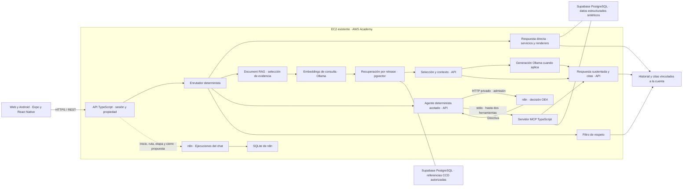

# Auditoría de n8n, RAG, MCP y observabilidad

**21/11/2026.** La auditoría partió de `main` en `6134fb3c042a2d775dd0990052b0a4d5a904099e`. La implementación correlacionada quedó en `d162b94d629dbb06466f7510cca49b4b3e32d816`.

## Continuación del despliegue

Learner Lab mostraba estado Ready y US$14,60 de US$50 usados. Systems Manager listaba la EC2 existente `i-0a726734ca6c6f10d` como Online y running. Se observó la sesión propietaria de n8n abierta antes de la última ejecución administrativa.

| Ejecución de Systems Manager | Resultado observado |
| --- | --- |
| `8eb91417-b314-4386-bd87-1f987307f28b` | Los cinco servicios estaban activos. El preflight detectó que el observador instalado correspondía a una revisión anterior a la base del parche. Se detuvo antes del respaldo y de los cambios. |
| `a3df0ddd-3c67-41e7-a8c2-16b9e91e695a` | Coincidió el SHA-256 del observador con el artefacto previo. Se verificó el respaldo privado `/opt/banuchat/backups/observability-20261121-01` con 20 archivos, manifiesto de hashes, SQLite con `quick_check` y 21 ejecuciones históricas. Se comprobó en SQLite la publicación de la revisión `a4407080-4800-489f-b973-55f8af9b7a07` y la igualdad del workflow combinado OE4. El webhook devolvió 404 inmediatamente después del arranque y el comando confirmó `ROLLBACK_OK`. El cambio de API todavía no se había aplicado. |
| `047499ee-c3ad-4c81-91af-41451ae0d98d` | Respaldo `observability-20261121-02`, 20 archivos y 21 ejecuciones. n8n guardó la revisión `05b6ab45-4d25-42ec-94a8-2639792aa87f` y el webhook se registró tras cinco segundos. El primer evento recibió 200 donde se esperaba 202. Se confirmó `ROLLBACK_OK`, antes de actualizar la API. |
| `1a8a1170-5798-452f-b48e-0cc33b22e16b` | Los cinco servicios estaban activos. SQLite confirmó las revisiones `4e654a8d-8f30-45c9-b654-3c37ac805a56` del colector y `60a7577b-30b1-4d52-87d9-dbaf28642def` de OE4, con sus dos webhooks registrados. |

Al recuperar acceso se comprobó BanuChat por HTTPS y el editor autenticado de n8n. Las pruebas de publicación usan eventos sintéticos de infraestructura para distinguir la confirmación HTTP del resultado de un turno real.

## Inventario observado en AWS

La EC2 existente reportó activos Ollama, API, web, HTTPS y n8n. El editor era n8n 2.40.5 y escuchaba en `127.0.0.1:15679`. BanuChat respondió 200 por HTTPS. Los endpoints públicos de producción y prueba del colector y de OE4 devolvieron 401 en acceso anónimo y 404 con la primera autenticación del editor. La API en ejecución tenía la bandera `BANUCHAT_N8N_CHAT_EXECUTIONS=1`. SQLite ocupaba 2.678.784 bytes y tenía 13 ejecuciones exitosas del colector en el momento del inventario. La configuración global de guardado era `none` para éxito y error, con guardado manual deshabilitado. El colector sobreescribía los dos primeros a `all`. El inventario del servicio carecía de límites de poda explícitos.

| Workflow | ID y revisión publicada observados | Hallazgo |
| --- | --- | --- |
| BanuChat - Ejecuciones del chat | `BanuChatChatExecution1`, `4e654a8d-8f30-45c9-b654-3c37ac805a56` | Activo, webhook conectado a un Set. Su revisión de AWS difiere del `versionId` del JSON de partida. Guardaba el cierre, sin eventos de inicio ni identificador compartido con MCP. |
| BanuChat - Manual ingestion v1 | `BanuChatOe4Conversation1`, `60a7577b-30b1-4d52-87d9-dbaf28642def` | Activo, con la rama de admisión de cinco nodos y la rama manual de ingesta en el mismo workflow. El JSON versionado de OE4 define la rama de admisión. El Webhook de OE4 referencia Header Auth. El inventario mostró ese tipo de credencial también en la comprobación de estado de la ingesta. Los nodos de ejecutar y reconciliar la ingesta carecían de credencial enlazada. Su ejecución quedó fuera de este ensayo. |

La rama de admisión conserva Webhook autenticado → validación → decisión → respuesta correlacionada, con rechazo alterno. Su guardado de éxito, error y manual estaba desactivado. La ausencia de filas en Executions para esa rama concuerda con su configuración. La consulta MCP pública del mismo corte devolvió citas de progreso y convocatorias. Equivalencia histórica de trazas por operación y reinicio con credencial cifrada se acreditó en el corte del 20/11. El identificador del colector anterior no permite atribuir retrospectivamente una fila a esa admisión.

El comando de inventario fue `2fa531db-161f-4fbb-85ce-988eb862e17b`. Registró nombres, revisiones, conexiones, tipos de credencial y totales. Las capturas del editor y de Executions para la versión nueva quedaron pendientes.

## Arquitectura y fronteras

En la composición administrada, las preguntas documentales pasan por RAG directo. Ollama aloja `qwen3-embedding:0.6b` para 1024 dimensiones y `qwen3:4b-instruct` para síntesis cuando corresponde. PostgreSQL busca por distancia coseno y release. Las respuestas factuales también pueden componerse desde evidencia recuperada sin una llamada de generación. Unified local conserva su composición y su corpus separado.

El agente solo invoca herramientas tras admisión y en el contexto autorizado por la API. Usa el rol lector propio en Supabase con transacciones de solo lectura. Fija principal, perfil, release y despliegue desde el servidor. El SDK usa stdio, validación de entradas con los contratos de herramientas y tiempos de conexión y llamada configurables (10 s y 15 s de forma predeterminada). El servidor define `search_knowledge`, `find_documents`, `get_courses`, `get_calendar_events`, `get_announcements` y `get_profile_progress`. El corte público de MCP acredita progreso y convocatorias. Las citas se forman con datos devueltos por las herramientas y la aplicación conserva la procedencia al persistir el turno. [Contrato MCP](../../backend/mcp-server/tools-contract.md) · [SDK TypeScript](https://github.com/modelcontextprotocol/typescript-sdk) · [API de Ollama](https://docs.ollama.com/api/chat).

## Instrumentación preparada

- La API emite `started` al admitir un turno autenticado y autorizado. `operation_id` es opaco y se comparte con OE4 y las trazas del agente. `sequence` ordena el inicio, la ruta seleccionada, las etapas y el cierre incluso si las entregas llegan en orden distinto. Un intento rechazado antes de la admisión queda fuera del colector.
- El cierre registra `answered`, `partial`, `insufficient_evidence`, `error` o `cancelled`. Este último indica que el socket HTTP se cerró antes de entregar la respuesta al proxy o cliente, detectado al completar el trabajo. El backend puede terminar y persistir un turno cuyo cliente se desconectó.
- El remitente usa loopback, 1 KiB por evento, hasta 16 envíos simultáneos y 3 s por llamada. La API sigue aunque el colector rechace o pierda un evento. Los avisos de fallo de entrega son genéricos. El último evento de etapa recibido ayuda a ubicar una espera. Cuando falta el cierre, solo se puede afirmar que aún no se ha observado. Una terminación brusca puede dejar eventos sin pareja.
- El flujo proyecta tiempos UTC y duración monotónica, etapa, ruta, cantidad de citas y códigos técnicos predefinidos. La latencia de embeddings y recuperación se acumula por turno. `generation_ms` mide el tiempo transcurrido hasta validar la respuesta de generación. `ollama_http_ms`, `ollama_calls` y `ollama_timeouts` conservan el registro del transporte de generación, incluidos fallos. Los metadatos excluyen contenido, identificadores de cuenta y credenciales.
- La entrada se restringe a loopback y Caddy bloquea los webhooks internos en el origen público. El colector devuelve 202 para un evento válido, 422 para uno inválido y 500 ante fallo controlado de proyección. Un `error_chat` aceptado puede verse como una ejecución verde de n8n. n8n conserva también los datos del trigger al guardar una ejecución. Por eso el emisor envía exclusivamente el evento permitido y la ruta debe mantenerse privada. El JSON facilita revertir la API al aceptar el esquema anterior.
- La configuración preparada fija siete días y 2.000 filas de ejecución para la poda automática de la instancia, con tope HTTP de 1 MiB para el cuerpo JSON en n8n. SQLite puede reutilizar páginas liberadas. El tamaño del archivo físico puede tardar en reflejar la poda. OE4 sigue sin guardar payloads. [Configuración de ejecuciones](https://docs.n8n.io/hosting/configuration/environment-variables/executions/) · [Webhook en n8n 2.40.5](https://github.com/n8n-io/n8n/blob/n8n%402.40.5/packages/nodes-base/nodes/Webhook/Webhook.node.ts).

## Prueba pública del backend anterior

Ensayo HTTP desde el origen público con una cuenta sintética y una conversación separada por caso. Se midió el tiempo desde el envío hasta recibir la respuesta HTTP. Las coincidencias temáticas fueron criterios semánticos simples y la primera descarga documental autorizada se comprobó en los casos citados. La temperatura de Ollama al inicio era desconocida. La repetición sirve como observación en el mismo ensayo. Un ensayo frío verificado requeriría constatar primero la residencia de modelos.

| Consulta | HTTP | Tiempo | Citas | Observación |
| --- | ---: | ---: | ---: | --- |
| ¿Qué es el Centro de Competencias Digitales? | 201 | 6.800 ms | 8 | Señales de respuesta sobre el centro y competencias digitales. Descarga documental 200. |
| ¿Qué hace el CCD? | 201 | 1.619 ms | 7 | Señales de formación u orientación y ámbito digital. Descarga 200. |
| ¿Para qué sirve el Centro de Competencias Digitales de la UNAB? | 201 | 1.737 ms | 1 | Señales de propósito formativo en competencias digitales. Descarga 200. |
| ¿Qué es la ruta de competencias digitales? | 503 | 151.597 ms | 0 | `DEPENDENCY_UNAVAILABLE`. La etapa que agotó el tiempo quedó por confirmar. |
| ¿Cómo funciona la ruta de competencias digitales? | 201 | 48.019 ms | 3 | Señales de estructura y diagnóstico o cursos. Descarga 200. |
| ¿Qué competencias digitales puedo desarrollar? | 201 | 95.593 ms | 3 | Señales de habilidades digitales concretas. Descarga 200. |
| Pregunta del director, repetida | 201 | 1.921 ms | 8 | Pasó el mismo criterio temático. Descarga 200. |
| Dato técnico sin evidencia del corpus | 201 | 13.196 ms | 0 | Marcó evidencia insuficiente y lenguaje de abstención. |
| Cursos completados y convocatorias | 201 | 5.980 ms | 3 | Citas `profile_course` y `announcement`, con señales de ambos temas. |
| Pregunta abierta de progreso académico | 201 | 74.078 ms | 3 | Citas documentales. |
| Calendario de esta semana | 201 | 1.300 ms | 1 | Cita `calendar_event` y coincidencia completa con Historial. |

El chequeo inicial de igualdad en Historial comparó el JSON serializado. El cotejo posterior por estructura e identidad del mensaje confirmó contenido y citas iguales para calendario, la pregunta del director y MCP. El director respondió en 1.616 ms con ocho citas y mencionó orientación, pilares y diagnóstico. MCP respondió en 3.560 ms con tres citas de dos tipos. Se cerró sesión en ambos ensayos con HTTP 204. Las comprobaciones semánticas fueron dirigidas a cada caso, sin evaluación ciega. El 503 real antecede a la actualización del colector y su causa exacta quedó abierta.

## Validación local

- API y MCP pasaron `npm run typecheck`.
- API pasó 229 pruebas focales de telemetría, chat, historial, contratos HTTP, clasificación documental, recuperación, citas, Ollama y adaptador administrado. La prueba de loopback requirió salir de la restricción de red del entorno. La validación de expresiones y conexiones del JSON se hizo en pruebas de repositorio. La ejecución del colector actualizado con el motor de n8n en AWS sigue pendiente.
- MCP pasó las 17 pruebas de runtime administrado, con destinos restringidos, asociación y permisos de contexto, y arranque seguro ante configuración incompleta.
- `git diff --check` pasó. Se excluyeron los archivos de operación privada y la edición previa de `panel-editorial.md`.

## Referencias del profesor

Se inspeccionaron los dos JSON encontrados en Descargas, con los nombres equivalentes sin sufijo `(1)`. El workflow conversacional contiene 24 nodos y el de embeddings 12. La comparación se hizo leyendo tipos de nodo y conexiones. El editor de AWS conservó sus workflows existentes.

| Referencia | Patrones aprovechables | Aplicación en BanuChat |
| --- | --- | --- |
| Chatbot RAG con Memoria y Guardrail | Entrada visible, decisiones, validación, manejo de resultados y notas por etapa | El colector explica visualmente estas etapas. La API conserva autorización, historial y RAG. OE4 decide admisión y la API ejecuta MCP. La identidad sale de la sesión, las consultas SQL usan parámetros y la evidencia académica proviene de la release autorizada. |
| Embedding documento RAG | Separar disparador, adquisición, preparación, embeddings y persistencia | La ingesta versionada delega validación y preparación a TypeScript. BanuChat conserva Ollama de 1024 dimensiones, publicación atómica y separación de releases. Drive, el endpoint MCP externo, las credenciales del profesor y su modelo de 1536 dimensiones quedaron fuera de la integración. |

## Publicación y reversión

Antes de cambiar la EC2, confirmar el ID y revisión activa de ambos workflows, el vínculo efectivo de Header Auth de OE4, la configuración de Caddy y los hashes de las fuentes API. Preparar un respaldo privado de SQLite mediante su API de backup con `PRAGMA quick_check`, del archivo de cifrado y datos n8n, de los workflows con revisión publicada, de la configuración systemd y de las fuentes que cambiarán. Mantener las revisiones del workflow combinado de OE4. Usar el mismo proyecto de n8n y el ID existente del colector.

Importar el colector en una ventana controlada y verificar conexiones y parámetros guardados antes de publicar. Después de publicar, comprobar revisión activa, Caddy, valores efectivos de poda y un evento interno sintético de inicio, otro de error y uno inválido. Etiquetar estos ensayos como validación del colector. Actualizar luego la API y ejecutar la secuencia web de la guía, con una pregunta nueva y el mismo UUID en el colector, OE4 y journal. Contar también un fast path. Para evidencia del fallo de aplicación, reproducir una falla de dependencia en una composición temporal aislada o conservar un fallo natural verificado del chat. Mantener separados un 422 provocado en el webhook y un error de aplicación. Revisar un detalle del trigger y del resumen antes de capturar, con el operador fuera de pantalla.

Si el colector o la nueva API fallan, recuperar primero las fuentes API del respaldo validado y reiniciar la unidad API. Replicar la revisión anterior del colector desde su historial o export sobre el mismo ID y retirar el cambio de retención si participa en el fallo. Comprobar salud, bloqueo público y publicación OE4. Reservar la restauración de SQLite para cuando la reversión puntual resulte insuficiente. La restauración con n8n detenido reemplaza el estado posterior al snapshot. Ningún paso requiere recrear servicios, cambiar el corpus ni modificar contratos.

La [guía de sustentación](../operations/GUIA-PRESENTACION-BANUCHAT.md) contiene la secuencia y el criterio para distinguir la versión actualmente observada de la versión preparada.
