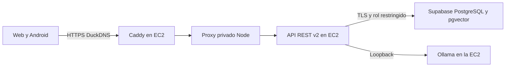

# BanuChat — guía de demostración 1.0.1

## Acceso

[Abrir BanuChat](https://banuchat.duckdns.org/login).

La versión Android usa el paquete `com.anonymous.banuchat`, versión 1.0.1 y código 2, con el mismo certificado de firma que la 1.0.0.

El acceso utiliza cuentas ficticias de BanuChat. El profesor recibe las contraseñas por canal privado. Las cuentas `U90000001` y `U90000002` tienen expedientes diferentes. La primera permite mostrar recursamiento. `U90000032` permite mostrar un estudiante sin intentos.

## Recorrido de cinco minutos

1. Iniciar sesión y abrir Progreso. Mostrar el identificador académico y los intentos del mismo curso, con sus períodos y resultados ficticios.
2. Abrir una conversación. Preguntar «¿Qué indica el documento de evaluación formativa sobre la entrega de evidencias?». La generación puede tardar más de dos minutos. La espera del cliente es de 175 s.
3. Expandir las cinco fuentes y abrir un documento. La descarga requiere la sesión del usuario.
4. Ir a Historial y reabrir el turno. La respuesta y las citas permanecen guardadas en Supabase.
5. Cerrar sesión y entrar con la segunda cuenta. Su expediente e historial corresponden a esa identidad.

Ante un timeout o error 502, 503 o 504, la aplicación conserva la pregunta y ofrece Comprobar estado. Usar esa acción antes de decidir un reenvío. Durante la presentación se puede reabrir una conversación real ya persistida y mostrar sus fuentes.

## Arquitectura publicada



El PC se utiliza para desarrollo y pruebas. AWS aloja la API, el proxy, la web y los modelos. Supabase conserva las cuentas BanuChat, los expedientes sintéticos, las conversaciones, los vectores y las citas. El cliente consume REST v2. La autenticación de BanuChat conserva sus contratos existentes.

## Relación con los objetivos académicos

La siguiente relación usa la interpretación técnica provisional de OE1–OE6 registrada en `docs/arquitectura.md`. La alineación formal con el anteproyecto y las decisiones del director requiere su revisión.

| Objetivo | Evidencia que puede mostrarse | Alcance pendiente |
| --- | --- | --- |
| OE1, recuperación documental | Respuesta generada con cinco fuentes, artefactos protegidos y citas recuperadas desde Historial | Esta entrega no vuelve a medir todas las métricas de calidad del banco académico |
| OE2, ingesta y publicación | Dos releases y vectores persistentes procedentes del laboratorio sintético, documentados en los checkpoints de migración | Esta presentación no ejecuta una nueva ingesta ni mide el objetivo temporal de publicación |
| OE3, herramientas MCP | Contratos e implementación descritos en `docs/transition/banuchat-oe3-checkpoint.md` | El recorrido documental publicado no acredita por sí solo selección de herramientas por un agente |
| OE4, n8n y calendario | Implementación y fixtures descritos en `docs/transition/banuchat-oe4-checkpoint.md` | El recorrido publicado no acredita una ejecución nueva de n8n ni integración real con Google Sheets |
| OE5, experiencia de uso | Recorridos web y Android, dos identidades y revisión de historial | SUS y tasas de completación requieren participantes y evaluación específica |
| OE6, operación y estabilidad | Servicios systemd, HTTPS, aislamiento y demostración sin procesos locales | AWS Academy detiene la EC2 al finalizar la sesión y la inferencia supera el criterio histórico de 5 s |

## Disponibilidad y recuperación

La IP elástica y DuckDNS conservan la dirección entre sesiones mientras permanezcan asignados. La aplicación requiere una sesión activa del Learner Lab. El crédito mostrado puede demorarse entre 8 y 12 horas en reflejar consumos.

Para recuperar la demostración, iniciar Learner Lab y abrir Session Manager en la instancia existente `i-0a726734ca6c6f10d`. Comprobar los servicios con

```sh
systemctl is-active ollama banuchat-api banuchat-web-duckdns banuchat-https
systemctl is-enabled banuchat-web-duckdns
journalctl -u banuchat-ollama-warmup -b --no-pager
bash /opt/banuchat/infra/scripts/ollama-demo-warmup.sh --check
```

Si los modelos ya salieron de memoria, ejecutar la precarga existente mediante `sudo systemctl start banuchat-ollama-warmup`. La precarga ayuda al arranque, pero las consultas nuevas pueden requerir una evaluación costosa del prompt en las dos vCPU disponibles.

Los resultados finales, los enlaces de distribución y la evidencia de esta versión se registran en [el checkpoint de publicación](CHECKPOINT-PUBLICACION-BANUCHAT.md).
