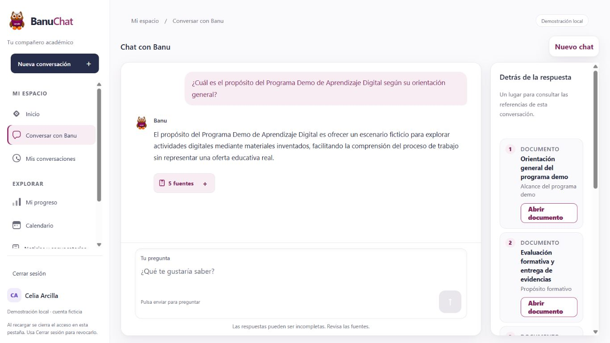
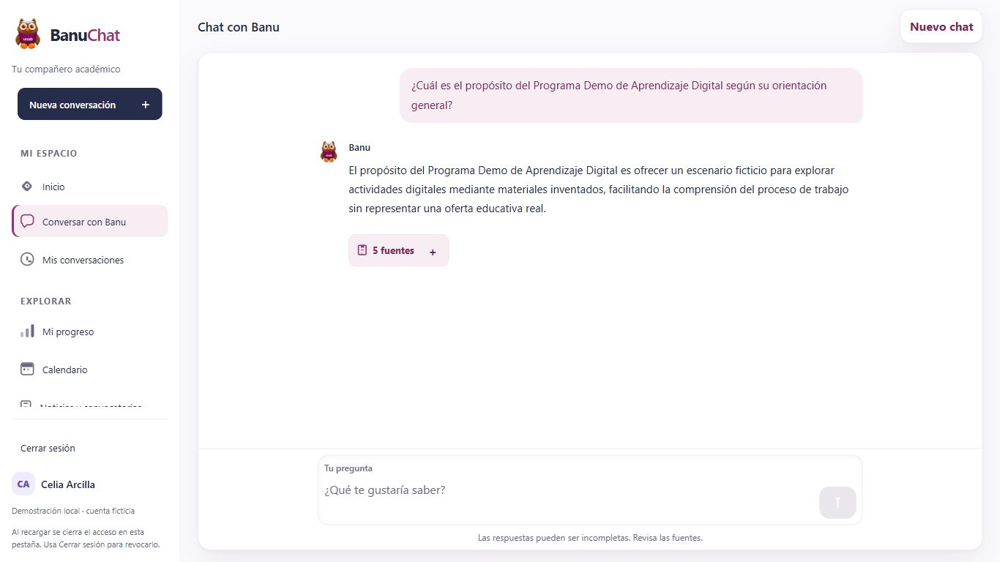
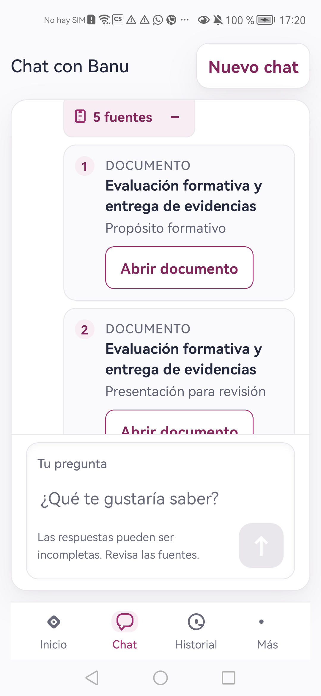
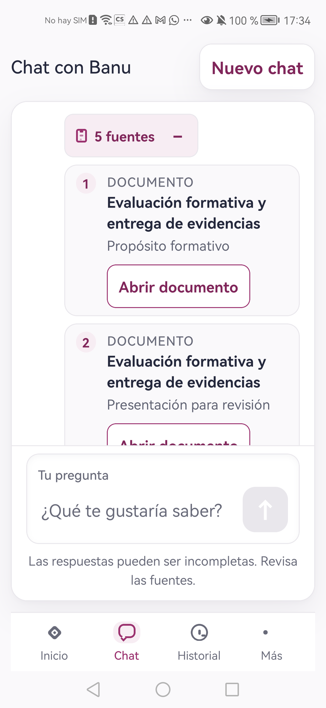

# BanuChat — entrega académica de demostración 1.0.3

Actualización del 18/11/2026: identidades y expedientes siguen siendo sintéticos. Las consultas documentales generales usan ahora 107 derivados CCD depurados, en un esquema privado separado y autorizados por el dueño del proyecto. Ese permiso no equivale a aval institucional ni garantiza vigencia o aplicación individual. La consulta explícita del material ficticio mantiene el corpus sintético.

El detalle reproducible, inventario, pruebas nuevas, archivos privados y reversión está en [el checkpoint consolidado](CHECKPOINT-PUBLICACION-BANUCHAT.md). Las mediciones y capturas 1.0.2 de las secciones siguientes conservan su fecha; no se presentan como pruebas nuevas.

## Acceso e instalación

- [Web HTTPS](https://banuchat.duckdns.org/login).
- [APK ARM64 1.0.3](https://github.com/XeyKG/BanuChat_/releases/download/demo-1.0.3/BanuChat-demo-1.0.3-arm64.apk) · [Release](https://github.com/XeyKG/BanuChat_/releases/tag/demo-1.0.3).
- [Paquete académico 1.0.3](https://github.com/XeyKG/BanuChat_/releases/download/demo-1.0.3/BanuChat-entrega-academica-1.0.3.zip): guía, checkpoint, APK y capturas sintéticas. GitHub exige acceso al repositorio privado; compartirlo por un canal autorizado. La entrega 1.0.2 se conserva como respaldo.

APK de 47.060.204 bytes, paquete `com.anonymous.banuchat`, versionCode 4. Actualiza las versiones anteriores conservando su firma local de debug. No desinstalar para actualizar. [La versión 1.0.1](https://github.com/XeyKG/BanuChat_/releases/tag/demo-1.0.1) se conserva; Android puede impedir instalar un versionCode menor sobre el nuevo. No se ensayó downgrade nativo.

SHA-256 del APK:

```text
48dcdb79660b06e4909e80863c7948442223bacb2cf919af83329975410b27f9
```

Cuentas ficticias: `U90000001` y `U90000002`, con expedientes distintos; la primera permite mostrar recursamiento. `U90000032` representa un estudiante sin intentos. Las contraseñas se entregan por canal privado y no están en este paquete. La sesión web vive en la pestaña: al recargar se requiere otro login.

## Cambios actuales del chat

Las respuestas van directamente al contenido; la procedencia queda en las fuentes. El historial original no se reescribe. Tras preguntar por el progreso propio aparece «Ver mi progreso», que abre la pantalla autenticada y permite regresar al mismo chat. Bienvenida breve y sugerencias adaptadas a web y Android. En web, recargar e iniciar sesión de nuevo carga el cliente actualizado.

Web pública y Huawei físico comprobados; 74 pruebas Mobile y 28 backend focales, typechecks correctos. Nueve consultas documentales remotas adicionales respondieron en 1,75–1,97 s, con citas/hashes, historial e aislamiento verificados. Son consultas con extracción documental; no una garantía de tiempo para generación libre ni de estabilidad RAG.

## Guion de sustentación y contingencia

1. Presentar el alcance: cuentas y expedientes ficticios; referencias CCD seleccionadas en un corpus separado, sin identidad académica institucional ni decisiones administrativas.
2. Pulsar Iniciar sesión con campos vacíos: aparece la advertencia. Entrar con una cuenta asignada y abrir Mi progreso; mostrar períodos e intentos del curso, incluido recursamiento.
3. Abrir Chat. Preguntar «¿Qué indica el documento de evaluación formativa sobre la entrega de evidencias?». La inferencia puede superar dos minutos o fallar. No prometer una respuesta inmediata.
4. Expandir las cinco fuentes, desplazarse hasta la última y abrir un documento completo. El visor indica «Material ficticio de demostración». Contraer desde el final permite volver a la respuesta sin recorrer toda la lista.
5. Reabrir el turno desde Historial. Si la consulta nueva falla, usar una respuesta real ya persistida, identificándola como histórica. Ante envío incierto, usar Comprobar estado antes de decidir reenviar; no presentar una respuesta guardada como generación nueva.
6. Cerrar sesión, entrar con la segunda cuenta y mostrar su expediente e historial propios. Las pruebas de aislamiento y revocación están en el checkpoint; esta comparación visual no sustituye esos controles.

## Arquitectura que se demuestra

`Web / Android → HTTPS DuckDNS / Caddy → proxy Node → API REST v2 en AWS EC2 → Supabase PostgreSQL + pgvector / Ollama en EC2`

La EC2 existente tiene dos vCPU y 8 GiB. Los modelos se conservan: `qwen3:4b-instruct` y `qwen3-embedding:0.6b`, vectores de 1024 dimensiones. No se sustituyó autenticación ni se añadieron servicios en 1.0.2. El PC sirve para desarrollar y probar; los procesos públicos y los modelos están en AWS y la persistencia en Supabase. MCP y n8n tienen evidencia local separada: este recorrido público no acredita su participación en todas las consultas.

El inventario sintético migrado documentado contiene dos releases, 32 estudiantes, 62 intentos y 120 vectores. No se repitió ese inventario SQL en esta actualización visual. Las citas recuperadas y el documento abierto sí se comprobaron de nuevo desde ambos clientes.

## Evidencia de esta actualización

| Comprobación ejecutada | Resultado observado |
| --- | --- |
| HTTPS externo Windows, DuckDNS y origen de transición | HTTP 200, validación TLS correcta, cero redirecciones en `/login` |
| Login web | Botón activo vacío; advertencias por campos ausentes/formato; credenciales incorrectas rechazadas; login correcto |
| Web 1366 × 768 | Área de mensajes aproximada de 403 a 541 px de alto (+34 %); pane de 807 a 1071 px de ancho (+33 %). Se retiró el panel duplicado de fuentes, permanecen las cinco citas en la respuesta |
| Web 390 × 844 | Sin desbordamiento horizontal; cinco fuentes recorridas y contraídas desde el final; envío accesible |
| Huawei YAL-L21 físico | Actualización `adb install -r` exitosa, misma sesión conservada; Historial remoto, cinco fuentes, documento completo y rótulo sintético |
| Texto Android ampliado al 150 % | Se recorrió hasta la quinta fuente y se contrajo desde abajo; escala original 1,15 restaurada |
| Compositor Android | Campo y enviar visibles con teclado; envío al lado del campo, sin duplicar instrucciones |
| Login Android 1.0.2 | Botón activo vacío, advertencia; logout y nuevo login correcto de Bruno |
| Independencia del desarrollo local | Sin listeners en 3000, 8081, 8082, 8085 y 8086 durante la comprobación Android; bundle dirigido a DuckDNS |
| Regresiones | Typecheck correcto, 70/70 pruebas Mobile y 1/1 del proxy web; `git diff --check` correcto |
| APK | Firma idéntica a 1.0.1; inspección dirigida sin credenciales/keystores/secretos de fixtures y URL canónica presente |

No se ejecutó una nueva evaluación de accesibilidad con lector de pantalla ni un estudio de usuarios. Las comprobaciones de tamaño, texto ampliado y navegación no equivalen a certificar accesibilidad integral.

Antes y después web, sobre la misma conversación:





Antes y después Android, sobre el mismo turno documental:





[Texto al 150 %](evidence/release-1.0.2/android-large-text.png), [visor sintético Android](evidence/release-1.0.2/android-document.png), [visor web](evidence/release-1.0.2/web-document.jpg), [advertencia login Android](evidence/release-1.0.2/android-login-validation.png), [error login web](evidence/release-1.0.2/web-login-error.jpg) y [web estrecha](evidence/release-1.0.2/web-chat-narrow.jpg). Son capturas del producto ejecutado, no diseños simulados.

## Objetivos originales: evidencia y brechas

Se contrastó la guía anterior con la transcripción versionada del anteproyecto, pp. 7–8 y 20–21, y la [matriz académica vigente](../academic/oe1-oe6-current-status.md). No se releyó el PDF completo ni se alteraron sus compromisos en este cierre. Esta tabla sustituye la interpretación técnica provisional de la guía 1.0.1 para la sustentación.

| Objetivo y criterio original | Evidencia defendible | Incumplido, no evaluado o pendiente |
| --- | --- | --- |
| OE1: RAG PostgreSQL/pgvector sobre documentos CCD oficiales/verificados; banco de 50–80 preguntas y métricas de calidad | Recuperación, citas versionadas e historial demostrados; evaluación CCD local histórica separada | La nube separa expedientes ficticios y 107 referencias CCD depuradas. Nueve consultas remotas acreditadas en este cierre; banco histórico de 43, inferior a 50; no hay nueva evaluación RAGAS ni aceptación institucional |
| OE2: ≥3 flujos de scraping automáticos, actualización <24 h y extracción >90 % del universo institucional | Scheduler, snapshots y publicación sobre fixtures acreditados en pruebas locales anteriores | No scraping institucional autorizado ni denominador/reloj institucional; los fixtures no acreditan frescura o exactitud institucional |
| OE3: agente LLM ReAct multietapa con MCP | MCP y agente adaptativo determinista tienen evidencia local; política LLM experimental parcial | El recorrido público RAG no prueba ReAct productivo ni aceptación del objetivo completo |
| OE4: BPM/n8n, flujos completos e integración Sheets/calendario ≤30 min | Orquestación local acotada y fixtures comprobados anteriormente | No se acredita sincronización real Google Sheets ni totalidad de flujos institucionales en AWS |
| OE5: React Native, ≥10 estudiantes reales, cinco tareas >85 %, SUS medio >70 y ningún individuo <50 | Recorrido técnico en web y Huawei, sesión, expediente, fuentes y texto ampliado | Estudio con usuarios reales no ejecutado; no hay SUS ni tasa de completación; no confundir pruebas del desarrollador con validación humana |
| OE6: Docker on-prem UNAB, ninguna interrupción no planificada >5 min, media de consultas ≤5 s, 100 % de metas | Despliegue AWS + Supabase, HTTPS y recuperación de servicios con evidencia | AWS Academy sustituye técnicamente el receptor, sin aceptación académica acreditada. No acredita on-prem UNAB, SLA ni metas completas; las latencias RAG incumplen referencia de 5 s |

La [evaluación OE1 del 29/10](../../eval/rag-quality/results/oe1-cierre02-technical-report.md) registró 43 intentos, 39 respuestas y cuatro abstenciones. Sobre esas 39 respuestas: faithfulness **0,952991** frente a ≥0,80; context precision **0,709402** frente a ≥0,80; context recall **0,713675** frente a ≥0,75; answer relevancy **0,618210** frente a ≥0,80. MRR@5 **0,813953** frente a ≥0,70 (k original por ratificar). Tres medias RAGAS incumplen sus metas. Son mediciones históricas del corpus CCD local, anteriores a mejoras posteriores, con juez exploratorio que comparte modelo del generador; no describen la calidad actual de la demo sintética ni prueban independencia de evaluación.

No se declara ningún objetivo íntegramente aprobado por director, CCD o UNAB. Los nombres y expedientes de la cohorte de demostración son ficticios. Las referencias documentales CCD agregadas se identifican separadamente como no sintéticas y no autorizan decisiones individuales ni representan aprobación institucional.

## Rendimiento, disponibilidad y recuperación

**RAG no se declara estable.** La evidencia 1.0.1 conserva respuestas REST satisfactorias de 145,87 s y 117,41 s, una generación Android de 136,22 s con cinco fuentes y una consulta diferente fallida al límite de 150 s. La EC2 tiene dos vCPU; se observó CPU cercana al 100 %. La 1.0.2 cambia presentación, no modelos, parámetros ni presupuestos: API 150 s, cliente HTTPS 175 s, proxy 180 s. No se repitieron consultas costosas que este cambio no afecta.

La disponibilidad depende de internet, Supabase y de que AWS Academy mantenga la EC2 encendida. No es hosting permanente ni gratuito ilimitado. Último crédito acreditado en el checkpoint 1.0.1: US$7,60 consumidos de US$50, con retraso del tablero; no es una lectura nueva del saldo en este cierre. No se contrataron recursos adicionales.

Para recuperar: iniciar Learner Lab, comprobar/encender la **instancia existente** `i-0a726734ca6c6f10d`, entrar por Session Manager y consultar:

```sh
systemctl is-active ollama banuchat-api banuchat-web-duckdns banuchat-https
systemctl is-enabled banuchat-web-duckdns
journalctl -u banuchat-ollama-warmup -b --no-pager
bash /opt/banuchat/infra/scripts/ollama-demo-warmup.sh --check
```

Si requiere precarga: `sudo systemctl start banuchat-ollama-warmup`. Comprobar después `https://banuchat.duckdns.org/login`. La IP elástica y DuckDNS conservan la dirección mientras sigan asignados. No reconstruir instancia/base ni restaurar datos por una parada del laboratorio. La recuperación tras finalizar Academy fue ensayada en 1.0.1; no se volvió a detener la instancia en este cierre visual.

El [checkpoint consolidado](CHECKPOINT-PUBLICACION-BANUCHAT.md) conserva pruebas anteriores de aislamiento, revocación, expediente y RAG, así como las rutas de reversión web. Los archivos del paquete excluyen credenciales, keystores y corpus CCD.
