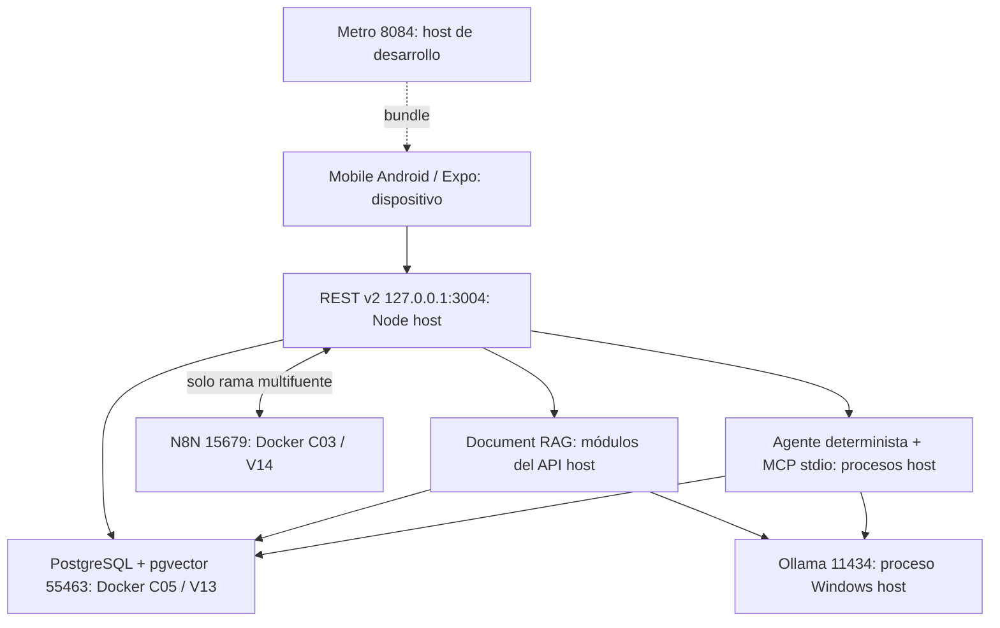

# BanuChat — INFRA-D0: Docker inventory & rationalization review

28 de octubre de 2026. Propuesta técnica, sin autorización de retirada.

**INFRA-D0 COMPLETE WITH UNKNOWN RESOURCES — NO RESOURCES REMOVED**

## A. Estado actual y método

HEAD inicial/final esperado para esta revisión: `1e8f417c3f1d93539f13e42e5e1b03d8b6f919fa`, branch
`main`. Status completo incluyendo untracked vacío al comenzar.
AGENTS.md leído completo. Sin commit/push ni operaciones Git destructivas.

Inventario del contexto local `desktop-linux`, motor Docker 29.7.2,
captura UTC `2026-10-28T20:26:08.532930+00:00`: **18 contenedores, 18 volúmenes, 12 redes y
4 imágenes**. Los 18 contenedores solicitados están presentes; no apareció otro
contenedor. **0 running**: 17 exited/exit 0 y uno created/exit 128 (C04).

Todo Docker fue READ ONLY: listado completo ps -a, inspect de contenedores con
tamaños, volume/network/image inspect/list, system df y compose ls --all. Se
filtró JSON en memoria: sin Env completo, contraseñas, tokens, claves, Cmd o logs
de health. Solo se conservaron nombres de variables, POSTGRES_DB explícitamente
no sensible y puertos numéricos/loopback. Etiquetas con paths se normalizaron al
repositorio; las sensibles se redactan. No se arrancó, detuvo, reinició, creó,
recreó, montó o eliminó ningún recurso. No exec, SQL, health requests, dumps,
restores, descargas ni lecturas de bases/volúmenes.

Se guardó evidencia saneada fuera del repositorio: inventarios before/after,
clasificación, tamaños, metadata de respaldos, procedencia, listeners del host,
comparación final y manifiesto. No se copió ninguna base, clave o configuración
privada completa. El único archivo del repositorio añadido es este informe.

## B. Container, image, volume y Compose project

- **Container**: instancia con ID, estado y writable layer; borrar su nombre no
  equivale a borrar ni a respaldar sus volúmenes.
- **Image**: capas/plantilla referenciada por varios contenedores. Igual imagen
  no implica igualdad de bases, releases, claves o finalidad.
- **Volume**: persistencia independiente; Docker lo identifica por Name. Un
  volumen sin consumidor o pequeño no demuestra que esté vacío o sea descartable.
- **Network**: red/namespace y referencias; un contenedor parado puede conservar
  configuración aunque network inspect no tenga endpoints activos.
- **Compose project**: agrupación por etiquetas; **service** es la definición YAML;
  **container real** es la instancia. El project no es un contenedor adicional.

| Compose project | Servicio → contenedor real | Archivo de configuración |
| --- | --- | --- |
| banuchat-ccd-dev | `postgres-ccd` → C16 `banuchat-ccd-dev-postgres-ccd-1` | `repo:infra/docker-compose.ccd.yml` |
| banuchat-dev | `postgres-ccd-auth` → C10 `banuchat-dev-postgres-ccd-auth-1` | `repo:infra/docker-compose.dev.yml` |
| banuchat-oe6-local | `ollama` → C06 `banuchat-oe6-local-ollama-1`; `api` → C07 `banuchat-oe6-local-api-1`; `postgres-synthetic` → C08 `banuchat-oe6-local-postgres-synthetic-1`; `n8n` → C09 `banuchat-oe6-local-n8n-1` | `repo:infra/docker-compose.oe6.yml` |
| banuchat-schema-test | `n8n` → C17 `banuchat-n8n`; `postgres` → C18 `banuchat-postgres` | `repo:infra/docker-compose.yml` |

Los diez contenedores restantes son manuales, sin project/service Compose en sus
etiquetas; incluyen Unified, P0/P1 y los cinco laboratorios auth. No hay un project
Compose Unified acreditado por los recursos actuales. `banuchat` y `banuchatv2`
aparecen solo como etiquetas de cuatro volúmenes huérfanos, no como contenedores
o proyectos con instancias actuales. Las tres redes bridge/host/none son del
motor, no nuevas aplicaciones BanuChat.

## C. Inventario completo observado

Los prefijos Docker de 12 caracteres de la tabla son únicos en esta captura;
los IDs completos de contenedores/redes se conservan abajo. C/V/N/I son únicamente
referencias internas de este informe.

### C.1 Contenedores

| ID local | Contenedor real | ID Docker (prefijo único) | Imagen | Created UTC |
| --- | --- | --- | --- | --- |
| C01 | `banuchat-p1-product-staging` | `b920befbb0f7` | I04 | 2026-10-26T21:40:37Z |
| C02 | `banuchat-p0-operational-pilot` | `d083ecc9a2a8` | I04 | 2026-10-26T08:00:17Z |
| C03 | `banuchat-unified-n8n` | `44ad546b86e5` | I03 | 2026-10-25T18:27:49Z |
| C04 | `banuchat-unified-n8n-port-conflict` | `dd2fd2142908` | I03 | 2026-10-25T18:27:29Z |
| C05 | `banuchat-unified-postgres` | `874662fc76ea` | I04 | 2026-10-25T18:22:55Z |
| C06 | `banuchat-oe6-local-ollama-1` | `d01b0dd3a93f` | I02 | 2026-10-25T13:23:02Z |
| C07 | `banuchat-oe6-local-api-1` | `6a7defe79c9e` | I01 | 2026-10-25T12:53:20Z |
| C08 | `banuchat-oe6-local-postgres-synthetic-1` | `e3eb5edb4980` | I04 | 2026-10-25T12:53:20Z |
| C09 | `banuchat-oe6-local-n8n-1` | `5b7d715a612e` | I03 | 2026-10-25T12:53:20Z |
| C10 | `banuchat-dev-postgres-ccd-auth-1` | `a8aeeb2c44e7` | I04 | 2026-10-24T07:01:01Z |
| C11 | `banuchat-auth-i1b-uid-test` | `a43254674c37` | I04 | 2026-10-23T15:14:05Z |
| C12 | `banuchat-ccd-auth-i1b-test` | `ab46191b3e79` | I04 | 2026-10-23T15:12:29Z |
| C13 | `banuchat-auth-i1a-test` | `9ad9605680e1` | I04 | 2026-10-23T14:18:37Z |
| C14 | `banuchat-auth-r0-replay` | `2ce0225e189e` | I04 | 2026-10-23T13:20:50Z |
| C15 | `banuchat-auth-p4l1-demo` | `d1589cf81081` | I04 | 2026-10-23T06:59:08Z |
| C16 | `banuchat-ccd-dev-postgres-ccd-1` | `3492ad8d2a3c` | I04 | 2026-10-21T22:53:40Z |
| C17 | `banuchat-n8n` | `9511c8128cf5` | I03 | 2026-10-02T12:11:30Z |
| C18 | `banuchat-postgres` | `a2903193f220` | I04 | 2026-09-25T17:40:59Z |

Todos tienen Running=false. C04 está created, exit 128, sin arranque efectivo y
con error de binding de puerto; el resto exited, exit 0. Restart policy:
**unless-stopped en C06/C07/C08/C09/C10; no en los otros 13**. Health almacenado:
unhealthy/failing_streak=0 en esos mismos cinco; los otros no tienen health state.
Es estado retenido de contenedores detenidos, no una prueba de salud actual.

**Ningún puerto Docker está actualmente publicado:** NetworkSettings.Ports está
vacío en los 18. Los bindings siguientes son configuración para un futuro inicio,
no listeners activos. Todos los bindings explícitos son 127.0.0.1.

| Contenedor | Binding configurado, NO activo | Volumen / destino | Red registrada | Etiquetas de alcance |
| --- | --- | --- | --- | --- |
| C01 | 127.0.0.1:55483→5432/tcp | V10 → /var/lib/postgresql/data | N08 | banuchat.scope=p1-product-staging |
| C02 | 127.0.0.1:55473→5432/tcp | V01 → /var/lib/postgresql/data | N10 | banuchat.scope=p0-isolated-no-publication |
| C03 | 127.0.0.1:15679→5678/tcp | V14 → /home/node/.n8n | N10 | banuchat.scope=unified-isolated |
| C04 | 127.0.0.1:5679→5678/tcp | V14 → /home/node/.n8n | sin endpoint registrado | banuchat.scope=unified-isolated |
| C05 | 127.0.0.1:55463→5432/tcp | V13 → /var/lib/postgresql/data | N10 | banuchat.scope=unified-isolated |
| C06 | sin PortBindings | V08 → /root/.ollama | N11 | Compose/imagen; ver proyecto/servicio |
| C07 | sin PortBindings | sin volumen | N11 | Compose/imagen; ver proyecto/servicio |
| C08 | sin PortBindings | V12 → /var/lib/postgresql/data | N11 | Compose/imagen; ver proyecto/servicio |
| C09 | sin PortBindings | V11 → /home/node/.n8n | N11 | Compose/imagen; ver proyecto/servicio |
| C10 | 127.0.0.1:55453→5432/tcp | V09 → /var/lib/postgresql/data | N07 | com.banuchat.environment=development; com.banuchat.identity=synthetic; com.banuchat.knowledge=ccd-selected-local; com.banuchat.role=ccd-auth-database |
| C11 | 127.0.0.1:55444→5432/tcp | V03 → /var/lib/postgresql/data | N02 | banuchat.task=BCH05-CCD-AUTH-I1B |
| C12 | 127.0.0.1:55443→5432/tcp | V06 → /var/lib/postgresql/data | N05 | banuchat.task=BCH05-CCD-AUTH-I1B |
| C13 | 127.0.0.1:55442→5432/tcp | V02 → /var/lib/postgresql/data | N01 | banuchat.task=BCH05-CCD-AUTH-I1A |
| C14 | 127.0.0.1:55441→5432/tcp | V05 → /var/lib/postgresql/data | N04 | banuchat.task=BCH05-CCD-AUTH-R0 |
| C15 | 127.0.0.1:55440→5432/tcp | V04 → /var/lib/postgresql/data | N03 | banuchat.task=BCH04-AUTH-P4-L1 |
| C16 | 127.0.0.1:55433→5432/tcp | V07 → /var/lib/postgresql/data | N06 | Compose/imagen; ver proyecto/servicio |
| C17 | 127.0.0.1:5678→5678/tcp | V11 → /home/node/.n8n | N09 | Compose/imagen; ver proyecto/servicio |
| C18 | 127.0.0.1:5432→5432/tcp | V12 → /var/lib/postgresql/data | N09 | Compose/imagen; ver proyecto/servicio |

Todos los mounts persistentes son volumes RW, sin bind mounts observados. Los
entornos OE6 C06–C09 usan network_mode=host; ausencia de PortBindings no significa
ausencia de un puerto si se ejecutaran. C04 tiene HostConfig bridge pero todavía
ningún endpoint registrado. Etiquetas Compose completas, hashes/config paths y
etiquetas OCI/DHI heredadas están en el inventario saneado; no se confunden con
una indicación de propiedad ni con versiones del producto.

### C.2 Imágenes

| Imagen | Referencia/ID real | Created UTC | inspect.Size B | system df | Contenedores | Propuesta |
| --- | --- | --- | --- | --- | --- | --- |
| I01 | `banuchat/backend:oe6-local`; `sha256:1b65b080f2979548895051f0be1940d66ca4f89542511993886c61cd42fc236c` | 2026-10-25T12:45:14Z | 156051405 | 697MB | C07 | HISTORICAL_PRESERVE_FOR_NOW |
| I02 | `ollama/ollama@sha256:2a6e883b917fc543389599dae79918f5cac9e1438890506982f44aa4f5625d01`; `sha256:2a6e883b917fc543389599dae79918f5cac9e1438890506982f44aa4f5625d01` | 2026-09-29T01:43:16Z | 3750498170 | 9.28GB | C06 | HISTORICAL_PRESERVE_FOR_NOW |
| I03 | `n8nio/n8n:2.40.5`; `sha256:9f693fd5565539efd5e75ad168526c8041a6af516d9e50bc4d9cb1c9c5031523` | 2026-09-21T13:51:03Z | 266901058 | 1.73GB | C03, C04, C09, C17 | CURRENT_OPTIONAL |
| I04 | `pgvector/pgvector:pg16`; `sha256:ccc6e83d6e35e931dc7c5def2022729d5a6c370318d099181995567ff1fb4d6b` | 2026-08-13T21:25:50Z | 156193044 | 621MB | C01, C02, C05, C08, C10, C11, C12, C13, C14, C15, C16, C18 | CURRENT_REQUIRED |

Las cuatro imágenes tienen consumidores, aunque todos estén parados; el Active=4
de system df no significa cuatro servicios ejecutándose. No hay una imagen local
sin referencia que pueda proponerse retirar por ese criterio. Todas son linux/amd64.
La imagen backend tiene etiquetas project=banuchat-oe6-local/service=api; N8N tiene
OCI version=2.40.5 y etiquetas DHI de su base. La etiqueta Ubuntu 24.04 de Ollama
no acredita por sí sola la versión de Ollama.

system df devuelve **12,32 GB en imágenes**, **191,1 MB en writable layers de
contenedores**, **4,063 GB en volúmenes** y **1,019 GB/33 entradas de build cache**.
Su reclaimable de volúmenes es 132 MB, correspondiente a los cuatro sin consumidor,
que aquí son UNKNOWN. No es una autorización de limpieza. Las cifras inspect.Size
y df difieren; se registran como mediciones distintas, sin sumarlas ni prometer
espacio liberable. No se atribuyó cada entrada de build cache a BanuChat ni se
propone retirarla.

### C.3 Redes

| Red | Nombre | Driver / ámbito | Proyecto o etiqueta | Consumidores registrados | Propuesta |
| --- | --- | --- | --- | --- | --- |
| N01 | `banuchat-auth-i1a-test-isolated` | bridge / local | banuchat.task=BCH05-CCD-AUTH-I1A | C13 | HISTORICAL_REPRODUCIBLE |
| N02 | `banuchat-auth-i1b-uid-test-isolated` | bridge / local | banuchat.task=BCH05-CCD-AUTH-I1B | C11 | HISTORICAL_REPRODUCIBLE |
| N03 | `banuchat-auth-p4l1-demo-isolated` | bridge / local | banuchat.task=BCH04-AUTH-P4-L1 | C15 | HISTORICAL_REPRODUCIBLE |
| N04 | `banuchat-auth-r0-replay-isolated` | bridge / local | banuchat.task=BCH05-CCD-AUTH-R0 | C14 | HISTORICAL_REPRODUCIBLE |
| N05 | `banuchat-ccd-auth-i1b-test-isolated` | bridge / local | banuchat.task=BCH05-CCD-AUTH-I1B | C12 | HISTORICAL_PRESERVE_FOR_NOW |
| N06 | `banuchat-ccd-dev_default` | bridge / local | banuchat-ccd-dev | C16 | HISTORICAL_PRESERVE_FOR_NOW |
| N07 | `banuchat-dev-ccd-auth` | bridge / local | banuchat-dev | C10 | HISTORICAL_PRESERVE_FOR_NOW |
| N08 | `banuchat-p1-product-staging-net` | bridge / local | banuchat.scope=p1-product-staging | C01 | HISTORICAL_PRESERVE_FOR_NOW |
| N09 | `banuchat-schema-test_default` | bridge / local | banuchat-schema-test | C17, C18 | HISTORICAL_REPRODUCIBLE |
| N10 | `bridge` | bridge / local | Docker Engine | C02, C03, C05 | Integrada del motor: fuera de retirada BanuChat |
| N11 | `host` | host / local | Docker Engine | C06, C07, C08, C09 | Integrada del motor: fuera de retirada BanuChat |
| N12 | `none` | null / local | Docker Engine | ninguno | Integrada del motor: fuera de retirada BanuChat |

Las 12 redes tienen cero endpoints activos en network inspect. Las nueve redes
de proyecto son bridge/local, internal=false, attachable=false; los consumidores
de la tabla son referencias registradas en contenedores parados. En tres
referencias a bridge hay IDs antiguos distintos del bridge actual; no se reparó
esa metadata ni se supuso conectividad activa. Las tres redes integradas quedan
fuera de cualquier retirada de propiedad BanuChat.

### C.4 IDs completos para revisión posterior

```text
C01 b920befbb0f75a6a887444387d5a9e08dfc399c92d287ed58ea24855b870dcd5
C02 d083ecc9a2a831ebb7606f06a4a682ee68bf8d98237a8f6a42790aba712b0eac
C03 44ad546b86e539638559e3a3fd2d821eea50e26cde14cb05a7f3d3e1352c785f
C04 dd2fd21429088798f690cf6c09d1391c6e8a61d047dde0410e2928604ba9dd78
C05 874662fc76ea6bd972b7631d7f9e245fa06af2f8331c4af12130cdc7acf2d63e
C06 d01b0dd3a93f0c413417f183c0a044dd09fd431d38348051ab8ea04e6e88d1d6
C07 6a7defe79c9e1dbf11b8fda3101608e6a1fa410cb877f457b203f3f50301c2a6
C08 e3eb5edb4980c5bb8ffa8386fcde4ed55f351e514d28da262fa239d475a94a18
C09 5b7d715a612e7aff9d7fd3c72c3bede9be7f95a02118d7acc4b446eb3a2a6554
C10 a8aeeb2c44e768328b48082433e17f008cf7487ce853219be4fc76f47021cd0d
C11 a43254674c3700dc0b47694089056d56547b994753dd4a802181dd67aac2c3c4
C12 ab46191b3e79253562b0010aacc5855005429d3a4f5734037f50a83a2342db0f
C13 9ad9605680e1ac28194a81be95e782b60f5cb8fb4c631cd30e124606e317c151
C14 2ce0225e189ed36de8910bccc9bc73e57358b12978e2cfcbe1e66d6ba78a2a68
C15 d1589cf81081c9b0cde1f81d228493849666bfa50b83379d114e15d551a374c8
C16 3492ad8d2a3c4432b3589751dd7b4966153244c238273411fa220c025b30a069
C17 9511c8128cf55c2e4e9049e5626c2ed525cec13f6c89eace3bd3fdfad1032b42
C18 a2903193f220e5f8acc0a1808868d0d76f13f13a21a947d492f6c10a03010999

N01 f8edbfd7cb6dccc263dc773d8310ad4cd219ba08dfa46b36a7a90781526743fd
N02 c9a5b53b926e3df98740119cfae865113ad73d68ba642e960dc24c8d4827e615
N03 d7aed135f81ef0a15fc05c13c16db9437d74d8af60e98cb0b8d9a51fb8b6be1b
N04 fb95a06778d3d889f33e2720864842c495379438d8b3b97aee3cd1faaccdd881
N05 4d0e5644c06264fca495e3aae7db19ab9d937cfcf0a0e47ca3def1ce0db50df7
N06 3e1ba8834e0fac10c15aea283a211c9e3db1768475cf7426f715f30b32e55181
N07 99c2fa2eee75d5655c1c2a49d6d61d53571cbdfade9931a9b99ad574be85a38d
N08 2af97f18e32a2ef97620e6884ff5f219bf487140579fbb59d76cd27ea2877e7f
N09 04afd6752cc7b9b63dac175abd217d71f11078fdfd9cd6e85d4be1287820ab5c
N10 1b9140a37d3e3b9c7955e162c7064a5b85f2c712c4bd15f9ba55fd5c1e506beb
N11 a326d586b3cc5df48d0e0d4f66d410cdce3c62df878648ccca4a5d50c63ce06d
N12 3006174f8f0f2cd8fce00b60ff37382896d622fbc5cdc318fc16271112380f3b
```

## D. Mapa de procedencia

DOCUMENTED significa que se localizó una finalidad/receta pública y se contrastó
con la identidad observada; no certifica que todos los bytes sean reconstruibles
solo desde Git. PRIVATE_EVIDENCE_ONLY se reserva a evidencia sin respaldo público
de finalidad; UNKNOWN a una procedencia/uso no demostrado. En los 18 contenedores
hay evidencia pública; algunas recetas exactas son privadas, señalado abajo.

| Recurso | Procedencia | Creador/receta localizado (NO ejecutado) | Evidencia pública y propósito |
| --- | --- | --- | --- |
| C01 | DOCUMENTED | `data/ccd/local/p1-product-candidate-integration/create-staging.mts` | [ccd-product-candidate-integration.md](../../eval/integration/results/ccd-product-candidate-integration.md); Validación normal aislada de la candidata CCD 1.3; evidencia de publicación solo en copia. Falta archivo final de DB restaurado y decisión de retención. |
| C02 | DOCUMENTED | `data/ccd/local/p0-operational-multidomain/environment.mts` | [ccd-operational-multidomain-pilot.md](../../eval/rag-quality/results/ccd-operational-multidomain-pilot.md); Piloto A/B/C NO_PUBLICATION separado; volumen anónimo con historia/embeddings experimentales y sin dump final verificado localizado. |
| C03 | DOCUMENTED | `backend/api/scripts/provision-unified-n8n.mts` | [banuchat-unified-application-checkpoint.md](banuchat-unified-application-checkpoint.md); Necesario al ejercitar la rama multifuente unificada; no se necesitó para T01–T05 de PV-1B. |
| C04 | DOCUMENTED | `backend/api/scripts/provision-unified-n8n.mts (antecedente; puerto corregido después)` | [banuchat-unified-application-checkpoint.md](banuchat-unified-application-checkpoint.md); Intento en 5679 fallido, nunca iniciado; comparte el volumen vigente. Candidato solo el contenedor, nunca su volumen o imagen compartida. |
| C05 | DOCUMENTED | `backend/api/scripts/provision-unified.mts` | [banuchat-unified-application-checkpoint.md](banuchat-unified-application-checkpoint.md); Destino de npm start y PV-1B: corpus CCD, auth, owners y auxiliares unificados. |
| C06 | DOCUMENTED | `infra/docker-compose.oe6.yml, perfil ollama-container` | [oe6-deployment.md](../../docs/operations/oe6-deployment.md); Runtime de transferencia OE6 y caché de modelos; el producto actual usa Ollama Windows. No se acreditó equivalencia de cachés ni archivo offline de esta. |
| C07 | DOCUMENTED | `infra/docker-compose.oe6.yml, servicio api` | [banuchat-oe6-checkpoint.md](banuchat-oe6-checkpoint.md); API synthetic de transferencia, no la API v2 host vigente; recreable con Compose, imagen y configuración preservadas. |
| C08 | DOCUMENTED | `infra/docker-compose.oe6.yml, servicio postgres-synthetic` | [oe6-deployment.md](../../docs/operations/oe6-deployment.md); Replay OE6 sobre el mismo volumen sintético que banuchat-postgres; conservar fuente/estado hasta cerrar recovery y retención académica. |
| C09 | DOCUMENTED | `infra/docker-compose.oe6.yml; infra/scripts/provision-oe6-n8n.mjs` | [banuchat-unified-application-checkpoint.md](banuchat-unified-application-checkpoint.md); Dependencia nominal de provision-unified-n8n, incluso --workflow-only; fuente de imagen/clave y de la copia inicial. |
| C10 | DOCUMENTED | `infra/docker-compose.dev.yml, perfil ccd-auth` | [docker-ccd-auth-o2.md](../../docs/operations/docker-ccd-auth-o2.md); Principal anterior O4 y fuente nominal de provision-unified; no reemplaza al Unified actual. Retener hasta recovery autocontenido actual. |
| C11 | DOCUMENTED | `backend/api/test/auth-i1b-setup.mts (kind uid)` | [bch05-ccd-auth-i1b-checkpoint.md](bch05-ccd-auth-i1b-checkpoint.md); Laboratorio UID synthetic; receta pública y corpus origen identificado. Datos exactos/auditoría requieren respaldo o retención explícita. |
| C12 | DOCUMENTED | `backend/api/test/auth-i1b-setup.mts (kind ccd)` | [bch05-ccd-auth-i1b-checkpoint.md](bch05-ccd-auth-i1b-checkpoint.md); Fuente/antecedente CCD de O2 y reversión O4; historial posterior no se puede intercambiar con Unified. |
| C13 | DOCUMENTED | `backend/api/test/auth-i1a-setup.mts` | [bch05-ccd-auth-i1a-checkpoint.md](bch05-ccd-auth-i1a-checkpoint.md); Laboratorio 010, copia sintética sin historial origen; receta pública y evidencia publicadas. |
| C14 | DOCUMENTED | `eval/integration/ccd-auth-r0.mts` | [bch05-ccd-auth-r0-checkpoint.md](bch05-ccd-auth-r0-checkpoint.md); Replay diagnóstico auth/CCD R0 aislado; script y resultado históricos. |
| C15 | DOCUMENTED | `infra/local/auth-p4l1/prepare.mjs; resume.mjs (privados)` | [bch04-auth-p4l1-checkpoint.md](bch04-auth-p4l1-checkpoint.md); Prueba Android/auth synthetic anterior; preparación privada y procedimiento documentado. |
| C16 | DOCUMENTED | `infra/docker-compose.ccd.yml` | [bch03-increment-2-checkpoint.md](bch03-increment-2-checkpoint.md); CCD editorial original aislado y fuente para I1B; backup O1 histórico, sin certificar delta actual por lectura de DB. |
| C17 | DOCUMENTED | `infra/docker-compose.yml, servicio n8n` | [n3-n8n-e2e-2026-10-02.md](../../eval/ingestion/results/n3-n8n-e2e-2026-10-02.md); Contenedor Compose original recreable; conservar volumen compartido con OE6 por dependencia de recovery. |
| C18 | DOCUMENTED | `infra/docker-compose.yml, servicio postgres` | [docker-organization-o1-checkpoint.md](docker-organization-o1-checkpoint.md); Contenedor Compose synthetic recreable; conservar volumen compartido, fuente de laboratorios y demo histórica. |

**P1 no es UNKNOWN ni una segunda base de producto vigente.** El informe de
integración documenta la copia del modelo normal después de incorporar la candidata
CCD 1.3, puerto 55483, publicación solo dentro de la copia, dos fixtures y limpieza
de conversaciones de ensayo. Su staging-environment.json y configuración privada
coinciden con ID completo C01, volumen/red observados y source_container_id=C05.
El SHA de create-staging.mts coincide con su run-manifest histórico. Lo mismo se
verificó para environment.mts de P0. No se ejecutaron esos scripts ni se mostraron
sus secretos. El ZIP P1 presente es de revisión: excluye dump/credenciales y no
respalda por sí solo el estado completo de la DB.

Los cuatro volúmenes huérfanos solo tienen etiquetas de project/volume y presencia
en inventarios O1/O5. La búsqueda dirigida, incluidos registros Git de banuchatv2,
no demostró creador, contenido, versión de DB o backup específico. Su procedencia
funcional sigue UNKNOWN; una mención en un inventario no la resuelve.

## E. Clasificación funcional propuesta, no permiso de borrado

| Recurso | Clasificación propuesta | Razón/condición |
| --- | --- | --- |
| C01 | HISTORICAL_PRESERVE_FOR_NOW | Validación normal aislada de la candidata CCD 1.3; evidencia de publicación solo en copia. Falta archivo final de DB restaurado y decisión de retención. |
| C02 | HISTORICAL_PRESERVE_FOR_NOW | Piloto A/B/C NO_PUBLICATION separado; volumen anónimo con historia/embeddings experimentales y sin dump final verificado localizado. |
| C03 | CURRENT_OPTIONAL | Necesario al ejercitar la rama multifuente unificada; no se necesitó para T01–T05 de PV-1B. |
| C04 | FAILED_OR_REDUNDANT_CANDIDATE | Intento en 5679 fallido, nunca iniciado; comparte el volumen vigente. Candidato solo el contenedor, nunca su volumen o imagen compartida. |
| C05 | CURRENT_REQUIRED | Destino de npm start y PV-1B: corpus CCD, auth, owners y auxiliares unificados. |
| C06 | HISTORICAL_PRESERVE_FOR_NOW | Runtime de transferencia OE6 y caché de modelos; el producto actual usa Ollama Windows. No se acreditó equivalencia de cachés ni archivo offline de esta. |
| C07 | HISTORICAL_REPRODUCIBLE | API synthetic de transferencia, no la API v2 host vigente; recreable con Compose, imagen y configuración preservadas. |
| C08 | HISTORICAL_PRESERVE_FOR_NOW | Replay OE6 sobre el mismo volumen sintético que banuchat-postgres; conservar fuente/estado hasta cerrar recovery y retención académica. |
| C09 | HISTORICAL_PRESERVE_FOR_NOW | Dependencia nominal de provision-unified-n8n, incluso --workflow-only; fuente de imagen/clave y de la copia inicial. |
| C10 | HISTORICAL_PRESERVE_FOR_NOW | Principal anterior O4 y fuente nominal de provision-unified; no reemplaza al Unified actual. Retener hasta recovery autocontenido actual. |
| C11 | HISTORICAL_REPRODUCIBLE | Laboratorio UID synthetic; receta pública y corpus origen identificado. Datos exactos/auditoría requieren respaldo o retención explícita. |
| C12 | HISTORICAL_PRESERVE_FOR_NOW | Fuente/antecedente CCD de O2 y reversión O4; historial posterior no se puede intercambiar con Unified. |
| C13 | HISTORICAL_REPRODUCIBLE | Laboratorio 010, copia sintética sin historial origen; receta pública y evidencia publicadas. |
| C14 | HISTORICAL_REPRODUCIBLE | Replay diagnóstico auth/CCD R0 aislado; script y resultado históricos. |
| C15 | HISTORICAL_REPRODUCIBLE | Prueba Android/auth synthetic anterior; preparación privada y procedimiento documentado. |
| C16 | HISTORICAL_PRESERVE_FOR_NOW | CCD editorial original aislado y fuente para I1B; backup O1 histórico, sin certificar delta actual por lectura de DB. |
| C17 | HISTORICAL_REPRODUCIBLE | Contenedor Compose original recreable; conservar volumen compartido con OE6 por dependencia de recovery. |
| C18 | HISTORICAL_REPRODUCIBLE | Contenedor Compose synthetic recreable; conservar volumen compartido, fuente de laboratorios y demo histórica. |

HISTORICAL_REPRODUCIBLE se refiere a recrear el laboratorio/contenedor con receta,
imagen y dependencias preservadas; no promete reproducir IDs, auditoría, secretos,
timestamps o respuestas generadas byte a byte desde Git. Sus volúmenes se
clasifican separadamente y se conservan hasta backup/retención aprobados.

## F. Arquitectura Docker vigente

La base vigente se determina por
[npm start → start-unified.mts](../../backend/api/scripts/start-unified.mts),
[composición efectiva](../../backend/api/src/authenticated-main.ts),
[checkpoint Unified](banuchat-unified-application-checkpoint.md),
[P4-B/promoción](../../eval/integration/results/ccd-current-promotion.md) y
[PV-1B](../../eval/mobile/results/product-validation-ux-closure-pv1b.md).
No por la afirmación histórica de O4/O5 de que 55453 era principal.



El mapa representa la configuración cuando se opera, no servicios arrancados
por D0. La configuración privada actual, derivando solo campos no sensibles,
apunta a C05/V13, banuchat_unified, 55463/API 3004 y Ollama
http://127.0.0.1:11434, qwen3:4b-instruct/runtime 0.35.0. netstat y nombres de
proceso observaron únicamente el listener de interés **127.0.0.1:11434, Ollama**;
API/Metro/N8N/PostgreSQL no tenían listener en los puertos revisados.

PV-1B acredita documental current 10af4ffd-effb-41fc-bbfe-4dc48cb3398f,
ready/ccd-1.4.0, y auxiliar af157a78-4c51-49c0-b8cc-509257d89f1e, sobre C05/V13.
No hubo delta de backend/mobile/infra/n8n entre su HEAD y el HEAD de esta revisión.
**D0 no consultó de nuevo la DB detenida**: estos current son evidencia previa,
no una nueva comprobación SQL viva.

N8N es opcional para los fast paths/T01–T05 de PV-1B, pero requerido cuando se
ejercita la rama multifuente. El
[código Unified](../../backend/api/src/auth/unified-product.ts) espera orchestrate
antes de MCP stdio. Por eso no se declara N8N retirado de la arquitectura ni se
aplica indiscriminadamente la descripción general anterior de AGENTS sobre su
ausencia del camino síncrono. Conciliar esa documentación queda fuera de D0.
MCP/RAG no son contenedores adicionales materializados del producto actual.

## G. Volúmenes, consumidores y recovery — parte crítica

Los **18 volúmenes son driver=local, scope=local, sin opciones adicionales**.
Tamaño obtenido de system df, sin abrir payloads ni montarlos en otro contenedor.
Todos los consumidores están detenidos; la relación existe incluso así. Las
etiquetas completas y creación con precisión original quedan en el inventario.

| Volumen | Nombre/identificador | Created UTC | Tamaño df | Consumidores (todos parados) | Etiquetas relevantes | Propuesta | Backup/recovery/posible unicidad |
| --- | --- | --- | --- | --- | --- | --- | --- |
| V01 | `a1c49345d74b6dedffa3387996cd95fc14a5a1b37aa09166d3e5cb3fd6eafe8b` | 2026-10-26T08:00:17Z | 78.59MB | C02 | com.docker.volume.anonymous= | HISTORICAL_PRESERVE_FOR_NOW | P0: estado A/B/C y volumen anónimo identificado; sin dump final verificado localizado. |
| V02 | `banuchat-auth-i1a-test-data` | 2026-10-23T14:18:37Z | 68.99MB | C13 | banuchat.task=BCH05-CCD-AUTH-I1A | HISTORICAL_PRESERVE_FOR_NOW | Sin backup específico verificado localizado; puede haber auditoría/IDs/fixtures únicos, no inspeccionados. |
| V03 | `banuchat-auth-i1b-uid-test-data` | 2026-10-23T15:14:04Z | 68.87MB | C11 | banuchat.task=BCH05-CCD-AUTH-I1B | HISTORICAL_PRESERVE_FOR_NOW | Sin backup específico verificado localizado; puede haber auditoría/IDs/fixtures únicos, no inspeccionados. |
| V04 | `banuchat-auth-p4l1-demo-data` | 2026-10-23T06:59:08Z | 68.9MB | C15 | banuchat.task=BCH04-AUTH-P4-L1 | HISTORICAL_PRESERVE_FOR_NOW | Sin backup específico verificado localizado; puede haber auditoría/IDs/fixtures únicos, no inspeccionados. |
| V05 | `banuchat-auth-r0-replay-data` | 2026-10-23T13:20:50Z | 68.85MB | C14 | banuchat.task=BCH05-CCD-AUTH-R0 | HISTORICAL_PRESERVE_FOR_NOW | Sin backup específico verificado localizado; puede haber auditoría/IDs/fixtures únicos, no inspeccionados. |
| V06 | `banuchat-ccd-auth-i1b-test-data` | 2026-10-23T15:12:29Z | 68.68MB | C12 | banuchat.task=BCH05-CCD-AUTH-I1B | HISTORICAL_PRESERVE_FOR_NOW | B1 O1 verificado históricamente; publicaciones/historia posteriores no se dan por cubiertas. |
| V07 | `banuchat-ccd-dev_ccd_pgvector_data` | 2026-10-21T22:53:40Z | 67.61MB | C16 | com.docker.compose.project=banuchat-ccd-dev; com.docker.compose.volume=ccd_pgvector_data | HISTORICAL_PRESERVE_FOR_NOW | B2 O1 verificado históricamente; fuente editorial/I1B, exactitud de hoy no consultada. |
| V08 | `banuchat-closure-ollama-models` | 2026-10-25T13:18:00Z | 3.136GB | C06 | com.banuchat.content=ollama-models; com.banuchat.scope=closure-validation | HISTORICAL_PRESERVE_FOR_NOW | Sin archivo verificado localizado; pesos/digests y redescarga offline no comprobados; caché no equivalente al host por inferencia. |
| V09 | `banuchat-dev-ccd-auth-data` | 2026-10-24T07:01:01Z | 68.82MB | C10 | com.banuchat.data=ccd-auth; com.banuchat.environment=development; com.docker.compose.project=banuchat-dev; com.docker.compose.volume=ccd_auth_data | HISTORICAL_PRESERVE_FOR_NOW | B5 O4: catálogo histórico legible; conservar también fuente de provision-unified hasta recovery independiente. |
| V10 | `banuchat-p1-product-staging-data` | 2026-10-26T21:40:36Z | 69.82MB | C01 | banuchat.scope=p1-product-staging | HISTORICAL_PRESERVE_FOR_NOW | B8 snapshot inicial/ZIP de revisión, no dump final restaurado de esta DB. Estado de prueba preservado. |
| V11 | `banuchat-schema-test_n8n_data` | 2026-10-02T12:11:29Z | 5.559MB | C09, C17 | com.docker.compose.project=banuchat-schema-test; com.docker.compose.volume=n8n_data | HISTORICAL_PRESERVE_FOR_NOW | B4 O1, anterior al aprovisionamiento OE6/Unified; falta respaldo actual con clave correspondiente. |
| V12 | `banuchat-schema-test_pgvector_data` | 2026-09-25T17:40:59Z | 79.03MB | C08, C18 | com.docker.compose.project=banuchat-schema-test; com.docker.compose.volume=pgvector_data | HISTORICAL_PRESERVE_FOR_NOW | B3 O1 y B6 OE6 verificados históricamente; no se prueba igualdad actual ni se elimina historia sintética. |
| V13 | `banuchat-unified-data` | 2026-10-25T18:22:55Z | 74.2MB | C05 | banuchat.scope=unified-isolated | CURRENT_REQUIRED | B7 inicial anterior a Unified; NO backup integral CCD 1.4 restaurado localizado. Conservar estado vigente. |
| V14 | `banuchat-unified-n8n-data` | 2026-10-25T18:27:28Z | 6.592MB | C03, C04 | banuchat.scope=unified-isolated | CURRENT_OPTIONAL | No backup actual completo verificado localizado. B4 es del origen anterior, no de este volumen. |
| V15 | `banuchat_n8n_data` | 2026-09-13T20:50:46Z | 2.073MB | 0 | com.docker.compose.project=banuchat; com.docker.compose.volume=n8n_data | UNKNOWN_DO_NOT_TOUCH | Sin backup vinculado ni contenido/versión demostrado; no asumir vacío por tamaño o LINKS=0. |
| V16 | `banuchat_postgres_data` | 2026-09-13T20:50:46Z | 48.56MB | 0 | com.docker.compose.project=banuchat; com.docker.compose.volume=postgres_data | UNKNOWN_DO_NOT_TOUCH | Sin backup vinculado ni contenido/versión demostrado; no asumir vacío por tamaño o LINKS=0. |
| V17 | `banuchatv2_n8n_data` | 2026-09-14T03:17:49Z | 719B | 0 | com.docker.compose.project=banuchatv2; com.docker.compose.volume=n8n_data | UNKNOWN_DO_NOT_TOUCH | Sin backup vinculado ni contenido/versión demostrado; no asumir vacío por tamaño o LINKS=0. |
| V18 | `banuchatv2_postgres_data` | 2026-09-14T03:17:49Z | 81.34MB | 0 | com.docker.compose.project=banuchatv2; com.docker.compose.volume=postgres_data | UNKNOWN_DO_NOT_TOUCH | Sin backup vinculado ni contenido/versión demostrado; no asumir vacío por tamaño o LINKS=0. |

Tres comparticiones RW concretas impiden retirar el volumen junto con una copia:

- V11: C09 y C17, estado N8N antiguo/semilla de Unified.
- V12: C08 y C18, misma persistencia PostgreSQL synthetic; no ejecutarlos como
  supuestas copias independientes.
- V14: C03 vigente y C04 fallido; retirar C04 jamás implica retirar V14.

La procedencia de V01 no se desconoce por ser anónimo: Docker lo monta en C02 y
la evidencia P0 coincide. Debe revisarse por su nombre completo, no con limpieza
de volúmenes anónimos. Sus estados experimentales no son la demo congelada ni
la DB Unified. Los datos exactos de volúmenes no se inspeccionaron; Git/scripts
no contienen automáticamente todos los estados, vectores, auditoría o credenciales.

### Respaldos/archivos conocidos y nivel real de verificación

| Ref. | Archivo/evidencia existente | Presencia y límite D0 |
| --- | --- | --- |
| B1 | O1 ccd-auth.dump, 432771 B; globals separado | Presente. O1 registró restore y conteos 33 tablas; no se revalidó hash ni restore hoy |
| B2 | O1 ccd-editorial.dump, 356151 B; globals separado | Presente. O1 registró restore y conteos 17 tablas; no certifica delta posterior |
| B3 | O1 synthetic.dump, 787131 B; globals separado | Presente. O1 registró restore y conteos 16 tablas |
| B4 | O1 n8n-state y n8n-restore-verify | Directorios presentes; informe histórico 7 archivos, hashes iguales y SQLite íntegro en copia. Anterior a OE6/Unified |
| B5 | infra/local/banuchat-dev/o4-post-promotion.dump, 435119 B | Presente; O4 registra hash/catálogo legible. No confundir catálogo con ensayo de restore actual completo |
| B6 | infra/local/oe6/backups/synthetic-2026-10-25.dump, 1120214 B | Presente; reporte OE6 PASS, restauración y 16 fingerprints iguales. Corresponde a synthetic, no a Unified |
| B7 | infra/local/unified/ccd-before-unification.sql, 927710 B | Snapshot usado para copia inicial, anterior a Unified/CCD 1.4. No es backup integral actual |
| B8 | P1 normal-model-snapshot.sql, 2435501 B; ZIP de revisión 2408454 B | Presentes. Snapshot inicial de la copia; ZIP excluye dump/secretos. No acredita restore del estado final de P1 |
| B9 | O5 banuchat-historical-images.tar, 74805248 B | Presente; O5 verificó archivo de banuchat-api/mcp/migrate. No respalda la imagen actual banuchat/backend:oe6-local |

Fuentes: [O1](docker-organization-o1-checkpoint.md),
[O2](docker-organization-o2-checkpoint.md), [O4](docker-organization-o4-checkpoint.md),
[O5](docker-organization-o5-checkpoint.md),
[restore OE6](../../eval/oe6/results/oe6-backup-restore-2026-10-25.json) y evidencias
privadas asociadas. D0 comprobó metadata/presencia/tamaños y leyó registros previos;
**no abrió dumps, SQL de respaldo, SQLite, tar o ZIP para leer bases o probarlos**.

No se localizó respaldo integral posterior a CCD 1.4 con restore verificado de
V13, ni backup actual completo de V14, ni dump final de P0/P1 o archivo de V08
en las rutas revisadas. No se afirma que no exista otro respaldo fuera de ellas.
JSON de snapshots con conteos/fingerprints no sustituye un respaldo de los datos.

### Dependencias cruzadas demostradas

1. [provision-unified.mts](../../backend/api/scripts/provision-unified.mts) exige
   C10 activo, lee roles y obtiene/usa la copia fuente; valida su volumen.
   start-unified ya usa C05 sin C10. La dependencia es de aprovisionamiento/
   reconstrucción, no del runtime habitual, pero el script no es todavía un
   recovery autocontenido del estado CCD 1.4 actual.
2. [provision-unified-n8n.mts](../../backend/api/scripts/provision-unified-n8n.mts)
   inspecciona C09 y valida V11 **antes** de bifurcar --workflow-only. La copia
   V11→V14 ocurre solo en creación inicial; ejecución habitual usa V14 y su env
   independiente. Sin embargo, retirar C09 rompe también la actualización por
   ese script mientras no se elimine su dependencia nominal en una tarea autorizada.
3. npm start aún lee el archivo privado infra/local/oe6/n8n-conversation.env para
   el token de servicio y fija la URL Unified a 15679. El nombre antiguo del path
   no hace que el archivo sea prescindible ni demuestra uso del contenedor OE6
   durante runtime. Conservar configuración/clave de cifrado correspondiente y
   estado N8N para recovery, sin publicar valores.
4. I1A, R0, UID y P4-L1 se originan en snapshots/recetas synthetic; I1B CCD usa
   editorial, O2/O4 clonó I1B y Unified partió de O4. No retirar una fuente solo
   porque el último runtime no le abra conexiones; sustituir primero su función
   de reconstrucción por respaldos/restores independientes acreditados.

## H. Mapa de puertos

En Docker, «configurado» no significa «publicado ahora». Todos los contenedores
están parados y todos sus published_ports vacíos. La revisión de listeners fue
metadata netstat, sin conexiones de prueba.

| Puerto host/configurado | Recurso/uso | Vigente o histórico | Publicado/listening ahora | Conflicto o límite |
| --- | --- | --- | --- | --- |
| 5432 | C18 binding; C08 host-mode | Synthetic histórico | No | Misma persistencia V12; no iniciar ambas instancias como independientes |
| 55433 | C16 →5432 | Editorial histórico | No | Fuente I1B; no conectar producto normal por semejanza de imagen |
| 55440 | C15 →5432 | Auth P4-L1 histórico | No | Reserva histórica aislada |
| 55441 | C14 →5432 | R0 histórico | No | Reserva histórica aislada |
| 55442 | C13 →5432 | I1A histórico | No | Reserva histórica aislada |
| 55443 | C12 →5432 | I1B CCD histórico | No | No intercambiable con 55453/55463 |
| 55444 | C11 →5432 | UID synthetic histórico | No | Separado de CCD |
| 55453 | C10 →5432 | Principal anterior O4, fuente de bootstrap | No | O1/O5 no determinan el principal actual |
| 55463 | C05 →5432 | Producto/PV vigente | No | Binding exclusivo; ningún otro container lo configura o comparte V13 |
| 55473 | C02 →5432 | Piloto P0 | No | DB y modelo NO_PUBLICATION distintos |
| 55483 | C01 →5432 | Copia normal P1 | No | Mismo nombre banuchat_unified, instancia/datos distintos |
| 5678 | C17 binding; C09 host-mode | N8N histórico | No | V11 compartido; host-mode requiere considerar namespace, no solo PortBindings |
| 5679 | C04 →5678 | Intento fallido | No | Conflicto registrado al crear; no se deduce que siga ocupado hoy |
| 15679 | C03 →5678 | Multifuente Unified | No | Destino de npm start; conservar volumen y credencial correspondiente |
| 11434 | Ollama Windows; C06 host-mode al ejecutarse | Host vigente / Docker histórico | Sí, 127.0.0.1 Windows, PID 27824 | Docker Desktop/Linux host-mode no equivale automáticamente al namespace Windows; no iniciar a ciegas para sustituirlo |
| 3000 | C07 host-mode | API synthetic OE6 | No | No es API v2 vigente |
| 3002 | API host P4-L1 | Histórico | No | No hay container API adicional por ese puerto |
| 3003 | API CCD host O4 / perfil OE6 no materializado | Histórico | No | No es entrypoint npm start actual |
| 3004 | API v2 host | Vigente | No | Mantener loopback/configuración Unified |
| 3010 / 3012 | Perfiles operations de OE6 | Histórico/operaciones específicas | No | No hay contenedores materializados de esos servicios en esta captura |
| 8081 / 8084 | Metro host antiguo / script Mobile vigente | Desarrollo; 8084 actual | No | No son puertos de un contenedor Docker |
| 3308 | Listener temporal P1 registrado en su evidencia | Histórico | No verificado en D0; P1 registró cierre | No es Docker binding ni endpoint vigente |

Las comprobaciones directas netstat incluyeron los puertos de producto/históricos
listados salvo 3308, cuyo listener se documentó cerrado en P1; no se afirma una
nueva prueba de escucha D0 de ese puerto. Puertos internos ExposedPorts de imagen
(5432,5678,11434) no se confunden con puertos publicados.

## I. Redundancias y límites de equivalencia

- Doce PostgreSQL usan I04, pero no son doce copias equivalentes. P0 usa otro
  modelo sin publicación; P1 es copia normal de validación; Unified es el producto;
  editorial, synthetic y laboratorios auth mantienen historias y permisos distintos.
- C08/C18 sí comparten exactamente V12; son dos contenedores sobre el mismo estado,
  no dos respaldos. C09/C17 comparten V11. No iniciar ambos consumidores RW a la vez.
- Hay cuatro N8N: un vigente opcional, un intento fallido y dos históricos sobre
  la misma persistencia origen. Retirar uno no determina el destino de su volumen.
- OE6 sigue siendo evidencia de transferencia, no el modo actual de npm start.
  Su API puede recrearse, pero N8N todavía es fuente nominal de scripts actuales.
- Los cuatro volúmenes huérfanos, incluido el de 719 B, no se declaran vacíos.
  O5 los dejó conservados; aquella autorización histórica no se extiende a D1.
- El archive O5 de imágenes eliminadas no cubre automáticamente I01 o los modelos
  Docker actuales. Igual función/modelo nominal no acredita mismo digest/bytes.

## J. Estado objetivo propuesto

1. **Operación vigente:** C05/V13 y procesos host API/Metro/Ollama/Mobile. Añadir
   C03/V14 cuando se necesita la rama multifuente completa. Mantener I04/I03 por
   digest y bridge del motor. No hace falta crear otro Compose o red para D0.
2. **Recovery/archivo:** mientras no exista restauración autocontenida de Unified
   actual, conservar C10 y C09/V11 y sus recetas/configuraciones; preservar la
   cadena CCD, P0/P1 y cache/modelos OE6 según retención académica. La meta es
   trasladar esa función a archivos privados verificados, no mantener stacks
   ejecutándose por defecto. Eso aún no está acreditado.
3. **Candidatos concretos:** primero C04; después C07 y laboratorios/contenedores
   recreables de K, siempre con datos y referencias revisados. Mantener volúmenes
   compartidos/de recovery aunque se retire un wrapper de contenedor.
4. **No tocar:** V15–V18 hasta demostrar contenido/procedencia/backup; redes del
   motor y cache global no atribuido fuera de candidatos.

Así se tiende a dos contenedores de producto y dos volúmenes vigentes, con host
Ollama y archivos de recuperación; no se fuerza esa reducción antes de cerrar
dependencias, respaldos y retención. C05/C03 no se arrancaron para esta revisión.

## K. Candidatos futuros — PROPOSED — DO NOT EXECUTE

No se incluyen comandos destructivos. Toda fila requiere autorización INFRA-D1,
IDs/mounts frescos y rechazo ante cualquier delta inesperado. Los V/N/I se
resuelven exactamente en C/G; conservar un recurso indicado no es retirarlo.

| Orden propuesto / contenedor | Volumen | Red | Imagen | Evidencia que lo permite proponer | Respaldo previo | Reconstrucción | Riesgo/gate |
| --- | --- | --- | --- | --- | --- | --- | --- |
| 1: C04 | **V14 conservar** | Sin endpoint; bridge del motor no tocar | I03 conservar | Created/exit128, error de binding y checkpoint Unified | Metadata del intento y respaldo vigente V14 por política; no borrar estado compartido | No se necesita reproducir el fallo; C03/receta Unified cubre el servicio correcto | Alto si se elimina volumen por asociación; candidato solo contenedor |
| 2: C07 | Ninguno | host, conservar | I01 conservar hasta archivo/rebuild verificado | Compose OE6 y API host actual diferente | Metadata/configuración privada y archivo de I01 si se exige replay exacto | Compose OE6 + I01 + variables legítimas, servicio aislado | No usar Compose completo ni iniciar synthetic por accidente |
| 3a: C11 | V03, no retirar antes de backup/retención | N02 solo sin referencias | I04 conservar | Setup I1B kind UID y checkpoint | Dump/globals/ACL y evidencia auth propios, o aceptación explícita de pérdida de estado exacto | Script I1B con fuente synthetic y nueva configuración aislada autorizada | Fixtures/secretos/auditoría exactos no salen solo de Git |
| 3b: C13 | V02, mismo gate | N01 solo sin referencias | I04 conservar | Setup I1A y resultado documentado | Respaldo propio y sello de evidencia | Setup I1A con fuente synthetic, guards y configuración | No ejecutar sobre Unified ni reciclar IDs/config a ciegas |
| 3c: C14 | V05, mismo gate | N04 solo sin referencias | I04 conservar | Replay R0 público | Respaldo/evidencia R0 y retención | Script R0, dependencias fuente y secrets autorizados | No convertir replay en cambio de producto |
| 3d: C15 | V04, mismo gate | N03 solo sin referencias | I04 conservar | Runbook Android + prepare/resume privados | Dump/globals/auth y evidencia de la sesión histórica | Receta privada custodiada y corpus synthetic preservado | Estado de cuentas/sesiones no idéntico tras regenerar |
| 4a: C17 | **V11 conservar** | N09 solo tras retirar todas sus referencias | I03 conservar | Compose original; C09 mantiene dependencia nominal | Estado N8N actual + clave correspondiente + receta; no basta backup O1 antiguo | Compose original con mismo volumen/configuración si hace falta replay | Volume usado por C09 y bootstrap Unified |
| 4b: C18 | **V12 conservar** | N09 mismo gate | I04 conservar | Compose original; C08 conserva el volumen | Backup actualizado de synthetic y globals/ACL; conservar evidencia v1 | Compose original con V12, parámetros/roles correctos y sin C08 concurrente | Fuentes de auth y demo histórica, shared RW |

C01/C02/C06/C08/C09/C10/C12/C16 y sus persistencias **no se incluyen todavía en
una primera retirada**: razones concretas en E/G. Solo se reconsideran tras
archivo final P0/P1, cache/modelos verificables y recovery actualizado/autocontenido
que elimine dependencias nominales. Tampoco se propone eliminar ninguna de las
cuatro imágenes en la primera fase: todas siguen referenciadas y/o protegidas.

## L. Elementos UNKNOWN

| Recurso exacto | Evidencia disponible | Lo que falta / decisión |
| --- | --- | --- |
| banuchat_n8n_data | V15, project banuchat, sin consumidor, 2.073MB | Finalidad/estado/clave/backup asociados no demostrados: UNKNOWN_DO_NOT_TOUCH |
| banuchat_postgres_data | V16, project banuchat, sin consumidor, 48.56MB | Versión de datos, schema y backup no demostrados: UNKNOWN_DO_NOT_TOUCH |
| banuchatv2_n8n_data | V17, project banuchatv2, sin consumidor, 719B | Tamaño no acredita vacío; origen/backup faltan: UNKNOWN_DO_NOT_TOUCH |
| banuchatv2_postgres_data | V18, project banuchatv2, sin consumidor, 81.34MB | Versión/contenido/backup faltan: UNKNOWN_DO_NOT_TOUCH |

P1 quedó trazado y no pertenece a UNKNOWN. El build cache global se registró
agregadamente, sin atribuir sus 33 entradas a BanuChat ni proponer limpieza.
Los UNKNOWN no bloquean completar el inventario; sí impiden disponer de esos datos.

## M. Riesgos

1. Destruir V13/V14 por aplicar etiquetas históricas a producto Unified; ningún
   backup integral actual restaurado se acreditó en D0.
2. Retirar C09 rompe provision-unified-n8n incluso --workflow-only; retirar C10
   deja sin fuente al aprovisionamiento PostgreSQL conservado en el repositorio.
3. Arrancar dos PostgreSQL/N8N sobre V12/V11 o el intento fallido sobre V14.
4. Restaurar dumps antiguos como si incluyeran CCD 1.4, auth actual, owners/ACL y
   auxiliares. También hacen falta artefactos CCD privados, configuración y claves
   legítimas: un dump o un ZIP de revisión aislado no completa recovery.
5. Usar health almacenado o un listener host como nueva prueba de disponibilidad;
   ningún servicio se probó funcionalmente ni se cargaron modelos en D0.
6. Reutilizar tags mutables, o confundir el archive O5 con I01. Conservar IDs/digests
   y demostrar reconstrucción/descarga antes de retirar imágenes/modelos de replay.
7. Datos huérfanos con versión PostgreSQL o clave N8N desconocidas: no inicializarlos
   con pg16 o una clave nueva para intentar identificarlos.
8. Confundir host-mode Linux/Docker Desktop con el host Windows; los perfiles OE6
   son de transferencia y no reemplazan automáticamente la composición Unified.
9. Descartar evidencia académica/estados exactos no presentes en Git. Retención y
   custodia requieren decisión humana; no se inventa plazo de conservación.
10. Deuda documental: O1/O5 y el resumen global de AGENTS no abarcan toda la rama
    Unified vigente. D0 señala el contraste, sin cambiar contratos o esos archivos.

## N. Plan INFRA-D1, no ejecutado

1. Revisión humana de clasificación y de los ocho candidatos concretos de K;
   autorizar nombres/IDs y recursos que permanecerán expresamente.
2. Nuevo inventario read only y prueba de ausencia de consumidores/ports inesperados.
   Los prefijos y timestamps D0 no sustituyen esa verificación futura.
3. Antes de cualquier volumen/cadena protegida, respaldo privado actualizado de
   Unified PG y N8N, roles/ACL, estado cifrado + clave correspondiente, configuración
   custodiada y artefactos CCD/manifiestos. Verificar hashes y restauración aislada
   con autorización separada. No resetear passwords/tokens o inventar credenciales.
4. Documentar recovery independiente del estado actual y, en tarea autorizada,
   resolver dependencias nominales de provision-unified/provision-unified-n8n antes
   de retirar sus fuentes. No ejecutar esos provisionadores como una restauración
   implícita sobre el destino ya configurado.
5. Registrar respaldo/retención por cada laboratorio y P0/P1. Mantener evidencia
   fuera de Git con custodia adecuada; aprobar explícitamente qué exactitud se
   conservará (datos/historia frente a mera reconstrucción funcional).
6. Retirada escalonada por IDs exactos revisados, empezando solo por wrappers
   autorizados. Verificar after y conservar los volúmenes compartidos/protegidos.
   Redes solo tras cero referencias; imágenes solo después de resolver todos sus
   consumidores y archivo/reconstrucción. No eliminación forzada genérica.
7. Revalidar el producto en el alcance que autorice D1 y registrar rollback/evidencia.
   No usar limpieza para cambiar current, datos o credenciales.

Una futura limpieza **no debe usar** `docker system prune`, `docker container prune`,
`docker volume prune`, `docker network prune`, `docker image prune` ni un
`compose down -v` genérico. D0 no ejecutó ninguno ni concede autorización D1.

## O. Límites y cierre

La clasificación es propuesta y se basa en metadata Docker, fuentes actuales,
evidencia pública/privada existente y stat de archivos. No se leyeron bases
completas, directorios montados, SQLite o dumps; no se inspeccionaron contenidos
de las writable layers ni modelos. No se verificó de nuevo un restore ni hashes
de payloads de backup, y no se buscó en otros discos/almacenes ajenos a las rutas
pertinentes del repositorio.

No se ejecutaron suites de producto, typecheck, Android, Ollama, SQL o E2E:
solo se añade documentación. Validación D0: cobertura de los 18 nombres requeridos,
referencias de imágenes/mounts/volúmenes/redes, clasificación, comparación de
inventarios before/after, enlaces locales, privacidad, git diff --check y status.
La comparación final y el sello de evidencia indican qué metadata permaneció
igual; tamaños/estado no prueban por sí solos igualdad del contenido de una DB.

Comparación final: **los 49 recursos atribuibles a BanuChat** (18 contenedores,
18 volúmenes, nueve redes y cuatro imágenes) conservaron IDs y toda la metadata
saneada comparada; los 18 contenedores siguen detenidos. **No se declara identidad
global de toda la metadata del motor**: la red integrada bridge devolvió otro
ID/CreatedAt, manteniendo los demás campos y cero endpoints. El ID de N10 en C.4
es el de la captura inicial; el observado después fue
`2204cfd13d948a1e60379f462789b569c767cf01c645e326ec32a36d241a9391`, creado según
esa metadata el 28/10/2026 20:58:46 UTC. La causa queda NOT_DETERMINED: la consulta
read only de eventos de red entre capturas devolvió cero eventos. No hubo comandos
mutativos ni intentos de reparar/recrear esa red. La diferencia y ambas capturas
se conservan en `engine-network-drift.json`, `network-events-readonly.json` y
`resource-comparison.json`; las tres redes integradas no son candidatas D1.

**INFRA-D0 COMPLETE WITH UNKNOWN RESOURCES — NO RESOURCES REMOVED**.
UNKNOWN: los cuatro volúmenes enumerados en L. No se arrancó ni se eliminó nada,
no se modificó producto o datos, sin commit/push. Detenerse aquí: toda retirada
real requiere INFRA-D1 separado tras la revisión humana del inventario.
